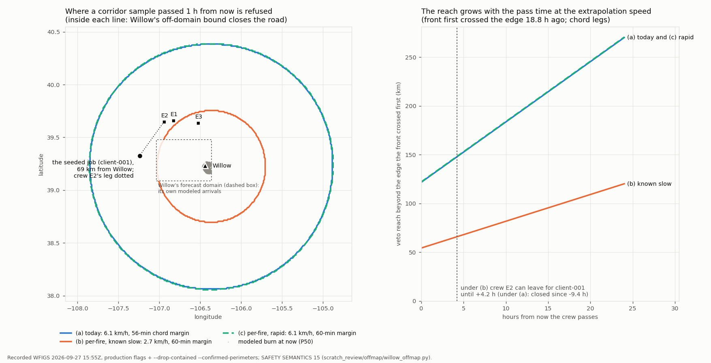
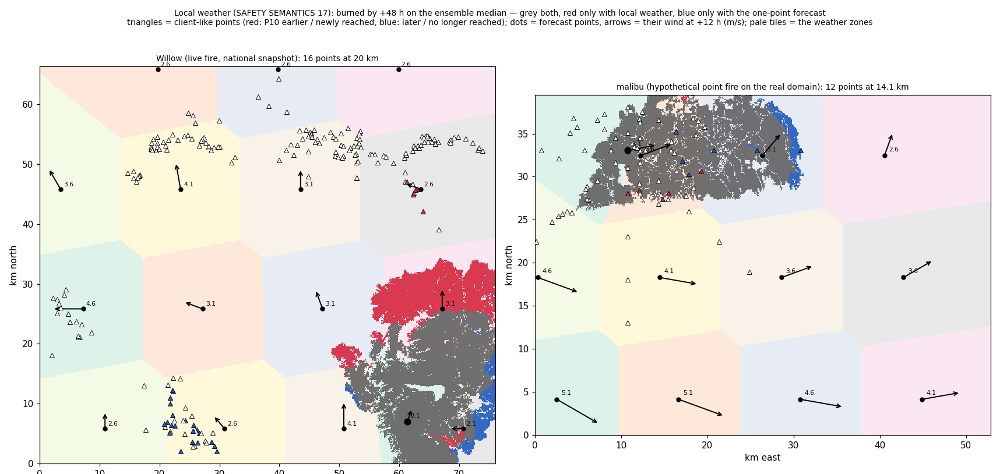

# WG Response — Live World Plan: one national map, live and seeded fires, crews that respond anywhere

> **Correction note (2026-09-27): stacked perimeter rows.** Hindcast numbers in this document were computed on corpora whose snapshots stacked every WFIGS Daily row sharing a capture time, and the even-odd rasterizer partly cancelled them (Madre 2025-07-02's 8,396-ac capture rasterized to 0 cells). On branch `fix/hindcast-stacked-rings` the corpora were repaired and every documented replay was re-run. Corrected values, and every number here they replace, are in [calibration/stacked_rings_fix_2026-09-27.md](calibration/stacked_rings_fix_2026-09-27.md) §4.1 and §4.4. **Affected here:** :830–831, the August guard A/B on the N variant: 27 pairs / 145,760 cells / 97.7 % / 2.3 % becomes 34 / 190,223 / 97.6 % / 2.4 %, and the byte-identity conclusion stands. Also :1302, where the extreme-regime evidence goes from n = 1 to n = 0. The text below is left as written.

2026-09-26. Founder direction: *"the model needs to move towards a more dynamic
situation where the screen is not the world, but is a zoomed in view of the
world. ultimately the entire US needs to be on one map with our crews and teams
to respond to wildfires."* This plan turns the tile-bound simulator and the
AOI-bound shadow watcher into one national world with a viewer that zooms
anywhere, monitors current fires, and lets a user seed a fire at any location.
Companion plans: `LIVE_OPS_PLAN.md` (feeds → shadow ops → clients → dispatch),
`SIMULATOR_DESIGN.md` (the view built so far), `vail_aspen_response_program.md`
(the first corridor program, whose measured findings shape the crew model here).

## 0. The principle

**The world is the state; the screen is a viewport.** Three layers, kept apart:

| Layer | Owns | Today |
|---|---|---|
| **World** | one authoritative national state: every live incident from the feeds, every seeded incident a user lights, every enrolled client, every crew and team with its base and beacon; persisted and served by an API | split across the watcher (`wgresponse.cli watch`: feeds, registry, persistence, per-incident domains) and the simulator (`simui.SimSession`: crews, dispatch, safety, the rich view) |
| **Domains** | the physics box around one incident: terrain, spread ensemble, client ETAs, dispatch, crew safety. A domain exists only where a fire meets clients or where a user seeds one; live and seeded fires run the same code | the watcher builds a domain per live incident with protected clients in range (`threat._assess_incident`); the simulator builds one per session on a pre-fetched tile |
| **View** | a map that zooms anywhere; what it draws depends on zoom (national markers → regional perimeters and rings → the full local detail) | the simulator page (one tile per session) and the ops console (one AOI) |

The engine's existing scaling law is what makes a national world tractable:
**a domain is built only where a fire comes within threat range of a protected
client** (or where a user seeds one). WFIGS listed 325 active US incidents on
2026-09-26 (163 with perimeters, the largest 374,000 acres); the number of
domains is driven by fires near clients, not by the national fire count.

## 1. What exists, and the gap

Verified on disk (see the companion docs for the record):

- **Feeds** are national already: WFIGS perimeters + incident points, NASA
  FIRMS hotspots, NWS gridpoint weather. FIRIS and CAL FIRE are California-only
  and simply contribute nothing elsewhere.
- **Per-incident domains** (`threat.py`): geometry + nearby clients + 2 km pad,
  cell size coarsened to stay under 300,000 cells, terrain from LANDFIRE LFPS on
  demand with a local + S3-mirrored cache (a fresh tile costs a 5–8 min LFPS job;
  cached tiles load in seconds). Cycle telemetry: the SoCal shadow AOI runs
  8.5–9.4 min steady on the 1-vCPU service, inside the 15-min freshness rule.
- **The simulator** has the complete local view and the complete crew model:
  crews on real roads with every straight stretch explained, user placement
  snapped to roads, the shaded actual fire with median bands from its edge,
  road-network escapes, old black as a refuge, crews that leave the map out of
  the simulation, sub-stepped time, wind steering of running fires, 13 presets
  including one 60-km valley tile.
- **Roads** are per-tile OSM graphs fetched from Overpass (not viable
  nationally); the routing upgrade path is already named in `travel.py`: a
  self-hosted Valhalla / OSRM on Geofabrik extracts.
- **Clients**: the read-only DynamoDB registry adapter exists
  (`DynamoClientRegistry`, per-bbox queries). **Crews**: the roster and GPS
  beacon endpoint are designed in `LIVE_OPS_PLAN.md` Phase 2, not yet live.
- **Persistence**: `persist.StateStore` with the S3 mirror; App Runner
  services; CodeBuild image pipeline.

**The gap.** Two engines share the physics but not the world. The watcher has
no crew kinematics, no safety sweep and a thin console; the simulator has no
feeds, no registry and one tile per session. Merging them into one world
model is the long pole. Everything else is data plumbing and a viewer.

## 2. Workstreams

Numbered in build order. Each has tickets and an exit gate; each keeps the
engine's laws (contracts.py: default-OFF knobs, byte-identical legacy; the
crew-safety invariants; "absence is not clearance").

### W1 — One world model (the merge)

| # | Ticket | Notes |
|---|---|---|
| 1.1 | `IncidentDomain`: one object hosting terrain, ensemble, ETAs, dispatch, crew kinematics, sweep and audit for one incident, built from either a feed incident or a seeded ignition | lift from `SimSession` (crews/safety) and `threat._assess_incident` (feeds/domain); one code path |
| 1.2 | Seeded incidents: a synthetic `IncidentSource.SEEDED` with point ignition, intensity → weather (the simulator's presets) or live NWS weather at the point | the simulator's `ignite` becomes "seed into the world" |
| 1.3 | World cycle: feeds → incident set (live ∪ seeded) → domains (build / re-anchor / retire) → per-domain cycle → persist; per-domain cycle budget; retire a domain when the incident is out and no seeded fire remains | keep the watcher's staleness gates, zombie-perimeter guards, restart re-fires-nothing |
| 1.4 | Crews are world objects, not session objects: a crew belongs to a team, has a base, a status, a beacon; a domain sees the crews whose reach covers it | replaces the session's round-robin staging; `place_crew` becomes "stage team at" |
| 1.5 | The world's map vs a domain: "left the map" becomes "left the domain"; ground past a domain edge gets a **conservative** fire horizon derived from the nearest in-domain cells (absence is not clearance), closing the open item from the escape work | measured: off-edge "never burns" pulled 29 crews off the corridor map |

**Exit gate:** a seeded fire on the Vail corridor and a live WFIGS fire with
clients nearby run side by side in one process; 0 departure-audit violations;
every 10c row reported; per-tick state hashes of the seeded run byte-identical
to the simulator's for the same commands.

#### W1 seeded incidents (2026-09-26)

Ticket 1.2 is built, and the first slice of 1.3 (live ∪ seeded in one
cycle): **a user lights a fire at a point and the live watcher runs it
through the same code as a feed incident.** The law is contracts SAFETY
SEMANTICS 12; the module is `wgresponse/seeded.py`. *(Superseded in one
respect on 2026-09-27: seeds now run in the isolated TEST world only —
`POST /api/test/seed`; the live world refuses them. See "Test map and live
map (2026-09-27)" below; everything else in this section holds there.)*

| Question | Answer as built |
|---|---|
| Identity | `SeededIgnition` (contracts): id `seeded:<uuid>` (a name-based uuid5 over the store sequence, ignition time and point, so a replayed command script re-mints the same ids — the ensemble is seeded on the incident id), `IncidentSource.SEEDED`, lat/lon, `t_ignite_s`, intensity preset **or** explicit `SeedWeather`, optional `wind_dir_deg`, `created_by`, `note`. |
| Fusion | Seeds are unioned **after** `fuse_incidents`, and `fuse_incidents` itself never joins a seeded incident with anything (IRWIN, name, distance) — pinned with a seeded record carrying a feed fire's IRWIN id, name and point. |
| Geometry | A point incident: no perimeter, acreage 0, containment unknown. **Its observed geometry stays the ignition point**; every cycle spreads it from the point at `now_s`, exactly like a feed point-incident without a perimeter (pinned: its ensemble equals a direct `ensemble_arrival` of the point at now). The watcher has no ground truth for live fires, so the simulator's "actual fire" (the nominal member's burn) does not exist here — a seeded fire therefore never grows, and its ETAs stay where the first cycle put them for as long as the weather holds. |
| Guards | Materialized with `updated_at_s = now` every cycle (the seed store vouches for it): the SEMANTICS 9 staleness gate keeps it until it is retired. |
| Client range | Unioned **before** the staleness gate and the client-range filter: a seed with no protected client within the threat radius is listed (`/api/state`, the note says so) and builds no domain — the live law. |
| Weather | Default: the LIVE provider at the fire (NWS gridpoint), as for every incident. Override, for that incident only, through the weather seam (`seeded.seeded_forecast`): `intensity` (the simulator's `INTENSITY_WEATHER` presets) or `weather` sets the conditions (sustained, gust, RH, temperature) in every hour, `wind_dir_deg` fixes the direction; each part left unset stays live; both set = the simulator's own `MockWeather` script, no network. The mode (`live`, `live+fixed-dir`, `preset`, `preset+live-dir`, `explicit`, `explicit+live-dir`) is in the cycle notes and `/api/state`. |
| Retirement | `DELETE /api/seed/<id>` (operator), or automatically once `t_ignite_s + horizon_h` has passed with no pair of it in NOTICE / WATCH / EXTREME and a healthy assessment (`OperatorEvent` kind `seed_retired`). A retired seed simply stops appearing, so its pairs take SEMANTICS 6's absence path **exactly** as a vanished feed incident's (pinned side by side: the same states and events cycle for cycle — CLEARED after `clear_cycles` while every feed is healthy, frozen while any is blind). |
| Clients | A seeded fire's notifications go to the DRILL LOG only (`SeedSafeNotifier`, wired by `watch`): never a client channel, whatever notifier the daemon runs. The ladder and its events are unchanged and the drill send is ledgered, so a restart re-fires nothing. |
| API | `POST /api/seed` {lat, lon, intensity?, wind_dir_deg?, weather?, note?, created_by?} → 201 `{incident_id}` (400: bad body / outside the AOI; 409: 12 active); `GET /api/seed[/<id>]` (weather mode, last-cycle domain and phase times, pair states); `DELETE /api/seed/<id>` (404 unknown, 409 already retired). Authed like every write path. A seed / retire persists at once and wakes the loop (the next cycle runs now, not after the period). `/api/state` lists seeded incidents with `source: "seeded"` and gains a `seeds` key once any seed exists; the console draws them with a violet ring. |
| Persistence | Seeds (active + the last 50 retired) ride in the StateStore under an additive `seeded_incidents` key, written only once a seed exists; restart restores them before the first cycle. |
| Byte-identity | With no seed the cycles, the persisted state file and `/api/state` are byte-identical to goldens computed on commit 09f94b5 **before** any of this code existed (`tests/test_seeded_incidents.py`). |

**The drill (2026-09-26, dev box, one watch daemon per phase).** `watch --aoi
data/aoi_vail_aspen.json --registry mock --dry-notify` with the production
physics flags (`--gust-blend 0.5 --grass-floor 0.10 --floor-gate
--model-error 0.71 --extreme-regime --fail-closed --ember-radius 200
--p50-bound --solver-evals 20000 --phi-vector`), live LANDFIRE via LFPS, live
WFIGS / FIRIS / CAL FIRE feeds, an API key, crews beaconing from the Eagle,
Gypsum and Avon zones. The live WFIGS **Willow** fire (39.234, −106.440;
7,389 ac, 80 % contained) was burning inside the AOI with 9 mock clients in
range, so every phase ran **a live WFIGS fire and a seeded fire side by side
in one process** — the W1 exit gate's shape. Every cycle was healthy
(`degraded: false`).

| Cycle | Wall | Where the time went |
|---|---|---|
| Willow, fresh domain | 439.7 s | LFPS terrain 424.6 s · NWS 1.3 s · spread 11.3 s (300,987 cells, 9 clients) · feeds 2.3 s · alerts 0.0002 s · dispatch 0.13 s |
| + seed, fresh domain (phase 1) | 477.2 s | seed: LFPS terrain 462.3 s · weather 0.0002 s (synthetic preset) · spread 1.05 s (300,286 cells at 108.8 m, 9 clients); Willow cached: terrain 0.10 s · NWS 0.24 s · spread 10.8 s |
| + seed, fresh domain (phase 2) | 387.9 s | seed: LFPS 372.6 s · spread 1.70 s (300,492 cells at 114.3 m, 12 clients); dispatch 0.24 s |
| both cached | 13–17 s | seed spread 1.0–1.7 s, Willow spread ~11 s, feeds ~2–3 s |

- **Phase 1 — the literal drill:** HIGH, wind FROM 240, 10 km WSW of the
  Eagle base (4–8 km out is FBFM40 91 in both cached Eagle tiles). `POST` →
  201 (persisted at once, loop woken); a point outside the AOI → 400. The
  seed missed the next cycle by 4 s (cycle 1 had overrun the 300 s period, so
  cycle 2 began at once, before the POST) and joined the one after — a fresh
  LFPS domain with 9 clients in range. Its 9 pairs stayed NONE: the run up the
  Eagle valley stalls in urban / agriculture / barren (the nominal member
  reaches 5,167 cells in 96 h) and every mock client sits S/SW of Eagle,
  upwind or crosswind. **Hard kill** (TerminateProcess, no final persist) →
  restart: the seed row, 18 alert records and 6 ledgered sends came back;
  `restored: true`; the post-restart cycle (14.3 s) re-fired **0** events.
  `DELETE` → 200 (again → 409); absent from the next cycle; listed retired.
- **Phase 2 — a seed that threatens:** HIGH, wind FROM 240, 8 km upwind of
  mock-client-000. Ladder: client-000 NONE → EXTREME_24H (p50 5.14 h), client-007
  NONE → EXTREME_24H on the P10 rung (p10 9.61 h, p50 51.8 h); two DRILL-log
  sends, no client channel. Both homes are also EXTREME for Willow with p10 =
  0 h, so the planner's one-job-per-home dedup kept Willow's (infeasible) job
  and folded the seeded ones away (`dedup_dropped_jobs: 2`). Hard kill →
  restart: seed restored active, **0** events and **0** drill-log lines
  re-fired. `DELETE` → next cycle absent with both pairs still EXTREME (clear
  streak 1; "pair … not assessed this cycle; job skipped", as for a vanished
  feed fire) → the cycle after, both EXTREME → CLEARED (the all-clear sends
  suppressed: both homes still hold Willow alerts — the existing law).
- **Phases 3–5 — dispatch:** HIGH seeds upwind of homes Willow does not
  threaten (client-006 wind 240; client-001 wind 90 and wind 135; phases 4–5
  reuse the cached 12-client domain — terrain 0.09 s). Ladder: EXTREME
  (p50 6.05 h), EXTREME (p50 7.53 h, p10 5.56 h), NOTICE_72H → WATCH (p50
  34.0 h, p10 20.8 h). Every plan listed the seeded job as
  **`no_safe_corridor`**; each retirement walked the pair to CLEARED on the
  second cycle. **Attribution** (phase 5's exact seed, same id, replayed
  through the real monitor + planner + cached tiles): **alone, it is served**
  — crew E2 (Gypsum) → client-001, arrive +1.61 h, margin 18.2 h; **with the
  live Willow ensemble present, the same job is `no_safe_corridor`.**
  Client-001 is ~69 km from Willow, outside Willow's domain: the fail-closed
  corridor law bounds every off-raster sample by Willow's reached-boundary
  arrival + distance at 1.7 m/s, so a large live fire vetoes routes tens of
  km beyond its own domain. Conservative by design — and in a multi-fire
  world it is the dominant dispatch constraint (ticket 1.5's question).

`POST` / `GET` / `DELETE` and every 400 / 404 / 405 / 409 / 401 path are also
pinned over real HTTP in `tests/test_seed_api.py`.

What remains of W1:

- **1.1 `IncidentDomain`** — one object hosting terrain, ensemble, ETAs,
  dispatch, crew kinematics, sweep and audit per incident. Today the watcher
  still rebuilds every domain from scratch each cycle, and a seeded fire is a
  point re-lit at `now`; with 1.1 a seeded domain can carry the simulator's
  ground truth (the nominal burn, re-anchored from its own history) and the
  exit gate's "per-tick state hashes byte-identical to the simulator's" becomes
  testable. The seeded weather already uses the simulator's own
  `MockWeather` script and preset table, so that comparison starts from the
  same weather.
- **1.3 (rest)** — domain lifecycle (build / re-anchor / retire as objects,
  not per-cycle rebuilds) and a per-domain cycle budget: a seed with clients
  in range costs a full ~300,000-cell ensemble every cycle.
- **1.4 crews as world objects** — the watcher plans with beacon crews only;
  seeded domains see no simulator crews.
- **1.5 left-the-domain / conservative off-domain horizon** — now with a
  measured stake: the fail-closed off-raster bound (1.7 m/s from every reached
  boundary cell) let the live Willow fire veto a seeded job ~69 km away that
  the planner serves with an 18.2 h margin when Willow is absent. A
  per-domain horizon that knows where each fire can actually go is what keeps
  one large fire from freezing dispatch across a region. **Built 2026-09-27
  as the per-fire off-domain horizon** (SAFETY SEMANTICS 15, default OFF,
  watch `--offmap-per-fire`): with the contained-fire flags it serves that
  job; the "left the domain" half of 1.5 is still open. See "The off-domain
  horizon is per fire (ticket 1.5, 2026-09-27)" under W6 below.
- ~~**Policy before real crews (W4):** a seeded fire is real to the engine —
  its P10 enters every corridor check and its jobs enter the plan — so on a
  daemon with real crews a drill would re-route them. The drill-safe notifier
  covers clients only; drills on a live crew roster need a drill window, a
  drill flag on crews, or a separate drill world.~~ **RESOLVED 2026-09-27 —
  a separate drill world** (founder ruling: "we need a test map and a live
  map so all simulations or drills do not impact real conditions"; section
  "Test map and live map (2026-09-27)" below; contracts SAFETY SEMANTICS 16).
  A seeded fire now exists ONLY in the TEST world: its P10 enters only the
  test world's corridor checks, its jobs only the test world's plan, which is
  planned for VIRTUAL crews (a clone of the live roster) and never leaves the
  process. The live world's monitor is locked (every seed refused), its plan
  is computed from live incidents and real beacons alone, and the proof runs
  the same live script with and without heavy drill activity and compares
  every live byte.

#### Test map and live map (2026-09-27)

Founder ruling, verbatim: *"we need a test map and a live map so all
simulations or drills do not impact real conditions."* The watch daemon now
runs **two fully isolated worlds in one process**. The law is contracts
SAFETY SEMANTICS 16 ("TWO WORLDS"); the module is `wgresponse/worlds.py`;
the daemon glue is `cli._WatchDaemon` (+ `_watch_test_world`); the routes
are in `server.py`.

| World | What it is |
|---|---|
| **LIVE** | Real conditions only: feed incidents, the real client registry, real crews (beacons), the real alert engine, the real dispatch plan, the real notifier, the live `StateStore` file + S3 object. Its `ThreatMonitor` is **locked** (`lock_live()`: `create_seed` / `add_seed` / `restore_seeds` raise `seeded.LiveWorldRefused`, and `_seeded_incidents` unions nothing, ever). `POST /api/seed` and `DELETE /api/seed/<id>` answer **409** with a pointer to `/api/test/seed`; `GET /api/seed[/<id>]` stays one release as a read-only alias of the TEST list. `/api/state`, `/api/plan`, `/healthz` and `/api/world/summary` (default `?world=live`) are unchanged. |
| **TEST** | Drills and simulations: `worlds.TestWorld`. It sees the live world's incidents and forecasts READ-ONLY and adds SEEDED fires; its own alert engine, crews, plan and state namespace. Everything it emits goes to the drill log. |

**What the test world shares and what it owns.**

| Shares (read-only, by reference) | Owns |
|---|---|
| The live cycle's own `WorldSnapshot` (`ThreatMonitor.last_snapshot`, recorded after the planner every cycle — shallow container copies around the cycle's objects): the post-gate incident set (the test world reads copies with their own `meta`), every `ThreatAssessment`, the **ensembles** (the arrival rasters — never recomputed, never copied, never mutated: pinned), in-domain clients, ETAs, fire-centroid forecasts, tiered eroded rasters, the regime flags, the registry roster per incident, the live-failed incidents, feed health, the feed notes and feed-blind events | The seeded store and the **seeded domains** (computed through the unchanged `ThreatMonitor._assess_incident`), an `AlertEngine` whose notifier is `seeded.DrillOnlyNotifier` (it holds **no client channel at all** — every send, a seeded fire's or a live incident's as seen from the test map, lands in the drill log and is ledgered), `VirtualCrewTracker` crews, its incumbent plan, its regime postures, the drill log |
| The `dispatch` module (pure functions; the corridor memo is a per-raster pure memo) and a stateless mock registry | Its OWN weather provider instance, its OWN registry instance when the live one caches (the Dynamo TTL roster), a `TestTerrainOverlay` (reads the live LANDFIRE tile cache read-only, fetches / caches everything else under `<state-dir>/test_world/terrain_cache` and `s3://<prefix>/test_world/terrain/`), its own `StateStore` (`<state-dir>/test_world/wgresponse_state.json`, `s3://<prefix>/test_world/state.json`), its worker thread |

**How a test cycle runs.** `_TestWorldMonitor` is a `ThreatMonitor` whose
`cycle()` — the SAME code the live world runs — has two seams overridden:
`_fetch_and_fuse` returns the live snapshot's incident set and feed health
(no feed is fetched), and `_assess_incident` hands every LIVE incident the
live cycle's results verbatim (a live-failed assessment fails on the test map
too, so its pairs are BLIND there as well) while a SEEDED incident runs the
real `_assess_incident`. Everything after — the seed union, the staleness
gate, blind pairs, regime postures, the ladder, the seed auto-retire, the
planner — is the live code path on the test world's own engine, crews and
incumbent. Every completed live cycle hands its snapshot to the test world
(`on_live_cycle`: a flag and an event; the live loop never waits), which runs
**one** test cycle at the live cycle's own time — so a live pair on the TEST
map moves exactly as on the LIVE map (pinned: states AND streaks, cycle for
cycle, the same events and plan when no seed is lit). A test action (seed,
retire, crew staging) re-runs the drill at once at the test clock, but that
re-run evaluates **only the seeded fires' pairs** (the additive
`AlertEngine.evaluate(only_incidents=...)`, default None = unchanged); the
planner re-plans on every run. The worker waits for the live loop to be idle
before it clones or cycles, and a test-world failure is logged, never raised
into the live loop.

**Drills.** The test world is **IDLE** — no cycle, zero cost; the TEST map
mirrors the live picture read-only — until a drill starts: the first seed,
or a test-crew reset / placement. The start clones the live crew roster at
once (positions and statuses; a crew the live dispatcher would not use —
stale beacon, UNKNOWN, OFF_DUTY — is cloned ineligible; the clone READS the
live tracker, never `stale()`, which flips live statuses) and, while the live
loop is idle, the live ladder + notified ledger + growth clocks, the incumbent
plan and the regime postures — so a drill answers *"what would we do right
now"*. From then on each world evolves alone. **Test crews are virtual**: they
never beacon and never move (W1.4), `POST /api/test/crews/reset` re-clones
them, `POST /api/test/crews/place` stages one; no test plan leaves the
process and no test position ever enters the live `CrewTracker`.
`POST /api/test/reset` wipes the test world (and writes an empty IDLE state
into its namespace) — 200, or 202 when a test cycle is running (applied
before the next one, or at shutdown). Test state is restart-safe: seeds,
ladder, ledger, plan, virtual crews and drill log come back and nothing
re-fires. **Migration:** a live file written by the pre-two-worlds build
with seeds in it is partitioned at load (`worlds.split_legacy_seeds`): the
seed rows, their alert pairs, ledgered drill sends and growth clocks go to
the test world (which starts a drill), the live incumbent loses its seeded
stops, and a loud WARNING + startup note says so — a seed never runs live.

**API** (authed like every write path): `GET /api/test/state` (the
`/api/state` keys + `world`, `banner`, `drill`, `seeds`, `live_crews`,
`drill_log`), `POST /api/test/seed` (the W1 body), `GET /api/test/seed[/<id>]`,
`DELETE /api/test/seed/<id>`, `POST /api/test/crews/reset`,
`POST /api/test/crews/place {crew_id, lat, lon, status?, name?}`,
`POST /api/test/reset`, `GET /api/world/summary?world=test` (rows marked
`world` live / test and `read_only`; a `rev` token drives `?since=`, since
several test cycles can share a cycle time).

**The page.** `/world` gets a **LIVE | TEST** switch in the header (LIVE by
default; `/world?world=test` opens the test map). The TEST map is
unmistakable: an amber banner across the top — *"TEST MAP — drills and
simulations. Nothing here affects real conditions, crews or clients."* — an
amber frame over the map, an amber header; seeded fires in the seeded colour
with a dashed amber ring; the **Seed a fire** control (arm, click the map,
choose the intensity / wind / note, Seed) and a **retire** button on every
seeded fire, **Reset test crews to live**, **Reset test map**, the drill log
— all of it only on the TEST map (hidden by CSS on LIVE, and every handler
returns unless the page is on TEST). The virtual test crews are drawn amber
and dashed ("T·E1"), the live crews ghosted grey and read-only. The offline
SVG shim gained map clicks, so seeding works air-gapped too. `/console` is
LIVE-only (a seeded row is never drawn there). The simulator page carries a
**TEST** chip and a legend line: it is a sandbox and never touches the
watcher's live or test maps.

**The isolation proof** (`tests/test_worlds_isolation.py`,
`tests/test_test_world_api.py`). The core test runs the SAME mocked daemon —
real `ThreatMonitor`, `AlertEngine`, dispatch planner, `CrewTracker` with GPS
beacons (one goes stale mid-run), `StateStore` with an S3 mirror, the real
HTTP server — through the same 8-cycle live script (a second fire appears
and vanishes, the feeds go BLIND for a cycle and recover) twice: once with no
test activity, once with heavy test activity over HTTP between the cycles
(five seeds — two threatening the live fire's own clients — a retirement, a
test-map reset and a new drill, crew placements and a crew reset, an extra
test cycle, the refused live seed POST, a seed outside the AOI, and test
state / summary / alias reads every cycle). It asserts the LIVE world's
per-cycle CycleResult digests, persisted state-file bytes, `/api/state`,
`/api/plan`, `/healthz` and `/api/world/summary` bytes (wall-clock telemetry
masked), plan, S3 objects and keys, the real notifier's calls, the live
providers' call logs, the live wake flag and even the live clock's read
count are identical between the two runs — and that the drill really ran
(a seeded domain, seeded pairs, a test plan, drill-log lines about a client
the live fire also threatens) and never wrote a key outside
`<prefix>/test_world/`. Also pinned: with no seed the test world mirrors the
live ladder (states and streaks), events, plan and the very ensemble objects
cycle for cycle; the shared rasters and live incident objects are never
mutated; the live loop completes three cycles while a test cycle hangs in its
terrain call (and a reset queued behind it lands at shutdown); a failing test
world never breaks the live cycle; a live restart re-fires nothing and a test
restart restores the drill; a pre-two-worlds live file is migrated; the live
monitor refuses every seed and unions none even if one is smuggled into its
store; no drill fire appears in one byte of `/api/state`, `/api/plan`,
`/healthz`, `/api/world/summary` or the live state file; and
`AlertEngine.evaluate(only_incidents=...)` leaves every other pair exactly as
it was. Result: all green — 12 tests in `test_worlds_isolation.py`, 35 in
`test_test_world_api.py`, the 54 W1 engine tests and 46 seed-route tests
re-pointed at the test world, the full suite 1,977 passed / 12 skipped / 0
failed (5 min 22 s) — and the W1 byte-identity goldens of commit 09f94b5 still pass
unchanged: no test activity = the pre-two-worlds live world, byte for byte.

**Measured cost** (2026-09-27 09:35–10:45 PDT, this machine, one daemon:
`watch --aoi data/aoi_vail_aspen.json --registry mock-presets --dry-notify`
+ the production physics flags `--gust-blend 0.5 --grass-floor 0.10
--floor-gate --model-error 0.71 --extreme-regime --fail-closed
--ember-radius 200 --p50-bound --solver-evals 20000 --phi-vector`,
`--period 120`, port 18989, its own state dir with the W1/W6 runs' cached
LANDFIRE tiles copied in; live WFIGS / FIRIS / CAL FIRE feeds; three live
crews beaconing every 60 s from the Eagle, Gypsum and Avon bases; driven by
`scratch_review/worlds_cost_run.py`, memory = the daemon process's working
set / private bytes every 2 s). The live world held the WFIGS **Willow** fire
(7,389 ac, 80 % contained): one 300,544-cell domain reaching 204 of the 279
in-AOI demo homes (126 alerted — finding 6's free-running polygon), spread
9.3–11.3 s. Seeds: HIGH, wind FROM 245, 6 km WSW of the Vail, Eagle, Aspen,
Glenwood Springs and Basalt presets — each a ~300,000-cell domain reaching
168–280 homes (the Eagle one on FBFM40 91, said out loud by the cycle note).

| Phase | Live cycle (wall) | Test cycle per live cycle (wall) | Working set median / max | Private median / max |
|---|---|---|---|---|
| A — IDLE (no drill) | 12.45–12.93 s | **none** (the test world does nothing) | 207 / 242 MB | 931 / 967 MB |
| B — drill, 0 seeds (3 crews + 204 live pairs cloned) | 12.42–13.30 s | **0.11–0.12 s** (dispatch 0.11–0.12, alerts 0.0002; the Willow domain shared) | 208 / 242 MB | 932 / 966 MB |
| C — 1 seed, cold | 12.65–13.23 s | 403.5 s once (a fresh LANDFIRE tile: LFPS 402.3 s) | 237 / 307 MB | 960 / 1,031 MB |
| C — 1 seed, warm | 12.23–12.49 s | **1.20–1.35 s** (tile load 0.10 s, spread 0.9–1.0 s at 300,348 cells / 195 homes, dispatch 0.21 s) | 244 / 311 MB | 967 / 1,035 MB |
| D — 5 seeds, cold | 12.26–15.10 s | 448.7 s + 1,280.4 s once (4 fresh tiles, one LFPS job each, 6.5–7.5 min) | 457 / 517 MB | 1,180 / 1,242 MB |
| D — 5 seeds, warm | 14.36–14.42 s | **13.0–13.6 s** (spreads 0.6 / 1.1 / 3.0 / 2.3 / 4.3 s, 0.10–0.13 s tile loads, dispatch 1.1 s) | 419 / 559 MB | 1,143 / 1,284 MB |

- **The added cycle time is the test cycle, and it runs beside the live
  cycle, never in it**: +0.12 s per live cycle for a drill with no seed
  (~1 % of the 12.5 s live cycle), +1.2–1.35 s for one seed (~10 %), +13–14 s
  for five (each seed is a full ~300,000-cell domain — the W1 law that a
  domain is built only where a fire meets clients applies to drills too). It
  runs on the test world's thread after the live cycle, inside the 120 s
  period; the live cadence held at 120 s even through the 403 s and 1,280 s
  cold test cycles (live cycles every ~120 s, 12.3–15.1 s each).
- **The live cycle is not slowed by the drill** — controlled check: after a
  hard kill + restart with the 5-seed drill restored, three live cycles took
  13.9–15.2 s (Willow spread 11.2–11.3 s); then `POST /api/test/reset` (IDLE:
  the test world computes nothing) and three more took 14.0–14.5 s (Willow
  spread 11.0–11.3 s). The rise from ~12.5 s over the hour is Willow's own
  spread growing (9.3 s at the first cycle → ~11 s), not the test world.
- **Memory**: +37 MB working set / +36 MB private for one warm seed, +212 /
  +212 MB for five (their ensembles and tiles; the live domains are shared,
  not copied); 0 for an IDLE test world and ~0 for a seedless drill. CPython
  keeps the high-water mark after a reset (377 MB / 1,101 MB median after the
  reset above) — the arenas are not returned to the OS until a restart.
- **Payloads**: `/api/test/state` 81 KB (0 seeds) → 157 KB (5 seeds);
  `/api/world/summary?world=test` 27 → 40 KB, built in 0.07–0.37 s once per
  test cycle (`rev`-cached).
- **Isolation on the real run**: the live `/api/state` never carried a
  `seeded:` id; the live tile cache kept its 44 files (the five seed tiles
  landed in `test_world/terrain_cache`); the TEST map alerted 144 homes while
  the LIVE map stayed at Willow's 126; every drill line went to the drill log
  ("DRILL (TEST MAP, …) — NOT sent to any client channel").
- **Restart on the real run**: hard kill (TerminateProcess, no final persist)
  with the 5-seed drill active → restart: live `restored: true` and 0 events
  on its first cycle; test `restored: true`, drill active, 5 seeds, the staged
  crew still at Edwards, the test cycle counter continued (16 → 17); the
  persisted drill log (75 lines) and the drill ledger (207 sends) identical
  before and after, 0 DRILL lines in the new process — nothing re-fired in
  either world. The live state file's keys stayed the pre-W1 six (204
  records, 0 seeded ids).

Screenshots of this run (`scratch_review/worlds_shots.py`, headless Chrome on
its own DevTools port, 5-seed drill active, one test crew staged at Edwards)
in `docs/img/worlds/`: `live_regional.jpg` / `test_regional.jpg` (the same
view on both maps: Willow and the live crews vs the banner, the frame, five
seeded fires, the test crews, the drill panel), `test_seed_control.jpg` (the
seed control armed: the pending ignition and the intensity form),
`live_crews.jpg` / `test_crews.jpg` (live A1 at Avon vs the staged virtual
T·A1 at Edwards with its ghosted live self), `live_local.jpg` /
`test_local.jpg` (the local tier), `test_national.jpg`, `test_offline.jpg`
(the TEST map in the offline SVG shim).

**What remains.**

- **W1.1 so seeded fires grow.** A seeded fire is still a point re-lit at
  the cycle time every cycle (no ground truth); with the `IncidentDomain`
  (ticket 1.1) a seeded domain carries the simulator's nominal burn and
  re-anchors from its own history — the TEST map is where that lands first.
- **Test crews do not move** (W1.4): a drill plans from where the virtual
  crews stand; kinematics, the safety sweep and "stage this team here" on
  the map (W4.4) are the next step for drills.
- **Cold seeds cost an LFPS job each** (measured above: 6.5–7.5 min per
  fresh seed domain, one after another inside one test cycle) until the
  national COGs (W2); a drill near a live fire reuses the live tile only
  when the domain box matches exactly. Warm, five seeds cost ~13 s of test
  cycle per live cycle — the per-domain budget of W1.3 applies to drills.
- **A drill that is never reset keeps running** (alerts + dispatch over the
  live snapshot each live cycle); cheap (measured), but an idle-timeout or an
  auto-IDLE once no seed or seeded pair is active is a policy call.
- **One process.** The test world shares the interpreter (and the GIL) with
  the live loop; it yields to a running live cycle but a long test cycle can
  still overlap the next one. The W7 worker fleet is where the test world
  moves out of process if drills grow heavy.

### W2 — Terrain anywhere, in seconds

| # | Ticket | Notes |
|---|---|---|
| 2.1 | National LANDFIRE layers (LF2024 FBFM40, LF2020 slope/aspect/elevation) as cloud-optimized GeoTIFFs on S3, read by window into the existing `TerrainTile` format | replaces the per-domain LFPS job; LFPS stays as the fallback and the refresh path |
| 2.2 | Pre-warmed fast path: the 13 preset tiles and every enrolled community's domain cached as today | instant where clients are |
| 2.3 | Provenance per domain (layer version, window, cell size) in the state, as the tile tools record it | the hindcast scorecard needs it |

**Exit gate:** any point in CONUS yields a 300,000-cell domain in under 10 s
from the COGs; the fingerprints of the 13 presets are unchanged when built from
the COGs at the same cell size (or the difference is recorded and explained).

### W3 — Roads anywhere

| # | Ticket | Notes |
|---|---|---|
| 3.1 | Self-hosted routing service (Valhalla on Geofabrik US extracts) behind `travel.py`'s seam: `/route`, `/sources_to_targets` for dispatch matrices; closures via `exclude_polygons` (the Glenwood Canyon input the corridor program asked for) | ~$100–200 / month; the public OSRM demo is development-only |
| 3.2 | Per-domain road graphs cut from the local OSM extract (osmium / pyrosm) into the `.wgr` format on demand, cached in S3, using the two-tier law the extended graphs already use (all classes in the core, major roads outside) | retires Overpass; keeps crews on real roads in every domain |
| 3.3 | Edge snapping and OSM `track` roads (open items from the roads inspection) | spurs −30…−60 %; mountain access roads |

**Exit gate:** the corridor drive-time matrix reproduced from the routing
service within the class-speed model's tolerance; a domain anywhere in CONUS
gets a road graph in under 30 s.

#### W3.2 road graphs from OSM extracts (2026-09-26)

`tools/fetch_roads_pbf.py` cuts a domain `.wgr` from a local Geofabrik
`.osm.pbf` and passes the ways, unchanged, through
`tools.fetch_sim_roads.build_graph`. Same highway regex, same simplification,
`roads.save_road_graph` on the way out. A preset `--key` uses
`bbox_for(LOCATIONS[key])` formatted the way the Overpass query sends it
(each edge to 6 decimals): a way is kept when any node lies inside that
inclusive box, and the way's full geometry is kept, not clipped.

**Dependency.** osmium 4.3.1 (pyosmium). On this Windows / CPython 3.14.5
machine, `py -3 -m pip install osmium` installed
`osmium-4.3.1-cp314-cp314-win_amd64.whl`. pyrosm does not install here:
`py -3 -m pip install pyrosm --only-binary=:all:` fails because `cykhash`
has no cp314 wheel, and pyrosm would return a GeoDataFrame rather than the
Overpass way elements `build_graph` already consumes. A hand-rolled protobuf
reader was unnecessary once the osmium wheel imported. The extra is
recorded in `requirements.txt`; cached `.wgr` files stay stdlib-only.

The first pass writes `out/osm/<extract>.osm.pbf.wgridx` (highway ways and
coordinates for the whole extract, 126 MB for Colorado: 752,075 ways,
7,211,411 node refs). Later domains reuse it. Colorado extract:
`colorado-latest.osm.pbf`, 365 MB, MD5 `8e574e1c76c0b6af264df52e1da95a34`,
Geofabrik timestamp `2026-09-26T20:22:51Z`. The committed Overpass graphs
were fetched 2026-09-24 (vail, eagle) and 2026-09-26T01:01Z (eagle_vail),
so counts are not required to be identical; these are the measured deltas.
Snap distances are the gap from the preset point to its nearest graph node.
Every safe zone and the location center agreed exactly (snap points 0 m
apart). `roads.route` uses the same seeded WUI pair as `tests/test_roads.py`.

| key | nodes (ov → pbf) | edges (ov → pbf) | LCC % (ov → pbf) | safe-zone snap \|Δ\| | route on_roads | route dist |
|---|---|---|---|---|---|---|
| vail_co | 1,170 → 1,170 (+0.00%) | 1,425 → 1,425 (+0.00%) | 98.32 → 98.32 (+0.00 pp) | 0.0 m (z1 31.0, z2 55.9, z3 17.1) | True / True | 7,137.4 m (+0.00%) |
| eagle_co | 2,124 → 2,140 (+0.75%) | 2,774 → 2,797 (+0.83%) | 99.07 → 99.07 (+0.00 pp) | 0.0 m (z1 18.2, z2 20.5, z3 889.4) | True / True | 5,458.9 m (+0.00%) |
| eagle_vail_co | 6,836 → 6,854 (+0.26%) | 8,462 → 8,486 (+0.28%) | 93.18 → 93.20 (+0.02 pp) | 0.0 m (z1 18.2, z2 20.5, z3 270.0, z4 4.8, z5 55.9, z6 31.0) | True / True | 27,275.1 m (+0.00%) |

Wall time and peak working set, separate processes, after the memory
counters were read correctly (`GetProcessMemoryInfo` needs ctypes
`argtypes` on Win64):

| run | wall | peak RSS | peak commit |
|---|---|---|---|
| vail_co cold (index build + cut) | 26.4 s | 1,290 MB | 1,591 MB |
| vail_co warm (index reused) | 0.12 s | 182 MB | 181 MB |
| eagle_co warm | 0.14 s | 182 MB | 181 MB |
| eagle_vail_co warm | 0.32 s | 224 MB | 223 MB |

The cold peak is the osmium node-location cache for the whole state
extract (~1.1 GB RSS while ways are scanned, then released; the process
ends near 280 MB). A domain after that pass is a fraction of a second,
under the 2-minute target. `corridor_vail_aspen` is out of scope: it was
built with a major-roads regex, not `HIGHWAY_REGEX`.

Commands used:

```
py -3 -m pip install osmium
py -3 -m pip install pyrosm --only-binary=:all:
curl.exe -L -o out/osm/colorado-latest.osm.pbf https://download.geofabrik.de/north-america/us/colorado-latest.osm.pbf
py -3 tools/fetch_roads_pbf.py --pbf out/osm/colorado-latest.osm.pbf --key vail_co --out out/roads/vail_co.wgr --compare
py -3 tools/fetch_roads_pbf.py --pbf out/osm/colorado-latest.osm.pbf --key eagle_co --out out/roads/eagle_co.wgr --compare
py -3 tools/fetch_roads_pbf.py --pbf out/osm/colorado-latest.osm.pbf --key eagle_vail_co --out out/roads/eagle_vail_co.wgr --compare
py -3 tools/fetch_roads_pbf.py --pbf out/osm/colorado-latest.osm.pbf --key vail_co --out out/roads/vail_co.wgr --compare --force --rebuild-index
```

`--bbox W,S,E,N --out path` is the direct alternative to `--key`. An
existing output is left in place unless `--force`; a git-tracked
`data/roads/*.wgr` is refused without it.

### W4 — Crews and teams

| # | Ticket | Notes |
|---|---|---|
| 4.1 | Team = crews + base + shift; bases carry measured drive-time reach (the Eagle base matrix generalized: a base's reactive reach is ~45 min, its alerted-regime reach is the whole corridor) | `vail_aspen_response_program.md` §3.3, §3.5 |
| 4.2 | Roster from `wg-technicians`; GPS beacons through the tech-portal endpoint (LIVE_OPS_PLAN 2.2); stale beacon bars dispatch as today | consent / retention policy before enabling |
| 4.3 | The regional / mutual-aid tiers (1 h / 3 h) become real drive times from real bases | the SEMANTICS 9 seam already takes minutes |
| 4.4 | "Stage this team here" on the map (placement generalized to teams and bases) | setup-only, road-snapped, as built |

**Exit gate:** a real crew beaconing from a real base appears in the world,
is dispatched into a seeded domain on the corridor, and every safety law
holds end to end.

### W5 — Clients nationwide

| # | Ticket | Notes |
|---|---|---|
| 5.1 | The DynamoDB registry as the world's client source; per-domain bbox queries; TTL cache | adapter exists |
| 5.2 | Enrollment tooling (`tools/onboard.py`) on any location via W2/W3 | grades homes anywhere, not on preset tiles |
| 5.3 | The ember-threat radius decision (developed cells get no arrival without it; the live default is 0) taken for the world | the Rancho Santa Fe finding |

**2026-10-03:** the review and pathway for putting real clients and crew locations on the national map, per-incident / per-client / per-crew views and training demos is `docs/CLIENTS_AND_CREWS_PLAN.md` (phases A-F: access and privacy first, then real clients, real crews, individual maps, training with real data, scale). It supersedes the order of W4 and W5 above where they differ.

### W6 — The viewer

| # | Ticket | Notes |
|---|---|---|
| 6.1 | World map (MapLibre or Leaflet) with three zoom tiers: **national** (incident markers scaled by acreage and source, teams and bases, enrolled-client clusters, a ranked "incidents threatening clients" list), **regional** (perimeters, forecast rings, ETAs, alert states), **local** (the full detail built this week) | `/api/world/summary`, `/api/world/region?bbox`, `/api/incident/<id>/view` |
| 6.2 | Seeding: click anywhere → seed a fire → the world builds a domain and the view shows it building; live and seeded incidents look the same, labelled by source | the simulator's ignite flow, generalized |
| 6.3 | Time-scrub across the world (the session history generalized per domain) | LAW 1 time-scrub exists |
| 6.4 | Crew and team panel: placement, status, beacons, escapes, "left the domain" | as built, per domain |

**Exit gate:** zoom from the US to a Vail street in one page; the national tier
shows every WFIGS incident with clients in range; seeding on the corridor shows
the fire in under 15 s (pre-warmed) and under a minute anywhere (W2/W3).

#### W6 thin viewer (2026-09-26)

§3 step 1, built: the existing watcher with its AOI set to CONUS and a zoomable
map over its state. No physics changed and no engine knob added; the watcher,
ThreatMonitor and request handler are extended only by new routes, a registry
choice and one loud-failure fix in the feed pager.

| Piece | What it is |
|---|---|
| `data/aoi_conus.json` | bbox W −125, S 24, E −66, N 50 (Alaska and Hawaii are outside it) + the union of every simulator preset's safe zones (42, all UNVERIFIED, as the corridor AOI) |
| `--registry mock-presets` | `clients.preset_client_registry`: `--preset-homes N` (default 40) demo homes on each of the 13 presets = 520, placed by the simulator's own `place_clients` (RSF city-limits polygon, the 300 m driveway rule on the seven corridor tiles, seed law `f"{key}|{seed}"` — a SimSession of the same preset, N and seed places the same cells, pinned in `tests/test_registry_presets.py`). Same `protected_clients(bbox)` seam; `--registry mock` is byte-identical (its roster fingerprint is pinned from 09f94b5) |
| `/world` (`console/world.html`) | one full-screen Leaflet map, three tiers by zoom. **National ≤ 6**: every incident as a marker scaled by acreage and coloured by source (WFIGS / FIRIS / CAL FIRE / FIRMS / SEEDED), a white ring + client-count badge when it built a spread domain, enrolled-client clusters, crews and safe zones small, and the ranked list "incidents threatening clients" (domain incidents first by earliest client P10, then the rest by acreage; a click flies to it). **Regional 7–11**: feed perimeters (else the point), P50 rings at the cycle time + 0/6/12/24/48/72 h, a "N homes · P10 +x h" label per domain, clients in the console's ladder colours, crews with status. **Local ≥ 12**: plan legs (crew → stops → egress zone, straight between plan points), egress zones ringed, client cards (state, P10/P50, crew stop and margin or the unserved reason); the shaded fire is W1's merge, and a visible "local detail arrives with the world merge (W1)" note sits where it will be drawn. Header: cycle clock + the console's age / staleness chip, AOI, counts, tier, source legend; hovering a marker says "why no domain?" in the cycle's own words. The offline SVG shim gained zoom (the same web-mercator law), so the tiers work air-gapped (`?nomap=1`) |
| `GET /api/world/summary` | `wgresponse.worldview`, authed and read-only: the four things `/api/state` does not carry — domains (clients, earliest client P10/P50, grid, phase times), the per-incident note, display geometry (perimeters simplified for display, P50 rings traced by the simulator's own tracer), counts + the ranked list. Built once per cycle; `?since=<t_s>` answers `{"unchanged": true}` so the 15 s poll stays light |
| Feed checks at CONUS scale | the ArcGIS pager's page cap is now LOUD (a fetch that runs out of pages while the server still reports more keeps its features but reports `last_fetch_ok=False`: absence is not clearance); FIRMS over a national AOI is one legal area request (the FIRMS docs' maximum boundary is the whole world) and a loud startup note on what does scale |

**The national run** (2026-09-26 21:32–22:34 PDT, this machine, real feeds,
live LANDFIRE via LFPS, the production physics flags, `--period 60`):

| | |
|---|---|
| National fetch | WFIGS incident points: 414 US-wide, **378 in the CONUS envelope** (283 wildfire, 92 prescribed — dropped by design —, 3 complex); perimeters 163 → **129**; FIRIS 439 (California-only); CAL FIRE 10. Every count equal to the layer's `returnCountOnly`, each in ONE page (maxRecordCount 2,000, no `exceededTransferLimit`): **nothing dropped**. 290 WFIGS + 439 FIRIS + 10 CAL FIRE → 537 fused → 280 stale-gated → **257 incidents on the map** (256 from cycle 2) |
| Domains | **18 of 257**: 14 LA County incidents (OTIS, DARK, ALAMO, LUCAS, ten LAC-numbered) whose 60 km radius reaches the Malibu demo homes, HIGHLAND and the 100%-contained Chileno Fire near Santa Rosa, DORADO near Rancho Santa Fe, and the 7,389-acre Willow fire reaching **204** demo homes across six Colorado presets. Grids 45,067–300,544 cells (Willow at the 300,000-cell cap, 129.5 m cells). The other 239 are markers, each with the cycle's "no protected clients within 60 km; spread skipped" |
| Cycle 1 (cold) | **56.8 min**: feeds 29.0 s; assess 56.3 min, of which **55.7 min is 18 fresh LFPS tile jobs** (155–435 s each, mean 186 s, sequential) — spread 19.2 s and weather 13.4 s in total; alerts 0.04 s; dispatch 1.2 s. 100 alert events, 4 extreme-regime entries (HIGHLAND, LAC-345537, Chileno, DORADO), not degraded |
| Cycles 2–5 (warm) | **39–49 s** each (the tile cache hits: terrain 1.2 s for all 18 domains): feeds 14–23 s, assess ~24 s (spread ~19 s — Willow 10.5 s, Chileno 4.3 s), dispatch ~1.1 s; well inside the 5-minute period and the 15-minute freshness rule while most of these fires do not spread |
| Memory (working set / private) | 231 / 955 MB with the roster loaded; 402 / 1,127 MB after the cold cycle; **peak 746 / 1,469 MB** at the start of cycle 2 (the last result's 18 ensembles are still held while the next 18 are built); 570–600 / ~1,300 MB steady. Tile cache 144 MB on disk (18 tiles + 18 job zips) |
| Viewer payloads | `/api/state` 276 KB; `/api/world/summary` 373 KB built in 0.31 s once per cycle (0.03 s cached), 63 bytes when `?since=` finds the cycle unchanged |
| Alerts it produced | 520 demo homes: 418 none, **91 EXTREME_24H, 11 IMPACTED** — all from the two contained fires in finding 6 |

**What strains at CONUS scale** (findings; only the pager was changed):

1. **Terrain per incident is the cold-cycle cost.** Every domain fetches its
   own LFPS tile, sequentially, at 155–435 s per job. The terrain cache
   keys on the exact domain bbox, so the 14 LA County incidents whose domains
   each wrap 26–40 of the same 40 Malibu demo homes cost 14 jobs and 14
   near-duplicate tiles. W2's national COGs remove this; an interim is snapping domain boxes
   to a shared grid so neighbouring incidents share a cached tile.
2. **Feed volume at full geometry.** One CONUS cycle downloads ~52 MB: WFIGS
   perimeters 29.3 MB for 129 polygons (4,513 rings; 126,102 vertices even
   after the adapter's 200-vertex subsample), FIRIS 23.0 MB for 439 polygons,
   incident points 0.12 MB — ~15 GB a day at the 5-minute period. ArcGIS
   `maxAllowableOffset` would shrink it, but it changes the rings spread
   seeds from, so it is a default-OFF engine knob for a later ticket, not a
   viewer change. (The viewer draws a display copy: the 117 fresh perimeter
   incidents' 4,509 rings / 119,757 vertices become 262 rings / 9,662
   vertices, ~210 KB, in 0.1 s.)
3. **The staleness gate carries the national picture.** 537 fused incidents,
   280 excluded as older than 7 days (236 of them FIRIS "current" polygons;
   median age 1,829 h, oldest 6,316 h), leaving 257. The exclusion note lists
   every id with its age — an ~8 KB warning line per cycle in the log and in
   `/api/state` notes.
4. **The pager's page cap was a silent drop** (fixed: loud, data kept, fetch
   marked unhealthy). Today every national count matched `returnCountOnly`
   in one page (points 378 = 283 WF + 92 RX + 3 CX, the RX dropped by
   design; perimeters 129; FIRIS 439). Paging without `orderByFields` is not
   stable per the ArcGIS docs — moot at one page, a note for the day a layer
   passes 2,000 features.
5. **FIRMS** (not armed on this machine — no `FIRMS_MAP_KEY`): CONUS is one
   legal area request (the docs' maximum boundary is the whole world; a
   large request may count as several of the key's 5,000 transactions per
   10 minutes). Downstream is quadratic: a synthetic 6,000-detection CONUS
   day clusters into 5,170 FIRMS incidents in 8.5 s and fuses in 3.2 s per
   cycle, and a FIRMS cluster never fuses with the WFIGS fire it sits on
   (synthetic name, no IRWIN id), so one fire near clients can build several
   domains. Spatial fusion (a hotspot inside or near a perimeter / incident
   point) is the prerequisite for national FIRMS.
6. **Days-old polygons of contained fires free-run into alerts** (engine
   policy; not changed here — an owner decision). The perimeter-provenance
   rule (a polygon burns at its OWN timestamp, never the fused record's) has
   no ceiling: Chileno Fire (341 ac, **100% contained**, record 4.7 h old)
   carries a FIRIS polygon 148 h old, and the engine spread it forward 148 h
   under the current forecast — the modeled burn at the cycle time fills
   most of its ~40 × 25 km domain and **11 Santa Rosa demo homes 23 km away
   read IMPACTED** (P50 arrival 24–39 h in the past); Willow (80% contained,
   polygon 249 h old) put **87 Colorado demo homes in EXTREME_24H**. The
   7-day staleness gate reads the record's time, not the polygon's, so it
   passes both; the containment WATCH ceiling (`containment_gate_enabled`,
   default OFF, not in the production flag set) would cap Chileno but not
   Willow (80% < 90%). Options: cap a polygon's free-run at a few hours past
   the newest observation, treat a contained fire's polygon as the fire, or
   arm the containment gate. `docs/img/world_viewer/w6_regional.jpg` and
   `w6_regional_ranked1.jpg` show both; the SoCal shadow service runs the
   same rule.
7. **Memory holds every domain twice at the cycle boundary.** The last
   CycleResult keeps all 18 ensembles (members + p10/p50/p90 as Python float
   lists, ~10 MB per raster at 300,000 cells) while the next cycle builds
   its own: a 746 MB working-set peak with mostly non-spreading fires. A busy
   season on the 1-vCPU watch service is a W7 sizing item (the worker fleet,
   or not retaining the members).
8. **One home, many domains.** The Malibu demo homes sit inside up to 14 LA
   County domains at once (842 client assessments for 520 homes); every domain
   re-spreads the same ground and re-assesses the same homes. Correct for
   the ladder (pairs key on client + incident) but it multiplies compute and
   alert pairs — a W1 `IncidentDomain` shared by nearby incidents would not.
9. **No crews in the national run** (the watcher has none until beacons
   arrive), so every dispatch job was unserved (91) and the local tier's
   plan legs were empty; they render from `/api/state`'s plan when crews
   beacon (pinned at source level in `tests/test_world_viewer.py`).

Start command (the production flags of `FIX_PROGRAM_2026-09-11.md`, dry-notify,
demo roster; `WGRESP_DEV_OPEN=1` only on a local box — a deployment keeps
`WGRESP_API_KEY` and the page prompts for it on the first 401):

```
py -3 -m wgresponse.cli watch --aoi data/aoi_conus.json --registry mock-presets \
    --dry-notify --gust-blend 0.5 --grass-floor 0.10 --floor-gate \
    --model-error 0.71 --extreme-regime --fail-closed --ember-radius 200 \
    --p50-bound --solver-evals 20000 --phi-vector --state-dir state --port 8877
# then open http://127.0.0.1:8877/world
```

The national run used `--period 60` to see several cycles quickly; the
production cadence is the default 300 s. Screenshots of that run
(`scratch_review/world_viewer_shots.py`, headless Chrome over the live
daemon, cycle 5) in `docs/img/world_viewer/`: `w6_national.jpg` (all 256
incidents, 18 domain badges, client clusters, the ranked list),
`w6_regional.jpg` (Willow and the Vail → Aspen corridor homes, the modeled
burn of finding 6), `w6_regional_ranked1.jpg` (Chileno Fire over Santa
Rosa), `w6_regional_malibu.jpg` (the 14 LA County domains),
`w6_local.jpg` (OTIS above Malibu: homes, client cards, the W1 note),
`w6_why_no_domain.jpg` (the hover on a 373,927-acre complex with no homes
in range) and `w6_national_offline.jpg` (the air-gapped shim).

**Open (W6 proper):** `/api/world/region?bbox` and `/api/incident/<id>/view`
(the thin viewer draws every incident in every tier — fine at 256, not at
thousands of FIRMS clusters); teams / bases on the national tier (W4);
seeding (6.2, the other half of W1's first piece); time-scrub (6.3).

#### Contained fires leave the map; perimeters are anchored where the feed confirmed them (2026-09-27)

Founder ruling, verbatim: *"a fire that is contained and no longer spreading
is removed from the map."* The problem is finding 6 above: a polygon burns at
its own timestamp and is spread forward to now with no ceiling, while the
7-day staleness gate reads the record's age, not the polygon's. Both fixes
are contracts SAFETY SEMANTICS 13, default-OFF knobs, armed by watch flags;
with both off the cycles, `/api/state` and the persisted file are
byte-identical to goldens computed on commit a8bebec on a world where both
bite (`tests/test_contained_removal.py`).

| Question | Answer as built |
|---|---|
| The removal definition (`drop_contained_incidents`, `--drop-contained`) | A feed incident is CONTAINED AND NO LONGER SPREADING when (1) the feed declares it contained: some source reports `containment_pct` >= 100, or the record carries a containment / control / out timestamp; (2) no source reports containment below 100 (fusion keeps every source's value in `meta["containment_by_source"]`; one source below 100 keeps the fire on the map); (3) it is not growing: no source's acreage (`meta["acres_by_source"]`) has risen above that source's value when the fire was first removed. Seeded fires are never removed. |
| Feed fields behind it | WFIGS incident locations: `PercentContained`, `ContainmentDateTime`, `ControlDateTime`, `FireOutDateTime`, `IncidentSize`; WFIGS perimeters: `attr_PercentContained`, `attr_ContainmentDateTime`, `attr_ControlDateTime`, `attr_FireOutDateTime`, `attr_IncidentSize`, `poly_GISAcres`; CAL FIRE: `PercentContained`, `ExtinguishedDate` (its "out"), `AcresBurned`; FIRIS: `area_acres` only (it carries no containment and no incident size). The timestamps ride in `meta` as `contained_at_s` / `controlled_at_s` / `out_at_s`, present only when the feed sends them. Both WFIGS layer schemas were checked live. |
| What removal does | The fire leaves the incident set after the staleness gate and before assessment: no domain, no ETAs, no dispatch job. It is absent from `/api/state` incidents and the world summary. |
| Its pairs | They take the SEMANTICS 6 absence law exactly as a vanished feed incident's do: toward CLEARED after `clear_cycles` while every feed is healthy, frozen while any is blind. IMPACTED stays terminal. This is pinned cycle for cycle against a fire that simply leaves the feed. |
| Nothing disappears silently | One cycle note counts the removed fires and lists each id with its reason. They are also in `CycleResult.removed_incidents`, in `/api/state` as `removed_contained` and `removed_incidents` (present only with the knob armed), in the world summary's `counts.removed_contained`, and in a header chip on `/world` ("contained, removed N", whose hover lists the fires). |
| Return to the map | The decision is re-made every cycle. A source reporting < 100 % brings the fire back that cycle, with a note. So does growth, and then the fire stays on the map until `containment_no_growth_h` (48 h, SEMANTICS 8's no-growth window) passes without further growth. A declaration that merely goes quiet (the fire leaves the WFIGS Current layer, or a feed is blind) keeps the fire removed: only contradiction or growth returns it. |
| The anchor (`perimeter_confirmed_anchor`, `--confirmed-perimeters`) | A polygon whose record reports the same size later than the polygon's own time is seeded at that report time (clamped to now), not at its own age. "Same size" means the record's `reported_acres` is within `perimeter_confirm_tolerance_frac` (2 %) either way of the polygon's own `perimeter_acres`. The anchor needs no newer polygon in any fused source (`perimeter_newest_at_s`). Fusion keeps the freshest record's polygon, which is not always the freshest polygon. |
| The opposite risk | A record reporting more acres than its polygon beyond the tolerance means the polygon lags a growing fire. The legacy, pessimistic seeding at the polygon's own time stands, and the note says "the polygon lags a GROWING fire". The same legacy seeding applies to a smaller size beyond the tolerance, a newer polygon elsewhere, and a missing size or area. Every decision on a domain incident is one `incident <id>: polygon N h old, record M h old — …` note. |
| Staleness | Unchanged. The gate still reads the record's own time: a confirmed polygon whose record then ages past 7 days is excluded (pinned on the recorded Willow payloads). |

**The feeds, checked live (2026-09-27 15:55Z).** The WFIGS *Current* item
description defines the layer as incidents that have "not been declared
contained, controlled, nor out". Accordingly, 0 of the 285 CONUS wildfire
points carried any of those timestamps, while 71 reported
`PercentContained = 100`. The percentage is the working signal; the
timestamps are defense in depth for records caught mid-transition and for
other layers. After fusion and the 7-day gate, **39** fires on the map are at
100 % and no other source contradicts any of them. All 7 CAL FIRE records had
an empty `ExtinguishedDate`. FIRIS `displayStatus` (81 Active / 358 Inactive)
is not used. Record size against polygon area, over 146 joined WFIGS
perimeters: 107 within 1 %, 112 within 2 %, 116 within 5 %; 67 records are
larger than their polygon, 16 of them by more than 5 %. Of the 252 fused
incidents on the map, 108 carry a polygon and 86 of those have a size report
newer than the polygon (76 by a day or more). The anchor takes **67**, removing
29,372 h of free-running spread in total (~440 h per polygon). **10** are held
on the legacy seeding as growing fires, 8 as smaller beyond 2 %, and 1
because another source holds a newer polygon.

**Before / after on ONE recorded snapshot.** The recorded national payloads
were replayed through the real adapters, monitor, ladder and planner, with the
production flags, the 520-home `mock-presets` roster, NWS forecasts cached so
both variants see the same weather, and the W6 tile cache. Each variant ran 3
cycles 5 minutes apart. Recipe, committed in `scratch_review/contained/`:
`feedsnap.py record` writes the payloads into the gitignored `out/contained/`;
then `ab_national.py [--options]`, `replay_69km.py [--options]`,
`snapshot_stats.py`, `largest_fires.py`, `hindcast_guard.py` and
`run_watch.py` (the live run). The results are in `ab_results.json`,
`replay_69km_options.json` and `live_cycles_run1.jsonl`.

| | A: production flags | B: + `--drop-contained --confirmed-perimeters` |
|---|---|---|
| Incidents on the map | 252 | **213** |
| Removed as contained | — | **39** (all "wfigs reports 100% contained") |
| Stale-gated | 282 | 282 |
| Domains | 18 | 16 (Chileno and HIGHLAND removed) |
| 520 demo homes by worst state | **120 EXTREME_24H · 6 IMPACTED** · 394 none | **520 none** |
| Alert events (3 cycles) | 132 | 0 |
| Chileno (341 ac, 100 %, FIRIS polygon 158 h old, record 15 h) | domain with 40 homes; today's forecast left its polygon unspread (1.4 km²), so no alerts this time | removed |
| Willow (7,389 ac, 80 %, polygon 259.7 h old, record 19.9 h, +1.8 %) | polygon spread from its own time: P50 burn at now **1,209.7 km²** (the polygon is 29.4 km²); 120 EXTREME · 6 IMPACTED · 78 none | anchored at the record: P50 burn at now **110.2 km²**; 204 none (earliest client P10 +59.7 h in the live run) |
| Warm cycle | 20.0–21.8 s (assess 17–19 s, dispatch 1.2 s) | 13.5–13.9 s (assess 11.7–12.1 s, nothing to dispatch) |

Every alert of the legacy national picture came from these two cases, as in
finding 6. Yesterday's W6 run gave 91 EXTREME + 11 IMPACTED; today's forecast
kept Chileno quiet and Willow produced them all.

**The live national run** (2026-09-27 16:25–16:30Z, this machine, real
feeds, the production flags plus `--drop-contained --confirmed-perimeters`,
`--period 60`, 6 cycles, tiles cached): each cycle took **32–42 s** (feeds
18.7–28.5 s, assess 13.1–14.3 s, of which terrain 1.0 s and spread
8.9–9.4 s over 16 domains; alerts ≤ 0.01 s; dispatch 0). The map held 212
incidents, **38 removed as contained**, 281 stale-gated and 16 domains. All
520 homes stayed at none with 0 alert events, and no cycle was degraded.
Chileno was removed and Willow anchored (record 20.3 h, polygon 260.1 h)
every cycle. Working set 405–453 MB (peak 664 MB), private 1.2 GB. The
header chip reads "contained, removed 38":
`docs/img/world_viewer/contained_national.jpg`, and
`contained_regional_willow.jpg` beside finding 6's `w6_regional.jpg`, which
shows the same fire before.

**The corridor veto** (`safety._bound_arrival_s`, not changed here). Under
`--fail-closed`, an off-raster corridor sample passed at now is refused
within R = (now + 56 min − t_b) × 1.7 m/s of the domain edge the eroded P10
first reaches at t_b.

| Willow | legacy | both knobs |
|---|---|---|
| National domain (204 homes, 300,544 cells) | edge reached 253.7 h ago, **R 1,574 km** | 13.8 h ago, **R 91 km** |
| W1 drill domain (Vail → Aspen AOI) | 258.6 h ago, **R 1,605 km** | 18.8 h ago, **R 122 km** |
| Gypsum crew → client-001 chord leg, latest safe departure | now − 249.2 h | now − 9.4 h |
| The phase-5 seeded job 69 km away (the drill's own seed, replayed) | `no_safe_corridor` | **still `no_safe_corridor`** |

**The 69-km refusal does not disappear.** The anchored front reaches its own
domain edge 0.9 h after the confirming report on the drill domain (6.1 h on
the national one). The domain pad beyond the fire on its client-free sides is
only 2 km. From that edge the bound extrapolates at 1.7 m/s for the rest of
the time until now: 18.8 h on the drill domain, 13.8 h on the national one. The other 15
national domains never reach their edge (R 0; DARK 0.1 km). The largest live fires
build no domain today (no demo home within 60 km), so they veto nothing. If
one did, its R would be at most (seeding age + 56 min) × 6.2 km/h:

| Fire | Legacy R | New R | Why |
|---|---|---|---|
| Crosswhite (342,923 ac, 99 %) | 1,304 km | 1,304 km | not confirmed: its record is 3.4 % *smaller* than its polygon |
| Little Giant | 312 km | 107 km | anchored |
| Sinlahekin | 1,056 km | 98 km | anchored |
| Widemouth 2 | 6,067 km | 115 km | anchored |
| Aspen Acres | 7,139 km | 118 km | anchored |
| Bench | 7,337 km | 863 km | anchored, but its record is 139 h old |
| Kaiser Canyon (100 %) | 5,031 km | — | removed, no domain |

The refusal lifts only when the modeled free run before now shrinks to a few
hours (options c and d below). That, or capping the off-raster
extrapolation, is the pending decision.

**Containment scaling (report only, nothing built).** Today the only
containment rule is SEMANTICS 8's WATCH ceiling: `containment_gate_enabled`,
default OFF and not in the production flag set; ceiling 90 %; 48 h of
alert-engine-tracked no growth. It caps new ladder escalations and never
touches ETAs, P10, corridors or crew math. The spread physics ignores
containment: an 80 %-contained fire is forecast as a free fire from its
whole perimeter. Willow's record has re-confirmed a polygon unchanged for 259
h (its `poly_PolygonDateTime` is ~68 days old), yet even anchored it is
modeled at 3.7× its reported area by now. The options, on the same snapshot
(national domain; the 69-km column is the drill replay):

| Option | Willow P50 burn at now | Willow homes alerted | Willow veto R | 69-km job |
|---|---|---|---|---|
| legacy | 1,209.7 km² | 120 EXTREME · 6 IMPACTED | 1,574 km | refused |
| (a) built: anchor | 110.2 km² | 0 | 91 km | refused |
| (b) SEMANTICS 8 ceiling at 90 % (default), 48 h tracked | 1,209.7 km² | unchanged (80 < 90) | 1,574 km | refused |
| (b′) the same at 80 % | 1,209.7 km² | 48 WATCH · 1 NOTICE (the ladder only) | 1,574 km | refused |
| (c) the free run since the confirming report × (1 − containment) — 20 % of 19.9 h | 43.2 km² | 0 | 0 km | **served**, margin 18.2 h |
| (d) a confirmed contained polygon IS the fire at now | 29.3 km² | 0 | 0 km | **served**, margin 18.2 h |

(c) and (d) would be default-OFF knobs on top of the anchor. The evidence to
arm one is a hindcast on containment-reporting fires: does reported
containment predict no growth over 24–72 h? Either one also trades away
pessimism that the fail-closed corridor law currently leans on, so it is the
founder's call.

**Hindcast guard.** `tools/hindcast_harness.py` seeds each corpus pair's
first polygon at its own capture time straight into
`spread.ensemble_arrival`. It never passes through `ThreatMonitor`, and the
pairs carry no separate record time or size, so neither knob can apply.
Measured on the August corpus with the deployed variant (gust 0.5,
floor 0.10 gated, model error 0.71, extreme regime, p50 bound, phi vector),
knobs off against on: 27 pairs / 145,760 cells, p10 adequacy 97.7 %, late
miss 2.3 %, and every scored pair byte-identical.

**Open:**

- The removal memory (first-removal baselines, the regrowth latch, the
  sticky "last reported contained") is in-process. A restart forgets it, and
  a fire whose declaration has gone quiet then returns until its record ages
  out, which errs in the pessimistic direction. Persisting it through the
  StateStore should wait for the TEST/LIVE world split.
- A fire declared contained leaves WFIGS Current by that layer's definition.
  Its leftover FIRIS polygon (no containment, no record size) then runs on the
  legacy law until its own 7-day gate.
- Fusion keeps the freshest record's polygon, not the freshest polygon (1
  fire today). The anchor refuses such a group, but the legacy seeding still
  uses the older polygon.
- The 2 % tolerance is a judgement call: Willow reads +1.8 %. A one-sided
  rule (smaller always confirms) would anchor Crosswhite-type records.
- Pairs already IMPACTED by earlier legacy cycles stay IMPACTED.
- The off-raster veto is the dominant remaining dispatch constraint near
  large fires. The per-fire off-domain horizon (next section) lifts it for
  fires the feed reports slow.

#### The off-domain horizon is per fire (ticket 1.5, 2026-09-27)

Founder rule, verbatim: *"the cap at extrapolation should include the rate of
fire spread vs. drive time through the region. the pathway only becomes
unaccessible when the crossing time between fire and road is less than 1 hour
unless the fire has shown rapid rate of spread"*. Built as contracts SAFETY
SEMANTICS 15 (`wgresponse/offmap.py`), four default-OFF knobs, armed by
`watch --offmap-per-fire`. With the knob off, the cycles, plans, `/api/state`,
the persisted file and `/api/world/summary` are byte-identical to goldens
computed on commit 6c748c5 on a world where the rule bites
(`tests/test_offmap_horizon.py`).

**For the founder.** Until now, once a fire's forecast reached the edge of
the area we model around it, the engine assumed the fire could keep running
beyond that edge at 6 km/h, the pace of a wind-driven grass fire at its worst,
for every fire and forever. That is why Willow, which the national feed
reports as 80 % contained and "Minimal: smoldering, creeping", closed every
road within about 128 km, including the road to a job 69 km away. With the
new option on, a fire the feed has reported as not running within the last
two days is extrapolated at its own pace: the speed its forecast front was
moving where it left the modelled area, never slower than 1 km/h. A road
beyond the modelled area stays open unless that fire could reach it within one
hour of the crew driving through. Willow's roads then close within about 57 km
instead of 128 km (for a crew passing an hour from now), and the 69-km job is
served, with the same 18-hour margin it has when Willow is absent. Roads near
Willow stay closed, and so does Willow's own client-009 job. Nothing opens up
for a fire the feed reports running, crowning or spotting long-range, for a
fire with no report or an old one, or for a drill fire. Those keep 6 km/h and
now also need the full hour. Two things it cannot see: a wind change the
weather forecast does not carry, and faster fuel beyond the modelled area
(grass past an edge that sits in timber). In both cases the engine's estimate
of when the fire reaches a distant road can come too late. In the tests below
a crew the rule lets through could be caught from 13 to 38 km beyond the edge,
depending on the surprise. What catches a surprise is the next weather
forecast, once it carries the wind, or the feed's "running" report, which
arrives as fast as the incident team updates IRWIN, often once a day.

| Question | Answer as built |
|---|---|
| What changes | Only the fail-closed corridor bound (`--fail-closed`): the arrival given to a corridor sample off a fire's forecast raster, or unreached inside it, is min over that fire's reached boundary runs of t_run + distance / speed. The rule gives each domain fire its own speed and a crossing-time margin. It is inert without `--fail-closed`, and the simulator never passes it. |
| Knobs | `corridor_offraster_per_fire` (False); `corridor_offraster_ros_floor_mps` (0.28, about 1 km/h); `corridor_offraster_margin_min` (0 = the leg's own margin; the flag sets 60); `fire_behavior_max_age_h` (48). The ceiling stays `corridor_offraster_ros_mps` (1.7 m/s, 6.1 km/h). |
| The speed | RAPID or UNKNOWN: the ceiling. Unknown defaults to rapid: a new or unreported fire has not shown it is slow, and every seeded fire is unknown. KNOWN and not rapid: clamp(front, floor, ceiling). A fire whose forecast stays inside its domain extrapolates nothing (`no_bound`), as before. |
| The front speed | Over the RAW (un-eroded) P10 raster's reached boundary cells whose inward neighbour burned earlier: cell / (arrival(boundary) − arrival(inward neighbour)), the speed the forecast front crosses the domain edge. The statistic is the **P90 (nearest rank)**; see the P90-vs-max evidence below. No crossing cell: the ceiling (`no_front`). |
| The status (feed) | WFIGS incident points now carry `FireBehaviorGeneral` + `FireBehaviorGeneral1-3` (meta `fire_behavior`, `fire_behavior_descriptors`, `fire_behavior_at_s` = the record's `ModifiedOnDateTime`; live schema and values checked today). KNOWN: a report in the recognized IRWIN vocabulary no older than 48 h. RAPID: a known report with general Very Active / Extreme, or any descriptor Running / Wind Driven Runs / Uphill Runs / Crowning / Long-range Spotting. Contradictions resolve toward rapid (0433 BREWER: 100 % contained yet "Extreme \| Torching, Spotting, Running"; "Minimal" beside "Uphill Runs"). A term outside the vocabulary never vouches for a slow fire. |
| The margin | A BOUNDED sample is unsafe when bound − pass < max(the leg's margin, 60 min). Samples inside the forecast keep 56 min (chord, every live watcher leg) / 30 min (road). For rapid and unknown fires the speed is the legacy ceiling, so the hour only adds conservatism there (chord 56 → 60 min). |
| Status seam | `offmap.status_for(inc, now_s, cfg) -> (known, rapid, reasons)`; `offmap.merge_status(...)` OR-combines tuples or objects with `.known/.rapid/.reasons` (rapid if any says rapid, known if any knows); `offmap.horizons(..., status={incident_id: FireStatus})` takes the per-fire spread belief when it lands (one argument in `ThreatMonitor._offmap_horizons`). |
| Surfacing | One cycle note per domain fire ("incident <id>: off-domain horizon 2.7 km/h (per-fire: P90 front speed 2.7 km/h); bounded samples clear max(leg margin, 60 min) — behaviour: …"); `CycleResult.offmap` (`contracts.OffDomainHorizon`); `/api/state` `offmap_rule` + an `offmap` block on every incident row (null without a domain); the world summary rows, `counts.offmap` and the `/world` tooltip, rank list and header chip. All present only with the knob armed. |

**The Willow replay** (`scratch_review/offmap/willow_offmap.py`,
`willow_offmap.json`). This is the W1 drill's phase-5 seed and three beacon
crews on the Vail → Aspen AOI, beside Willow as recorded at 15:55Z, with the
production flags (all of them include `--fail-closed`), the drill's cached
LANDFIRE tiles and cached NWS forecasts. The recorded points body carries the
behaviour of the same record revisions: 368 of the 377 recorded point records
are unchanged in a live query at 17:01Z, 145 of them with a behaviour report.
Willow's is "Minimal \| Smoldering, Creeping, Smoldering", 19.7 h old: known,
not rapid. Recipe: `py -3 scratch_review/offmap/behavior_snapshot.py record`
writes the live behaviour fields to the gitignored `out/offmap/`; then run
`willow_offmap.py`, `national_offmap.py` and `miss_case.py`. The recorded
payloads, tiles and NWS cache are the contained-fire study's `out/contained/`.

| Variant | Willow beyond its domain | Latest safe departure, E2 → client-001 | The 69-km seeded job | Willow's own homes |
|---|---|---|---|---|
| seed only (no Willow) | — | — | served: E2, arrive +1.61 h, margin 18.21 h | — |
| A: production flags | 6.1 km/h from an edge crossed 258.6 h ago | now − 249.2 h | `no_safe_corridor` | 6 `infeasible_deadline` |
| B: + contained-fire flags | 6.1 km/h from 18.8 h ago | now − 9.4 h | `no_safe_corridor` | client-009 `no_safe_corridor` |
| **C: B + `--offmap-per-fire`** | **per-fire 2.7 km/h (P90), 60-min margin** | **now + 4.2 h** | **served: E2, arrive +1.61 h, margin 18.21 h** | client-009 `no_safe_corridor` |
| D: A + `--offmap-per-fire` (no anchor) | per-fire 2.6 km/h from 258.6 h ago | now − 234.5 h | `no_safe_corridor` | 6 `infeasible_deadline` |
| E: C with Willow reported "Active \| Running" (hypothetical) | ceiling: rapid, 60-min margin | now − 9.5 h | `no_safe_corridor` | client-009 `no_safe_corridor` |

The two rules need each other. The anchor (SAFETY SEMANTICS 13e) says when
Willow reached its edge: 18.8 h ago, not 258.6 h ago. The per-fire horizon
says how fast it goes from there. D shows the per-fire speed alone does not
lift the refusal: 258.6 h at 2.6 km/h is still ~670 km.

**Veto reach** (measurement 2): Willow's real ensemble under B (the
contained-fire flags on; 477 × 631 cells at 91.5 m; the front first crossed
the edge 18.8 h ago). This is the distance beyond the edge the front crossed
first at which a sample passed one hour from now is refused:
R = ((pass + margin − t_b) × v + 0.71 cell) / 0.99.

| Extrapolation | Speed | Margin, chord / road leg | Reach, chord / road |
|---|---|---|---|
| (a) today | 6.12 km/h | 56 / 30 min | **127.9 / 125.3 km** |
| (b) the rule, known slow | 2.72 km/h (P90) | 60 / 60 min | **57.0 / 57.0 km** |
| (b′) the rule with the max statistic | 1,601.6 km/h, clamped to 6.12 | 60 / 60 min | 128.3 / 128.3 km |
| (c) the rule, rapid or unknown | 6.12 km/h | 60 / 60 min | 128.3 / 128.3 km |



The left panel shows where Willow's bound refuses a sample passed one hour from
now: (a) and (c) cover the whole corridor, while (b) leaves the job, E2's leg and
E1 outside and still closes the roads within about 57 km of the edge (E3
at Avon is inside). The right panel shows the reach growing with the pass time
at each speed. A per-fire horizon opens a road for a while, not for good:
E2 can leave for client-001 until +4.2 h.

**P90, not max.** On the real domains, the upper tail of the boundary speeds
is made of artefacts. There are oblique crossings, where a front running
nearly parallel to an edge reads v / cos(angle), and single-cell teleports
(spotting, quantile seams).

| Domain | Crossing cells | P50 | P90 | P95 | Max |
|---|---|---|---|---|---|
| Willow, drill domain (anchored) | 628 | 0.73 | **2.72** | 5.52 | 1,601.6 km/h |
| Willow, drill domain (legacy seeding) | 1,351 | 0.54 | **2.59** | 4.71 | 1,124.8 km/h |
| Willow, national domain (anchored) | 471 | 0.73 | **2.28** | 5.24 | 191.8 km/h |
| DARK (national; no report, so the ceiling applies) | 107 | 1.3 | **5.28** | 7.74 | 860.0 km/h |
| LUCAS (national; no report) | 9 | 0.85 | 16.56 | 16.56 | 16.6 km/h |

The max is above the ceiling on every domain that crosses its edge, so a max
rule would equal the legacy law everywhere. P90 needs 10 % of the crossing
cells to agree. It still sits above the median (oblique crossings only ever
read fast), and it can sit below the head's speed when the head crosses fewer
than 10 % of the cells (a fire that crosses long flanks and a short head).
The ceiling clamps what is left. Below 10 crossing cells the nearest-rank P90
is the maximum (LUCAS).

**Who the rule touches** (`scratch_review/offmap/national_offmap.py`,
`national_offmap.json`: the recorded national snapshot, production flags,
contained-fire flags, the rule, one cycle in 13.2 s). Of the 213 incidents
on the map, 50 are known slow, 4 are rapid and 159 are unknown (141 with no
report, 18 stale beyond 48 h). The rapid ones are Timber Fire (77 %,
"Minimal \| Creeping, Backing, Uphill Runs"), Stone Bridge (60 %, "Extreme \|
Spotting, Uphill Runs"), SECOND STREET (60 %, "Extreme \| Running") and Dome
Fire (30 %, "Moderate \| Flanking, Uphill Runs, Single Tree Torching"). 13 of
the 16 domains never reach their edge, so the bound, and with it the rule, is
moot there. Of the other three, Willow extrapolates at 2.28 km/h (the reach
for a pass one hour from now goes from 96.3 to 36.0 km). DARK and LUCAS have no
report and keep the ceiling. DARK's reach grows from 6.2 to 6.7 km: that is
the hour margin.

**What it can miss** (measurement 3; `scratch_review/offmap/miss_case.py`,
`miss_case.json`). The engine serves as its own truth, so only the rule is on
trial. A point fire starts in uniform fuel with a client 1 km downwind, and the
operational domain is the live law's bbox + 2 km (5.0 × 4.0 km). The forecast
ensemble runs with the production physics flags. The rule reads its P10 crossing
with a fresh known-slow report. The truth is the nominal run on a 72 × 24 km
domain under the weather or fuel that actually happens. "Late" means the bound
reaches a point along the downwind line later than the truth does. The law
passes a crew while bound − pass ≥ its margin, so a crew it lets through can
be overrun once the bound is later than the truth by more than the margin: 60
min for the rule, 56 min for the legacy chord law.

| Scenario | Rule speed (P90) | Truth beyond the edge | Rule late from | Rule: crew can be overrun from | Legacy 6.1 km/h: overrun from |
|---|---|---|---|---|---|
| S0 steady 4 m/s, grass | 4.0 km/h | 1.7 km/h | never | never | never |
| S1 forecast wind 4 → 12 m/s at +1 h | 6.1 km/h (P90 6.7 over the ceiling) | 5.0 km/h | never | never | never |
| S2 **unforecast** wind 4 → 12 m/s at +1 h | 4.0 km/h | 5.0 km/h | 16 km | **38.5 km** (118 min late at 60 km) | never |
| S3 **unforecast** extreme 4 → 20 m/s | 4.0 km/h | 8.3 km/h | 5 km | **13 km** (414 min late at 60 km) | 37 km (late from 14.5 km) |
| S4 timber domain, **grass beyond it**, 6 m/s | 1.8 km/h | 2.5 km/h | 19.5 km | **26.5 km** | never |
| S5 = S2 without the ensemble model-error term | 1.6 km/h | 5.0 km/h | 0 km | **2.25 km** | never (≤ 5 min late) |
| S6 timber domain, grass beyond, 2 m/s | 1.0 km/h (floor; P90 0.6) | 0.8 km/h | never | never (22.5 km without the floor) | never |

What guards what:

- **The floor** (1 km/h) catches S6. The raw 0.6 km/h front would let crews
  be overrun from 22.5 km. It does nothing in S2–S5, whose fronts are faster
  than 1 km/h.
- **The hour margin** turns "late" into "a crew can be caught" only past
  38.5 km (S2), 13 km (S3), 26.5 km (S4) and 2.25 km (S5). Lateness grows by
  (1/v − 1/u) per km, about 2.7 min/km in S2, 7.5 in S3 and 8.7 in S4.
- **The rapid flag** is feed-driven and none of these runs has it. It catches
  a surprise run only once the incident team reports Running / Wind Driven
  Runs and WFIGS republishes the record, which is often the daily ICS-209
  cadence. The first hours of a surprise are exactly what it misses. Its
  timestamp is the record's modified time, not the behaviour's own, so a
  record refreshed for any other field keeps an old "Minimal" fresh.
- **Not a guard of this rule, but it is what keeps S0 safe and S2 safe out
  to 38.5 km.** The production ensemble's model-error term (`--model-error
  0.71`) makes the P10 front the rule reads run 2.4 × the nominal (4.0 vs
  1.7 km/h in S0). Without it (S5) the bound is late from the edge.
- **The forecast refresh.** Every cycle re-forecasts. A fire anchored in the
  past re-runs its past hours with the current forecast's earliest weather
  (hours before the NWS series use its first hour), so a wind change reaches
  its crossing speed as soon as the forecast carries it for the current
  hours. A wind shift forecast for later hours does not reach a fire that
  crossed its edge before now. That fire's extrapolated front has a head start
  of speed × time since the crossing: Willow's is about 51 km today. What
  stays invisible is wind the forecast never carries (S2, S3) and fuel beyond
  the domain (S4, S6).
- The legacy ceiling is not safe against the most extreme runs either (S3:
  crews could be caught from 37 km).

**Tests and suite.** `tests/test_offmap_horizon.py` (49 tests;
`tests/offmap_stack.py` is the Willow-shaped world: a known-slow fire whose
flat bound refuses a job 80 km away, served under the rule) pins the byte
identity, the status vocabulary and contradictions, the floor and ceiling,
`no_bound` / `no_front`, the margin per sample, T* = verdict, monotonicity,
the status seam, the surfacing (incl. the `/world` page), the flag and the
simulator's non-use.
`tests/test_fix_program_2.py` parses `--offmap-per-fire` with the production
command. No existing test was re-pinned.

**Open:**

- The owner decides whether to arm it. It loosens the law for known-slow
  fires by design, and the miss cases above are the price.
- The behaviour time is the record's `ModifiedOnDateTime`, not the report's.
  WFIGS carries no per-field time.
- Fuel beyond the domain is invisible (S4). A fuel-aware extrapolation (the
  national LANDFIRE layer, W2) would close it.
- P90 can undershoot the head when flanks dominate the crossings. A per-edge
  statistic is the next refinement if that shows up on real domains.
- For unknown and rapid fires the hour margin tightens bounded samples: chord
  56 → 60 min (+0.4 km of reach at 6.1 km/h). Road legs (30 → 60 min) would
  follow only if the watcher planned on roads; today only the simulator does,
  and it never passes the rule.
- The "left the domain" half of ticket 1.5 (crews and the map) is not part of
  this build.

#### Spread reads the local weather forecast (2026-09-27)

Founder, verbatim: *"ensure that fire spread includes local weather
forecast."* Built as contracts SAFETY SEMANTICS 17 (`wgresponse/wxfield.py`),
three default-OFF knobs, armed by `watch --weather-grid-km KM
[--weather-points-max N]`. With the knob off, the arrival rasters, cycles,
plans, `/api/state`, the persisted file and `/api/world/summary` are
byte-identical to goldens computed on commit b5ce62c, on a world whose
forecast varies across the domain (`tests/test_weather_field.py`).

**For the founder.** Fire spread already used the National Weather Service's
hourly forecast (wind, gusts, humidity, temperature), but it asked for one
forecast per fire, at the middle of the fire, and used it across the whole
area the engine models around that fire. On the national map that area is
50 to 75 km across, so ridges, valleys and coastline all got the same
weather. With the new option on, the engine also asks for the forecast at a
grid of points across that area: every 10 km, or every 14 or 20 km on the
largest areas, so one fire never costs more than 16 forecasts. Each patch of
ground then burns with the forecast of the nearest point. "Local weather"
now means the Weather Service's own forecast grid, whose squares are 2.5 km
across. It captures the large contrasts: cooler, moister air over the
Continental Divide, damp marine air along the coast, stronger gusts on one
side of a valley. It cannot see what happens inside one square: wind
funnelled up a single canyon, a gust off one ridge line, or the wind a large
fire makes for itself. Between our points the engine uses the nearest
point's forecast rather than blending, so the patches meet at sharp edges.
On today's forecasts the change mattered for Willow, the one national fire
that spreads toward homes. Toward Aspen, the fire now has to cross air over
the Divide that is about 14 % more humid and 3 °C cooler than at the fire.
The pessimistic forecast no longer brings it to 21 Aspen homes within four
days (it did at 61 to 74 hours before). Toward Vail, stronger forecast gusts
bring the pessimistic front to four Vail homes at 25 to 28 hours, and to one
Eagle–Vail home six hours sooner. So the option makes forecasts more local,
not more cautious: some homes are warned sooner, others later or not at all.
Everything else that needs a single forecast (the extreme-fire posture, gel
timing) keeps using the forecast at the fire. If one of the extra points
fails to load, its patch falls back to the fire's own forecast and the log
names the point. If the fire's own forecast fails, the fire is flagged
exactly as it is today.

| Question | Answer as built |
|---|---|
| What was there | `ThreatMonitor._assess_incident` fetched ONE hourly forecast per fire at the fire centroid (`NwsWeather`: points → forecastGridData, RLE-decoded). `spread.compute_arrival` priced every edge with it at the departure hour. National domains are the bbox of the fire + the protected clients within the threat radius, padded 2 km, ≤ ~300,000 cells: 50–75 km across. |
| The points | The fire centroid stays the PRIMARY forecast (point 0). The others are the nodes of a GLOBAL lat/lon lattice that fall on the domain's grid. At level L the spacing is s = `weather_grid_km` × 2^(L//2), × √2 on odd levels. Row i (from the equator) sits at lat = i·s / `geo.M_PER_DEG_LAT`, and its nodes at lon = j·s / `geo.m_per_deg_lon(lat)` (j from Greenwich). A node depends on (s, i, j) only, so overlapping domains at one level ask the SAME points (and hit the same cache entries), and level L+2 nests in level L exactly. L grows until centroid + nodes ≤ `weather_points_max`. √2 steps halve the node count per step, where ×2 steps would quarter it: on the 40 × 53 km Malibu domain with 16 points, ×2 fell from ~20 nodes at 10 km straight to 4 at 20 km; √2 keeps 11 at 14.1 km. |
| The zones | Every cell takes its NEAREST point (Voronoi in local metres: east–west measured at the cell's row latitude; ties to the lower index). Per row the squared distance to each point is a line in the column index plus a common term, so a row is filled by walking the lower envelope of the lines: 8 ms for Willow's 300,544 cells with 16 points (39 ms with 54), against 0.2 s (0.7 s) brute force, identical cell for cell (`zone_map_cost.py`). Cached per (grid, points). Zones are discrete, never blended per cell. |
| The spread | `compute_arrival` / `ensemble_arrival(weather_field=...)`: an edge leaving cell u is priced with u's zone forecast. The ROS memo's per-hour weather is keyed (zone, hour) instead of hour; the ROS cache keys on the effective-weather VALUES, so cells of different zones with equal weather still share entries. Ensemble perturbations (wind / moisture scale, direction offset, gust blend, model error) apply identically in every zone. A spotting ember flies on its SOURCE cell's zone wind (bearing, Sardoy distance, flight time). The spread.py change is additive: one optional argument, a validated `_zone_tables` helper and a keyed lookup in the two weather reads; absent, every line runs as before. |
| One forecast where one is needed | The centroid forecast stays the one forecast for the extreme-regime posture, dispatch's gel windows (`plan(forecasts=...)`) and any per-fire belief or novelty logic. The per-fire off-domain horizon reads the P10 raster the zones produced (tested: with zones that all carry the same forecast it is bit for bit the per-fire result). |
| Failures | A failed CENTROID is today's provider failure (the incident is blind, SEMANTICS 6). A failed or empty NODE falls back to the centroid forecast for its zone, `WeatherPoint.ok = False`, one note naming the point; the cycle is not degraded, because that zone prices exactly the legacy weather. Anything else going wrong while building the field is a note and the legacy single point. |
| NWS cache | Only with the knob on: a process-level `NwsForecastCache` in `weather.py` keeps the points → forecastGridData mapping (static) and each gridpoint's DECODED series by URL for `weather_cache_ttl_s` (30 min), the centroid's included. A refresh that fails raises like an uncached fetch; an expired forecast is never served, and a kept mapping whose gridpoint then fails is dropped and re-resolved next time. Nodes are fetched four at a time; results are kept by index, so the field never depends on completion order. |
| Knobs | `weather_grid_km` (0 = off; ≥ 1 km), `weather_points_max` (16, centroid included, 1–255), `weather_cache_ttl_s` (1800 s, 0–21600). Flags: `--weather-grid-km KM`, `--weather-points-max N` (refused without the grid). |
| Surfacing | One note per domain incident ("local weather — 16 forecast points (fire centroid + 15 nodes of the 20 km lattice (coarsened from 10 km to fit 16 points)), 0 failed; …") and one per failed node; `CycleResult.weather_fields`; `/api/state` gains `weather_grid` (the rule) and a `weather` block on every incident row (null without a field): the points (lat, lon, role, source, ok, zone cells), each point's wind, gust, direction, RH and temperature at +0/3/6/12/24 h, and how far the points disagree at each lead. The world-summary rows carry the same block, `counts.weather` counts domains, points and failed points, and `/world` draws each point with an arrow for its wind (regional and local tiers) and a "LOCAL WEATHER" tooltip line. All only with the knob on. |
| Unchanged | Seeded (drill) fires keep their single-point weather (SEMANTICS 12f; noted). The simulator never passes a field. A domain with no lattice node inside spreads on the centroid alone (the legacy call). |

**A. How much the forecast differs across one domain.** The recorded
national snapshot (2026-09-27 15:55Z, 16 domains with clients) replayed with
the production flags + `--drop-contained --confirmed-perimeters`, and FRESH
NWS forecasts for every point, fetched once and replayed from disk so that
every variant sees one forecast vintage
(`scratch_review/wxfield/national_wxfield.py`, `national_wxfield.json`). For
each domain, over the next 48 h hour by hour: the spread across its points of
the sustained wind (max − min), the smallest arc that holds every point's
direction, and the RH spread; median / max over the 49 hours.

| Domain | Size | Points @ spacing | Wind spread (m/s) | Direction arc | RH spread |
|---|---|---|---|---|---|
| Willow (CO, live fire) | 66.3 × 76.0 km | 16 @ 20 km | 2.6 / 3.6 | 170° / 290° | 25 / 34 % |
| Malibu tile (LAC-345615 domain) | 39.5 × 52.8 km | 12 @ 14.1 km | 2.1 / 4.1 | 90° / 240° | 24 / 37 % |
| DARK | 28.2 × 60.2 km | 9 @ 14.1 km | 2.1 / 4.1 | 40° / 210° | 27 / 35 % |
| LAC-347778 | 24.9 × 63.1 km | 13 @ 10 km | 2.1 / 4.1 | 70° / 240° | 22 / 40 % |
| LUCAS | 15.1 × 63.6 km | 7 @ 10 km | 1.0 / 3.6 | 30° / 200° | 13 / 20 % |
| OTIS (smallest) | 16.8 × 21.7 km | 3 @ 10 km | 1.0 / 1.5 | 20° / 60° | 9 / 21 % |

Every domain's points disagree by 1–2.6 m/s of sustained wind and 7–27 % RH
at the median hour. The direction arcs are wide because today's winds are
light (the strongest point in Willow's domain peaks at 5.1 m/s), and a light
wind's direction is loosely defined. The same points under a wind event
would disagree less on direction and more on speed. What the fire feels is
per zone. Mean signed difference from the centroid over the next 72 h,
Willow (`zone_signed.py`):

| Willow zone (from the fire) | Wind | Gust | RH | Temp | Dead-fuel moisture |
|---|---|---|---|---|---|
| 14: 10.7 km W, toward Independence Pass / Aspen | +1.5 m/s | +2.5 m/s | **+14.0 %** | **−2.8 °C** | **+6.3 pts** |
| 13: 30.7 km W, the Aspen side | −0.2 | +0.9 | −4.1 % | +1.3 °C | −1.5 pts |
| 11: 19.7 km NNE, toward Leadville / Vail | −0.1 | **+2.4** | +10.0 % | −2.4 °C | +4.1 pts |
| 15: 9.4 km E | +0.3 | +0.4 | +2.0 % | 0.0 | +1.6 pts |
| 8: 57.4 km WNW | +0.3 | +1.3 | −6.8 % | +4.9 °C | −2.4 pts |

Malibu (the hypothetical fire below): the coastal and offshore zones 15–45 km
south and south-east of the fire read **+12 to +16 % RH** (marine air), i.e.
+2.3 to +3.4 points of dead-fuel moisture; the zones just east of it (1.6
and 15.6 km) run about 2 °C cooler.

**B. What it changes in the fire.** Same replay, one cycle each way (the
production ensemble: 7 members, model-error term 0.71, gust blend 0.5).
Of the 16 domains, 13 have fires that do not spread at all under this
forecast (burned P50 area 0 at +96 h either way), and DARK (37.9 km²) and
LUCAS (5.8 km²) burn out within a few km of their centroid: LUCAS does not
change, DARK by 0.8 km² of P10 at +24 h and 0.1 km² of P50 at +48 h (at the
edge of its western neighbour zone, 7 km out), and neither by +72 h. Willow is the one live fire that changes. Because the
SoCal fires do not spread, the second domain is a HYPOTHETICAL point fire on
the real Malibu domain tile (the burnable cell nearest 34.09, −118.72, GS1,
in the Santa Monica Mountains above the Malibu demo homes), spread both ways
through the same `ensemble_arrival` (`domain_wxfield.py`,
`domain_malibu.json`; client-like points: the 40 demo homes and 28 ring
points 2–20 km from the fire).

*Willow (live, 204 demo homes in range).* No home is reached by the median
(P50) within 96 h either way. 27 homes are reached by the pessimistic
arrival (P10) in one run or both:

| Homes | One point (legacy) | Local weather |
|---|---|---|
| 21 Aspen homes (aspen_co-c002 … c040) | P10 +61.5 to +74.1 h | not reached within 96 h |
| aspen_co-c004 | +60.7 h | +60.9 h |
| eagle_vail_co-c019 | +27.8 h | **+21.8 h** |
| vail_co-c014, c018, c022, c036 | not reached | **+25.4 to +28.3 h** |

Burned area (km²) by hour after the snapshot:

| Hours | 0 | 6 | 12 | 24 | 36 | 48 | 72 | 96 |
|---|---|---|---|---|---|---|---|---|
| P50, one point | 108.9 | 136.5 | 189.9 | 278.3 | 381.1 | 417.3 | 657.3 | 976.4 |
| P50, local weather | 92.2 | 116.9 | 164.5 | 287.5 | 472.7 | **556.1** | 740.3 | 973.4 |
| P10, one point | 296.2 | 420.4 | 619.1 | 894.8 | 1,063.6 | 1,146.2 | 1,585.7 | 1,587.6 |
| P10, local weather | 187.3 | 310.7 | 534.6 | 991.6 | 1,347.5 | 1,457.5 | 1,658.1 | 1,670.2 |

Where the front differs most: at +48 h, 172.8 km² burn only with local
weather, centred 20 km NORTH of the fire (bearing 10°; 144 km² of it in zone
11, the gustier zone toward Leadville and Vail, reaching 29.5 km). Another
34.0 km² burn only with the one point, 10.8 km EAST (zone 15). At +24 h the
two pictures are 49.6 km² (north) and 40.4 km² (east). The smaller burn at
+0 h is a consequence of the confirmed-perimeter anchor: Willow's polygon
burns from its confirming report 19.9 h before the snapshot, and the hours
before the forecast's first sample take each zone's FIRST forecast hour. The
Aspen homes drop out because the zones between the fire and Aspen are moister
and cooler (zone 14: +6.3 points of dead-fuel moisture). The Vail homes come
in because zone 11's gusts are 2.4 m/s stronger, and gusts enter the
production wind as blend 0.5.

*Malibu (hypothetical, 40 demo homes + 28 ring points; 12 points at
14.1 km).* The fire spreads the same way for its first 6 h. Then the
coastal zones' marine air slows it: burned P50 at +24 h 54.2 → 50.1 km²
(−8 %), +36 h 138.0 → 125.1 km² (−9 %), +48 h 221.7 → 211.2 km² (−5 %); it
converges by +96 h (351.0 → 350.0). 21 demo homes are reached within 96 h
both ways. Median arrivals move later by 0.9 h on average (up to +5.8 h;
8 homes by more than 1 h). P10 moves +0.1 h on average, but two homes swing
far: malibu_ca-c035 +15.3 → +27.9 h, malibu_ca-c030 +26.8 → +17.9 h. The
front differs most 18 km EAST along the range (zone 2: 11.1 km² burn only
with the one point at +48 h).



**C. Cost.** The same national replay (16 domains, 181 forecast points
with the knob on: 82 distinct points URLs, 79 distinct gridpoints, because
the SoCal domains overlap and share lattice nodes). The LIVE run hits the
network for every request (`national_wxfield.py --live`,
`national_wxfield_live.json`); requests per cycle are what `NwsWeather`
issued.

| Cycle | Wall | Weather phase | Spread phase | NWS requests |
|---|---|---|---|---|
| Knob off (legacy) | 15.9 s | 2.9 s | 10.4 s | 32 (16 points + 16 gridpoints) |
| On, cold cache (first cycle) | 21.6 s | 7.3 s | 11.3 s | 161 (82 + 79) |
| On, warm (within the 30-min TTL) | 14.7 s | 0.2 s | 11.0 s | **0** |
| On, after the TTL | 19.1 s | 4.2 s | 11.2 s | 79 (gridpoints only; mapping kept) |
| On, no cache | 27.3 s | 11.8 s | 11.4 s | 362 (181 + 181) |

So the steady state is a gridpoint refresh every 30 min (~+3 s per cycle
then) and warm cycles otherwise. Warm cycles are slightly faster than
today's, because the centroid forecasts are cached too. The spread itself does not
slow: 10.4–11.4 s for all 16 domains either way. Willow's nominal member
solves in 0.73 s one-point vs 0.69 s zoned, with 51,753 vs 52,605 Rothermel
evaluations (+1.6 %: on this 129.5 m grid the ROS memo shares little either
way; `real_memo_parity.py`). The zone map costs 8 ms per new (grid, points).
Memory: one byte per cell per cached zone map (≤ 32 kept), a decoded series
per gridpoint (≤ 512 kept).

**D. Byte identity and memo parity.** `tests/test_weather_field.py` (52
tests): the knob OFF reproduces the b5ce62c goldens (three cycles, the
`/api/state` payload, the persisted file bytes, the world summary) on the
gradient world `tests/wxfield_stack.py`, where the knob (7 points at
7.07 km) moves the downwind client's arrival from +17.6 h to +13.0 h; the companion knobs
are inert with the grid off; spread with no field, or a field whose zones all
carry the one forecast (memo and reference paths, ensemble, all physics
knobs, spotting), is the legacy raster bit for bit; knob-off `NwsWeather`
makes exactly the legacy requests. With zones ON, the memo path equals the
`WGRESP_NO_ROS_MEMO=1` reference path over the B3 matrix (3 tiles × 2 wind
regimes × {no perimeter, stale perimeter} × {0, +17.3° offset}, every case
also differing from the one-point raster), with the piecewise walker +
phi-vector + floor gate + gust blend + ros_scale, with spotting, for the
5-member ensemble with the model-error term, and for a re-anchor with
kept / kept_wx. On the REAL Willow and DARK domains with their real fields
the nominal member is memo = reference bit for bit, zoned and one-point
(`real_memo_parity.json`). Full suite (serial): 2,097 collected, 2,084
passed, 13 skipped, 0 failed; no existing test was re-pinned.

**What it cannot see.** Wind finer than the forecast grid (NWS 2.5 km):
canyon channelling, slope and valley flows, a sea-breeze front inside one
cell. Anything between lattice nodes: nearest point, no interpolation, so a
zone edge is a step. The fire's own wind, and the forecast's own error (the
ensemble perturbs every zone alike). Past hours of an anchored perimeter take
each zone's first forecast hour. A node that fails takes the centroid's
weather, which is exactly today's error for that zone.

**Open:**

- The owner decides whether to arm it, and at what spacing. The effect runs
  both ways by construction. Willow's P10 dropped 21 Aspen homes out of its
  96-h window and brought 4 Vail homes in. A hindcast A/B
  (`tools/hindcast_*`, the two-sided rule) should decide the live flip, as
  it did for the other physics knobs.
- The cap: 16 points on a 76 km domain means 20 km spacing. The Willow P10
  change comes from zones 11 and 14, 10–20 km from the fire. A finer lattice
  near the fire (a spacing that grows with distance) would spend the same
  budget where the fire goes first.
- Past hours before the NWS series starts (an anchored perimeter's growth
  before now) use each zone's first forecast hour. Observed weather (RAWS)
  for the past hours would be the honest input.
- Blending across zone edges (inverse-distance or bilinear per cell) would
  remove the steps, at the cost of per-cell weather and most of the ROS memo.

### W7 — Scale, cost, operations

| # | Ticket | Notes |
|---|---|---|
| 7.1 | Worker fleet: domains run in parallel across a container fleet (ECS / Fargate; the corridor grid ran 12 in parallel on the dev box) instead of the 1-vCPU service; per-domain 15-min freshness | cost scales with fires near clients, near zero today |
| 7.2 | Shared caches: terrain windows, road graphs, routing matrices in S3; one RoadGraph per file per process (as built) | |
| 7.3 | Alarms: feed staleness, domain cycle overrun, violations > 0, LFPS / COG failures; on-call runbook | LIVE_OPS_PLAN 1.3 |
| 7.4 | Security: the world API behind staff auth; the public simulator becomes a read-only demo of seeded domains | |

### W8 — Validation and safety at scale (runs throughout)

| # | Ticket | Notes |
|---|---|---|
| 8.1 | Nightly hindcast scorecard across every live incident with clients in range (`tools/hindcast_*`) instead of hand-picked corpora; the two-sided decision rule stands | `docs/calibration/SCORECARD.md` |
| 8.2 | Safety invariants as world-level tests: 0 departure violations, every 10c row reported, old-black forgiveness only for black already old at step start, conservative off-domain horizon, no crew silently lost | |
| 8.3 | Good-black sizing: doctrine wants a burned area around the crew, the model judges one cell; measure and decide before crews rest near flame by rule | corridor: 60 crew-ticks 113–300 m from flame |
| 8.4 | The median bound and the honest band stay the operating physics; the extreme-spread posture remains data-limited (n = 1) | `FIX_PROGRAM_2026-09-11.md` |

#### Fire belief — each fire's spread rate corrected by the live reports (2026-09-27)

Founder, 2026-09-27: the rate of spread of an ageing, contained fire "should be bayesian unless
a new weather pattern emerges", and the map should be "updated with the live data ... so that
simulations are always corrected by the real data ... a bayesian feedback loop for each fire".
Built as contracts **SAFETY SEMANTICS 14** (`wgresponse/fire_belief.py`, full write-up
`docs/FIRE_BELIEF.md`): per fire, every new perimeter or changed acreage is compared with the
engine's own forecast of that growth and updates a posterior over a whole-fire spread-rate
multiplier (prior = the engine's measured model error, evidence half-life 72 h). Two
default-OFF knobs: `fire_belief_track` (learn + publish `FireStatus` on the cycle, `/api/state`,
the world summary's `belief` rows and `<state-dir>/fire_beliefs.json`; no physics change) and
`fire_belief_apply` (the belief drives the footprint, the ladder's P50 and P90 in
same-weather-pattern hours; physics returns for new weather, surprise resets, rapid fires and no
evidence; P10 is GUARDED — never later than physics — because the synthetic study measured that
letting the learned rate slow P10 leaves 38–43 % of a contained fire's newly burned cells ahead
of it; `fire_belief_apply_p10` lifts the guard, config only). Watch flags `--fire-belief` /
`--fire-belief-apply`.
`FireStatus` (known / rapid / multiplier quantiles / new-pattern time) is the input the
off-map road-crossing rule consumes. A TEST (drill) world takes `fire_beliefs.copy()` (never
saved) so drills cannot change the live belief. Open: point incidents are still seeded as a
point at now (the belief learns their rate, not their extent); FIRMS hotspots would shorten the
evidence lag; a real-fire WFIGS hindcast should calibrate the noise and rapid thresholds before
`--fire-belief-apply` goes live.

## 3. Sequencing and what to build first

1. **Now (days):** a thin W6 over the existing watcher — set its AOI to CONUS
   and put a zoomable map over `/api/state`. It costs nothing new and shows the
   national picture immediately, because the watcher already skips fires with
   no clients nearby.
2. **Next (weeks, the long pole):** W1, the engine merge, with seeding (1.2)
   first so the simulator's users see no regression.
3. **Then:** W2 and W3 together — they are what make seeding work anywhere.
4. **Then:** W4 and W5 as the business enrolls real clients and crews.
5. **Throughout:** W7 as domains multiply; W8 from day one.

## 4. Honest boundaries

- Seeding anywhere is instant only once the national terrain layer (W2)
  exists; until then a fresh domain takes minutes.
- Roads outside pre-fetched areas are straight lines until W3.
- The off-domain "never burns" reading and per-cell old black both need their
  conservative fixes (1.5, 8.3) before domains multiply.
- The national tier will look empty until real clients are in the registry:
  the world computes only where fires meet clients, by design.
- Every coating number remains a coating rate, not a survival rate, until gel
  effectiveness data exists (`OPEN_QUESTIONS.md`).
