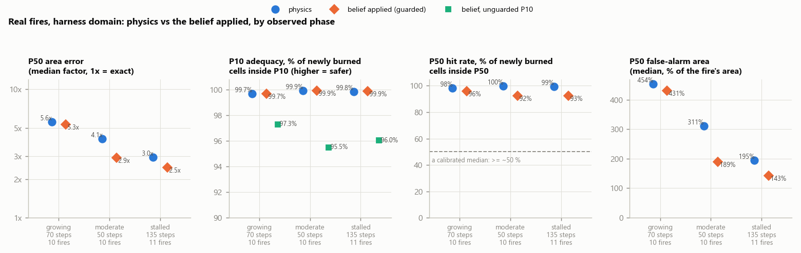
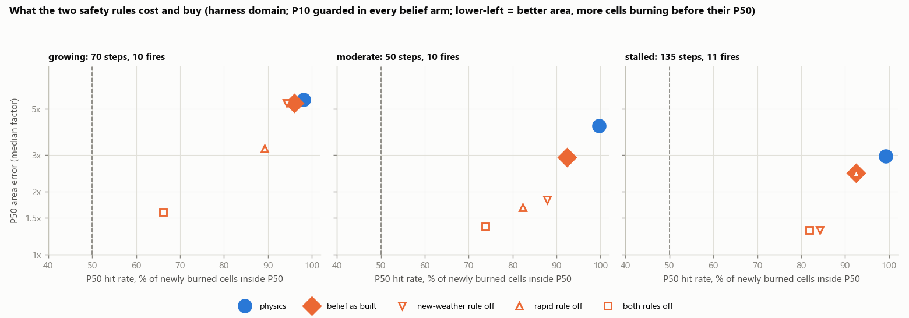
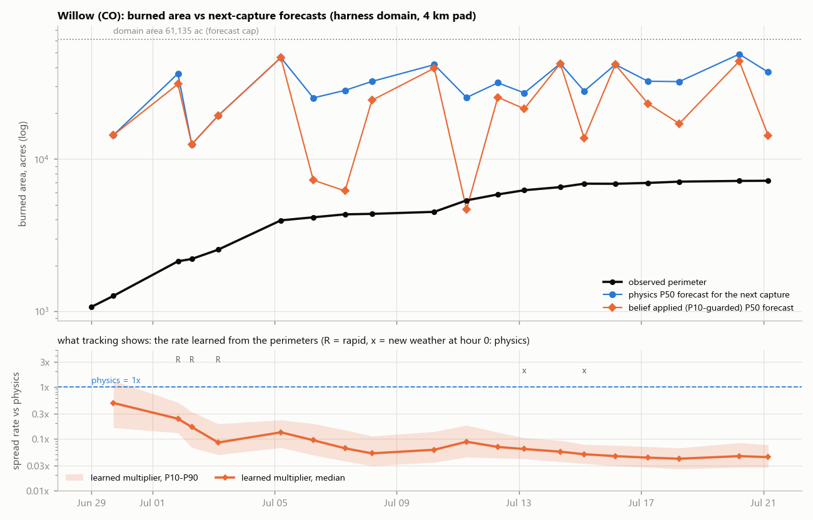
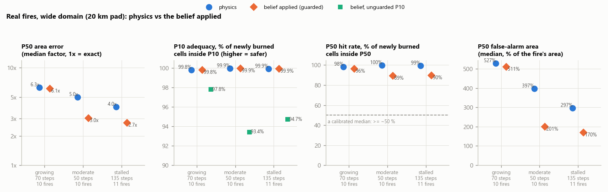
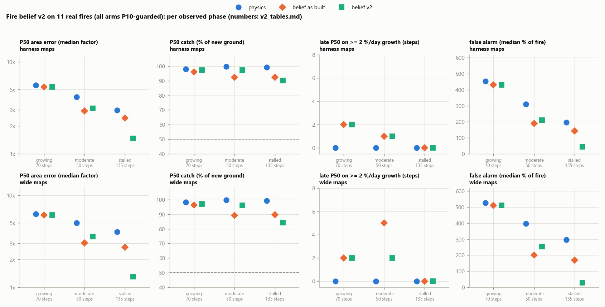
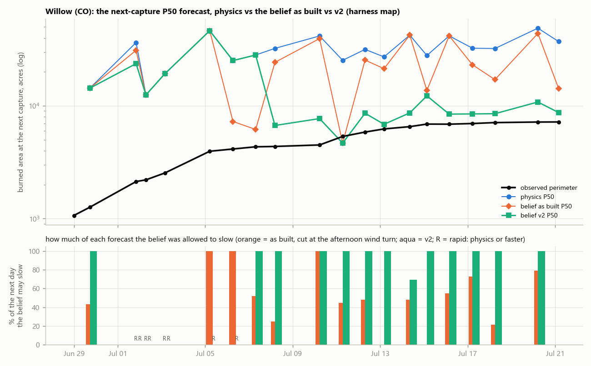

# Belief vs physics on real fires (2026-09-27)

Founder, 2026-09-27: *"I want a full analysis of the difference between belief tracking and
physics."*

Scripts, results and figures: `scratch_review/belief_vs_physics/` (fetch, replay, pooling, figures;
`results_*.json` per fire and pooled) and `docs/review/belief_vs_physics/` (PNG). The engine was not
changed. Everything below is a **perfect-forecast hindcast**: every forecast was driven by the weather
that actually happened (Open-Meteo archive reanalysis), so the differences measured are the
**model's** (the spread physics, and the belief's correction of it), not the weather forecast's. Live,
the NWS forecast adds its own error on top of everything here.

## 1. For the founder, in plain words

**What was tested.** Eleven real 2026 fires, each replayed one day at a time over its whole published
perimeter history: Willow and Aspen Acres (CO), Grasshopper and Hagen (OR), Little Giant, Sinlahekin
and Border 2 (WA), Sand Creek and Bobcat Lakes (MT), Timber and Plaskett (CA). Between them they cover
fast runs (a fire growing 10 % or more a day) and long aging tails (weeks at under 2 % a day while
containment climbed). 276 daily forecasts, 255 of them scoreable. At each day's perimeter the deployed
engine forecast the next day ("physics"), and the same forecast was run with the fire belief applied,
the belief having learned only from that fire's own earlier perimeters ("belief").

**The answer in six points.**

1. **Physics runs far too fast on these fires, in every phase.** At the next day's perimeter the
   physics P50 footprint was a median **3.5 times** the area actually burned: 5.6x on growing days,
   4.1x on moderate days, 3.0x on stalled days. Its forecast of *new* ground was 20 to 80 times the
   new ground that actually burned. These numbers are *understated*: in most steps the physics
   footprint ran into the edge of the replay map. On maps 20 km wider the median is **4.9 times**
   (§6). These are mostly timber fires with crews on them. The engine models neither suppression
   nor containment, and its ROS floor speeds up timber fuels (§7).
2. **The belief sees this almost at once, and tracking would have shown it.** On every fire the
   learned rate fell below 0.3x physics within 1 to 3 daily perimeters (Plaskett took 5). Its upper
   bound (P90) then stayed below 1x on 87-96 % of captures. By the end of each fire's life the learned
   rate was **0.04x (Willow) to 0.35x (Border 2)**, typically 0.1-0.3x. In 276 growth windows it
   raised one surprise reset: Little Giant's 14,780-acre run of Aug 7-8, a real run it had not
   predicted.
3. **Applying the belief as built changes the forecast only a little**: the median P50 area error
   goes from 3.5x to 3.0x (4.9x to 3.6x on the wider maps). Two of the belief's own safety rules put
   the physics back most of the time:
   - *The rapid rule* never lets the belief slow a fast-growing fire. On growing days the applied
     forecast was unchanged in 62 of 70 steps.
   - *The new-weather rule* fires on the ordinary afternoon wind shift, not only on real changes in
     the weather. Across 243 forecasts with a learned belief, the first "new weather" hour came a
     median **13 hours** in. The belief covered the whole next day in only 30 % of forecasts. The
     trigger was a wind turning more than 60 degrees at 4 m/s or more in 167 of them, and "the
     evidence winds had no steady direction" in 43 more.

   Where it does act, mostly on moderate and stalled days, it helps: moderate days 4.1x to 2.9x,
   stalled days 3.0x to 2.5x. It was worse than physics on 3 of 255 steps, by 0.4-3 % of area.
4. **Crew safety (P10) is unchanged, by design, and should stay that way.** The physics P10 held
   99.8 % of the newly burned ground, but only because physics over-runs. With the built-in P10 guard,
   the belief's P10 equals physics (99.8 %). Without the guard (`fire_belief_apply_p10`) coverage drops
   to 96.5 % overall, and on single days to **20-24 %**: Border 2 on Aug 19-20, and Little Giant's
   Aug 7 run. The synthetic study's verdict holds on real fires: never lift the guard.
5. **Alerts (P50): physics over-warns heavily, and the belief as built trims it.** The physics P50 held
   99 % of the newly burned ground, and the ground it marked beyond the fire was 2 to 4.5 times the
   fire's own area. That is an early, wide alert ladder, not a median. The applied belief cut that
   false-alarm area on moderate days from 311 % of the fire's area to 189 %, and on stalled days from
   195 % to 143 %, while its P50 still held 92-94 % of what burned. The cost is a late P50 when a fire
   learned as slow suddenly runs. On Little Giant on Aug 7 the fire made 14,780 acres in 8 hours: the
   belief (0.08x, not flagged rapid) had 15 % of that ground inside its P50, physics 60 %. P10 was
   unaffected, and the next perimeter reset the belief to physics. As built, the belief's P50 caught
   under half of the new ground on 7 of 254 steps; physics never did that.
6. **The value is there, but locked behind the two rules.** As a what-if with the new-weather rule
   off (same learning, same P10 guard), the stalled-day error falls to **1.3x** (1.2x on the wider
   maps) and the false alarm to 29 % of the fire's area. Moderate days fall to 1.8x. P50 still held 84-88 % of the new ground. With
   both rules off, growing days fall from 5.6x to 1.6x, but the P50 then holds only 66 % of the new
   ground, and 24 steps drop under half. The rules are doing a real job: the new-weather rule caught
   real runs on Timber (Aug 21), Grasshopper (Aug 4), Little Giant (Aug 21) and Willow (Jul 12 and
   14), which the rule-off variant under-forecast. They just fire far too often.

**What tracking alone would have displayed.** For Willow, the fire the watcher follows:
- after the first day (Jun 29): *"learned from 1 growth window: 0.49x physics (0.16x-1.31x)"*;
- by Jul 3: 0.08x (0.05x-0.19x), flagged rapid until Jul 3 (a 69 % growth window);
- from Jul 7 to the end: 0.04-0.09x, P90 at most 0.18x.

In words, Willow was spreading at about **1/20 of what the map showed**, and tracking would have said
so from its fourth day. Its forecast footprint at the next perimeter was 4 to 17 times the real one on
every day of its life. The other ten fires read the same way (table in §4.4). The tooltip would
usually have added "same weather pattern until ~16:00-18:00 UTC, then new pattern (physics applies)":
the diurnal wind turn. On the replay's tight maps it seldom printed "belief predicted +N ac" for the
last perimeter. The physics footprint had reached the map edge, and the belief then makes no growth
prediction (221 of 276 windows). On maps 20 km wider it predicted 201 windows. Its median error was
about 10x, against physics' 105x. It erred high (conservative) in 97 % of them, and the observed
growth fell inside the belief's P90 in all 201 (§6).

**Recommendation.**
- **Tracking: turn it on now** (`watch --fire-belief`). It changes no forecast, alert or dispatch.
  The learned rate is the most accurate single number the system has about an aging fire; show it
  prominently ("this fire is running at about 0.1x the modelled spread"). One interplay needs a
  decision before arming it: under the road rule (SAFETY SEMANTICS 15), tracking's `rapid` and
  `known` flags feed the off-map road decision, so tracking alone can change which roads open.
- **Apply: hold.** It is safe for crews as built (P10 guarded: identical to physics here) and
  mildly helpful for alerts. Its benefit is small, though, and comes at the price of a late P50 in
  real runs of learned-slow fires. The benefit sits behind two rules that are miscalibrated for real
  weather and real big fires. Before turning it on:
  1. Recalibrate the new-weather test to compare the forecast *day* against the evidence *days*
     (their diurnal wind and severity envelope), not single hours against one mean direction.
  2. Close the rapid rule's big-fire blind spot. At ~80,000 acres Little Giant grew ~4,400 ac/day,
     and the noise-discounted lower bound read zero growth, so the fire was never flagged.
  3. Re-run this study. The scripts are ready and take about an hour. Flip apply only if the
     stalled-day gain holds without new late-P50 runs.
- **Never lift the P10 guard** (`fire_belief_apply_p10` stays off).
- **Physics itself.** Across very different fires the belief keeps learning the same thing, 0.04-0.35x.
  That is a structural bias of the physics on these timber fires under suppression, and a belief
  can only paper over it. §7 measures how much of it one existing knob explains
  (`ros_floor_grass_only`). It deserves its own hindcast A/B, independent of the belief.

## 2. What was measured, exactly

For each fire, captures are thinned to the last one of each UTC day; a capture closer than 6 h to the
previous kept one is skipped. For each step k -> k+1:

1. **Physics**: the deployed engine ensemble (`spread.ensemble_arrival`) seeded with perimeter k at its
   own time, with the live watcher's production posture. Settings: `wind_gust_blend` 0.5,
   `grass_ros_floor_frac` 0.10, `ros_floor_extinction_gate`, `model_error_sd_log` 0.71,
   `extreme_regime_enabled` (no regime floor, so the spread settings are unchanged; the regime
   detector never tripped on these timber fuelscapes), `ensemble_p50_nominal_bound`,
   `slope_phi_vector`, `solver_budget_evals` 20000 (dispatch only). Everything else is the
   `ResponseConfig` default: ensemble of 6, 96 h horizon, frozen departure-hour edge weather, one
   weather point.
2. **Belief** (`wgresponse.fire_belief.FireBeliefStore`), driven as the watcher drives it:
   - `observe()` of the capture: perimeter series, `perimeter_at_s` = capture time,
     `perimeter_acres` = poly_GISAcres, exactly what `feeds.py` sets for WFIGS.
   - The weather log is filled hourly from the archive at the then-current fire centroid.
   - `before_spread()` runs, with the new-pattern rule on.
   - The physics nominal's growth curve (`fire_belief.growth_curve`) is pinned to the capture by
     `after_spread()`'s rule.
   - `statuses()` then reads the state.

   The belief at step k has seen only captures up to k. Every `fire_belief_*` knob is at its default.
3. **Belief applied**: the same ensemble call with the `member_hour_scale` that `before_spread()`
   returned. Two P10 variants are scored:
   - **Guarded** (the build's default): P10 = min(belief, physics). This was verified against
     `fire_belief.applied_ensemble` itself on each fire's first applied step and first slowed step:
     identical P10, P50 and P90 footprints on all 21 checked steps (`check_guard.txt`).
   - **Unguarded** (`fire_belief_apply_p10`).

   Where `before_spread()` returned nothing (no evidence, a reset, or new weather from hour 0), the
   applied forecast *is* the physics forecast.
4. **Scores at t(k+1) against perimeter k+1** (rasterized on the engine grid; within 1-2 % of
   poly_GISAcres):
   - **area error**: |ln(P50 footprint area / observed area)|, reported as a factor (1x = exact).
   - **growth ratio**: forecast new area / observed newly burned area.
   - **P10 adequacy**: share of the observed newly burned burnable cells inside the P10 footprint.
     This is the harness's `p10_not_after_window`; higher is safer.
   - **P50 hit rate**: the same share for the P50 footprint. A calibrated median should hold about
     50 % or somewhat more, since a cell seen burned at t(k+1) burned at an unknown earlier time.
   - **false-alarm area**: the forecast new area outside perimeter k+1.
   - **the belief's state**: prior, learned or reset; multiplier P10/P50/P90; rapid; known; first
     new-pattern hour.
5. **Phase** by the *observed* growth over the step (poly_GISAcres): growing ≥ 10 %/day, moderate
   2-10 %/day, stalled < 2 %/day.

Pooling: medians and IQRs across steps; P10/P50 rates are cell-weighted. Steps within a fire are not
independent, so the uncertainty is a **fire-cluster bootstrap**: 2,000 resamples of the 11 fires, with
5-95 % intervals. Steps longer than 90 h (the harness's horizon − 6 h rule), or ending after the
archive's last hour, are fed to the belief but not scored: 21 of 276.

## 3. The fires

| fire | captures kept (days) | area | captures | steps / scored | grid |
|---|---|---|---|---|---|
| Willow (CO) | Jun 28 - Jul 21 (22 d) | 1,066 -> 7,196 ac | 20 | 19 / 19 | 90 m, 184x166 |
| Grasshopper (OR) | Jul 26 - Sep 15 (51 d) | 9,535 -> 93,966 | 31 | 30 / 28 | 90 m, 294x437 |
| Hagen (OR) | Jul 18 - Sep 20 (63 d) | 423 -> 61,379 | 38 | 37 / 36 | 90 m, 321x396 |
| Little Giant (WA) | Jul 19 - Sep 25 (67 d) | 20 -> 172,891 | 53 | 52 / 51 | 109 m, 604x498 |
| Sinlahekin (WA) | Jul 27 - Sep 19 (54 d) | 2,313 -> 166,007 | 30 | 29 / 27 | 90 m, 586x489 |
| Sand Creek (MT) | Aug 03 - Sep 14 (42 d) | 1,004 -> 35,520 | 20 | 19 / 16 | 90 m, 270x387 |
| Border 2 (WA) | Jul 21 - Sep 27 (68 d) | 122 -> 23,857 | 15 | 14 / 8 | 90 m, 334x200 |
| Bobcat Lakes (MT) | Aug 01 - Sep 14 (43 d) | 224 -> 10,896 | 21 | 20 / 18 | 90 m, 184x220 |
| Timber (CA) | Aug 10 - Sep 16 (36 d) | 1,330 -> 25,435 | 25 | 24 / 23 | 90 m, 228x258 |
| Plaskett (CA) | Aug 27 - Sep 14 (18 d) | 40 -> 29,993 | 10 | 9 / 8 | 90 m, 227x258 |
| Aspen Acres (CO) | Jun 29 - Aug 02 (33 d) | 22,827 -> 101,965 | 24 | 23 / 21 | 90 m, 451x383 |

Fuel burned (LANDFIRE FBFM40, `fuel_mix.json`): timber understory and litter (TU+TL) make up 44-99 %
of the burned area on 10 of 11 fires. The exception is Hagen at 33 %, with 52 % shrub; Plaskett's
44 % comes with 37 % shrub. Grass (GR+GS) is 1-50 %. No step tripped the extreme-spread-regime detector, so the alert ladder would have read P50
on every one of these fires.

## 4. Results (harness domain: every perimeter's bbox + 4 km, the calibration record's law)

### 4.1 Headline, by observed phase

| phase | steps (fires) | P50 area error, median (5-95 % fire bootstrap) physics -> belief | P10 adequacy physics / belief / unguarded | P50 hit physics -> belief | false-alarm area, median % of the fire's area, physics -> belief | forecast changed by the belief |
|---|---|---|---|---|---|---|
| growing (≥ 10 %/d) | 70 (10) | 5.6x (4.8-6.3) -> 5.3x (4.6-6.3) | 99.7 / 99.7 / 97.3 % | 98 -> 96 % | 454 -> 431 % | 8 of 70 |
| moderate (2-10 %/d) | 50 (10) | 4.1x (3.1-5.6) -> 2.9x (1.9-3.4) | 99.9 / 99.9 / 95.5 % | 100 -> 92 % | 311 -> 189 % | 25 of 50 |
| stalled (< 2 %/d) | 135 (11) | 3.0x (2.5-3.6) -> 2.5x (2.0-3.1) | 99.8 / 99.9 / 96.0 % | 99 -> 93 % | 195 -> 143 % | 106 of 135 |
| all | 255 (11) | 3.5x (3.0-4.7) -> 3.0x (2.7-3.5) | 99.8 / 99.8 / 96.5 % | 99 -> 94 % | 253 -> 198 % | 139 of 255 |

- The paired per-step change in area error is 0 on growing days and negative on moderate and stalled
  days (stalled: median −0.05 to −0.13 in ln units across the bootstrap). The belief was never worse on
  growing or moderate days. On stalled days it was worse on 3 of 135 steps, each by 0.4-3 % of area
  (§8, item 5).
- Physics' forecast of *new* ground, as a median multiple of what burned: growing 22x, moderate 38x,
  stalled 79x. With the belief: 18x, 23x, 51x. The physics P50 reached the map edge by t(k+1) in 57 %
  (growing), 88 % (moderate) and 87 % (stalled) of steps, so its error here is a floor.
- Unguarded P10 fell under 90 % on 25 of 254 steps, with a minimum of 20 % (Border 2, stalled, Aug 19).
  The guarded P10, like physics, never fell under 90 %.



### 4.2 What the applied belief actually did

| phase | action (steps) |
|---|---|
| growing | held at physics by the rapid rule 40; new weather from hour 0 11; no evidence yet 10; slowed 8; surprise reset 1 |
| moderate | slowed 25; held by the rapid rule 21; new weather from hour 0 3; surprise reset 1 |
| stalled | slowed 108; new weather from hour 0 24; held by the rapid rule 3 |

How long it acts (`novelty_stats_results.json`). There were 243 forecasts with a learned belief. The
first new-pattern hour came at a median of hour 13. The same-pattern hours covered a median 43 % of
the forecast window. They covered the whole window in 30 % of forecasts and none of it in 16 %.
Triggers:

| trigger | forecasts |
|---|---|
| wind turns > 60° at ≥ 4 m/s from the evidence mean | 167 |
| evidence winds had no steady direction (resultant < 0.3), so any hour ≥ 4 m/s counts | 43 |
| severity > 1.5x the evidence P90 | 15 |
| none within the 96 h horizon | 18 |

On Willow the cut comes almost every day at 15:00-18:00 UTC (09:00-12:00 MDT), when the daytime wind
turns. That is the diurnal cycle, not a new weather pattern.

Coverage varies by fire, and the gains follow it. The median share of each forecast window left to
the belief was:

| fire | share of window |
|---|---|
| Hagen | 100 % |
| Little Giant | 79 % |
| Willow, Timber | 50 % |
| Grasshopper | 43 % |
| Bobcat Lakes, Sand Creek, Border 2 | 29-34 % |
| Aspen Acres | 20 % |
| Sinlahekin, Plaskett | 4 % |

### 4.3 The rules as a trade-off (what-if knob settings; same learning, same physics, P10 guarded)

| phase | arm | area error | P10 guarded / unguarded | P50 hit | false alarm (% of fire) | better / worse / same vs physics |
|---|---|---|---|---|---|---|
| growing | physics | 5.6x | 99.7 % | 98 % | 454 % | - |
| growing | belief as built | 5.3x | 99.7 / 97.3 % | 96 % | 431 % | 8 / 0 / 62 |
| growing | new-weather rule off | 5.3x | 99.7 / 96.0 % | 94 % | 431 % | 9 / 0 / 61 |
| growing | rapid rule off | 3.2x | 99.7 / 92.7 % | 89 % | 225 % | 48 / 0 / 22 |
| growing | both off | 1.6x | 99.7 / 80.2 % | 66 % | 67 % | 59 / 0 / 11 |
| moderate | physics | 4.1x | 99.9 % | 100 % | 311 % | - |
| moderate | belief as built | 2.9x | 99.9 / 95.5 % | 92 % | 189 % | 25 / 0 / 25 |
| moderate | new-weather rule off | 1.8x | 99.9 / 92.7 % | 88 % | 82 % | 28 / 0 / 22 |
| moderate | rapid rule off | 1.7x | 99.9 / 90.7 % | 82 % | 69 % | 46 / 0 / 4 |
| moderate | both off | 1.4x | 99.9 / 84.2 % | 74 % | 38 % | 49 / 0 / 1 |
| stalled | physics | 3.0x | 99.8 % | 99 % | 195 % | - |
| stalled | belief as built | 2.5x | 99.9 / 96.0 % | 93 % | 143 % | 103 / 3 / 29 |
| stalled | new-weather rule off | 1.3x | 99.9 / 92.0 % | 84 % | 29 % | 128 / 0 / 7 |
| stalled | rapid rule off | 2.5x | 99.9 / 96.0 % | 93 % | 143 % | 106 / 3 / 26 |
| stalled | both off | 1.3x | 99.9 / 90.9 % | 82 % | 29 % | 135 / 0 / 0 |

The price is late-P50 steps: steps where the belief's P50 held under half of the newly burned ground
(physics: 0 of 254).

| arm | late-P50 steps | of which under 25 % |
|---|---|---|
| as built | 7 | 4 |
| new-weather rule off | 15 | 6 |
| rapid rule off | 11 | 5 |
| both off | 24 | 8 |

The unguarded P10 falls to 85 % with both rules off, which is again why the guard must stay.



### 4.4 Per fire

| fire | scored (grow/mod/stall) | P50 area error physics -> belief (median, ln) | P10 physics / belief / unguarded | P50 hit physics -> belief | learned at the end (P10-P50-P90) | windows until learned < 0.3x / < 0.1x | P90 < 1x on | windows (censored) | resets | rapid captures |
|---|---|---|---|---|---|---|---|---|---|---|
| Willow (CO) | 19 (5/7/7) | 1.80 -> 1.72 | 100 / 100 / 97.6 % | 100 -> 87 % | 0.03-0.04-0.08x | 2 / 4 | 90 % | 19 (19) | 0 | 3 |
| Grasshopper (OR) | 28 (8/6/14) | 1.05 -> 0.98 | 100 / 100 / 100 % | 100 -> 100 % | 0.07-0.13-0.23x | 2 / - | 94 % | 30 (30) | 0 | 15 |
| Hagen (OR) | 36 (8/9/19) | 1.36 -> 1.04 | 99.8 / 99.8 / 92.3 % | 100 -> 88 % | 0.11-0.32-0.93x | 3 / 10 | 95 % | 37 (29) | 0 | 9 |
| Little Giant (WA) | 51 (12/12/27) | 0.97 -> 0.65 | 99.3 / 99.4 / 91.0 % | 97 -> 86 % | 0.07-0.12-0.26x | 2 / 9 | 94 % | 52 (24) | 1 | 15 |
| Sinlahekin (WA) | 27 (8/2/17) | 0.95 -> 0.93 | 100 / 100 / 99.7 % | 100 -> 99 % | 0.08-0.16-0.36x | 2 / 21 | 93 % | 29 (24) | 0 | 11 |
| Sand Creek (MT) | 16 (7/0/9) | 1.77 -> 1.73 | 100 / 100 / 99.9 % | 100 -> 100 % | 0.09-0.28-0.82x | 2 / 6 | 90 % | 19 (17) | 0 | 6 |
| Border 2 (WA) | 8 (0/2/6) | 0.81 -> 0.68 | 98.7 / 98.8 / 91.5 % | 98 -> 86 % | 0.15-0.35-0.99x | 3 / 8 | 87 % | 14 (8) | 0 | 1 |
| Bobcat Lakes (MT) | 18 (6/4/8) | 1.89 -> 1.77 | 100 / 100 / 98.5 % | 100 -> 97 % | 0.06-0.13-0.45x | 2 / 6 | 90 % | 20 (20) | 0 | 5 |
| Timber (CA) | 23 (8/3/12) | 1.31 -> 1.18 | 100 / 100 / 99.7 % | 100 -> 96 % | 0.05-0.08-0.14x | 1 / 6 | 96 % | 24 (20) | 0 | 9 |
| Plaskett (CA) | 8 (4/1/3) | 1.10 -> 1.10 | 100 / 100 / 100 % | 98 -> 98 % | 0.11-0.27-0.75x | 5 / - | 90 % | 9 (7) | 0 | 6 |
| Aspen Acres (CO) | 21 (4/4/13) | 1.20 -> 1.16 | 100 / 100 / 99.9 % | 100 -> 100 % | 0.08-0.16-0.42x | 2 / 8 | 96 % | 23 (23) | 0 | 6 |

The belief lowered the median error on 10 of 11 fires; on Plaskett it never acted (rapid, then new
weather at hour 0). Its biggest gains were Little Giant (median ln error 0.97 -> 0.65) and Hagen
(1.36 -> 1.04), whose long stalled tails seldom tripped the new-weather rule.

Per-fire time series (observed area; the physics and belief P50 forecasts for the next capture; the
learned multiplier band that tracking displays):
[Willow](belief_vs_physics/willow.png) ·
[Grasshopper](belief_vs_physics/grasshopper.png) ·
[Hagen](belief_vs_physics/hagen.png) ·
[Little Giant](belief_vs_physics/littlegiant.png) ·
[Sinlahekin](belief_vs_physics/sinlahekin.png) ·
[Sand Creek](belief_vs_physics/sandcreek.png) ·
[Border 2](belief_vs_physics/border2.png) ·
[Bobcat Lakes](belief_vs_physics/bobcatlakes.png) ·
[Timber](belief_vs_physics/timber.png) ·
[Plaskett](belief_vs_physics/plaskett.png) ·
[Aspen Acres](belief_vs_physics/aspenacres.png)



### 4.5 Willow in detail (the fire the watcher tracks)

19 daily steps, Jun 28 - Jul 21: 1,066 to 7,196 acres, containment 0 to 51 %.
- **Physics** forecast 4-17x the next perimeter's area on every day, running into the 15 x 16 km map
  edge within 7-23 h each time. Its P10 and P50 held 100 % of the new ground.
- **The belief** learned 0.49x after one day, 0.08x after four and 0.04-0.09x from Jul 7. It
  slowed the forecast on 13 steps. On days when the wind stayed steady into the next morning it
  brought the P50 within 1.5-1.8x of the truth: Jul 5-6 at 0.56 and 0.37 in ln units, against
  physics' 1.80 and 1.89. On most days the afternoon wind turn put the forecast back to physics after
  9-18 h, and its median error moved only 1.80 -> 1.72.
- **One miss.** On Jul 10 Willow grew 18 % (852 ac) after a slow week. The belief's P50 held 3 % of
  that ground (physics 100 %), and the unguarded P10 held 80 %. The guarded P10 held 100 %.

### 4.6 Little Giant's Aug 7 run (the exposure the design warns about)

At about 80,000 acres Little Giant was growing ~4,400 ac/day (5-6 %/day). Growth that big is inside
the rapid rule's noise discount: the lower bound of 5,249 ac grown between two ±2,400-ac
measurements is below zero. The fire was therefore never flagged rapid, and the belief (0.08x)
slowed it. Between Aug 7 22:33 and Aug 8 06:20 it burned 14,780 acres in 7.8 h:

| | inside P50 | inside P10 |
|---|---|---|
| physics | 60 % | 96 % |
| belief, guarded (as built) | 15 % | 96 % |
| belief, unguarded | 15 % | 24 % |

The belief's same-weather window ran to Aug 8 07:33, so it was active through the whole 7.8 h. The
next perimeter beat the belief's own P90 (12,830 ac) and reset it to physics for 24 h. This is
the only surprise in 276 windows. It is the documented design limit, now seen on a real fire: the
ladder carries the exposure until the next report; crew P10 does not.

## 5. What tracking alone would have shown

- **Speed of learning.** Every fire was learned below 0.3x physics after 1-3 daily perimeters (Plaskett
  5), and below 0.1x on 9 of 11 fires (after 4 to 21 windows).
- **Confidence.** The learned P90 stayed below 1x on 87-96 % of captures; the belief never said
  "physics is too slow" on these fires.
- **Stability.** After each fire's first week the learned median stayed within 0.04-0.42x on 10 of
  11 fires. Border 2, with sparse perimeters, reached 0.62x.
- **Surprise.** One reset (Little Giant, above), which was a real run.
- **Predictions.** For 55 uncensored windows on the tight maps the belief predicted the next window's
  growth:
  - its median error was |ln| 1.72 (about 5.6x), against physics' 3.51 (about 33x) on the same
    windows;
  - the observed growth fell under the belief's P90 in 54 of 55.
  - On the wider maps (§6), 201 windows have a prediction.
- **Rapid.** Captures were flagged rapid on 1-15 per fire. That is correct on the fast days. Big fires
  growing 5-6 %/day were missed (Little Giant).

What tracking cannot see (unchanged from the design doc): one number per fire, so an active flank on
a mostly contained fire reads as "slow on average"; nothing between perimeters; acreage noise.

## 6. Sensitivity: a wider map (20 km pad)

The harness map (every perimeter's bbox + 4 km) caps the physics footprint. The physics nominal
reached the map edge inside 221 of 276 growth windows, which also censors the belief's evidence. A
live watcher's map is usually larger: the fire, every protected client within 60 km, plus 2 km. The
whole replay was repeated on maps padded 20 km, with cells coarsened to 90-167 m to stay under 300k
cells.

| phase | steps (fires) | P50 area error, median (5-95 % fire bootstrap) physics -> belief | P10 adequacy physics / belief / unguarded | P50 hit physics -> belief | false-alarm area (% of fire) physics -> belief | belief better / worse / same |
|---|---|---|---|---|---|---|
| growing | 70 (10) | 6.3x (5.2-7.9) -> 6.1x (5.2-7.9) | 99.8 / 99.8 / 97.8 % | 98 -> 96 % | 527 -> 511 % | 8 / 0 / 62 |
| moderate | 50 (10) | 5.0x (3.5-7.2) -> 3.0x (2.2-4.1) | 99.9 / 99.9 / 93.4 % | 100 -> 89 % | 397 -> 201 % | 25 / 0 / 25 |
| stalled | 135 (11) | 4.0x (2.9-5.9) -> 2.7x (2.0-4.2) | 99.9 / 99.9 / 94.7 % | 99 -> 90 % | 297 -> 170 % | 107 / 1 / 27 |
| all | 255 (11) | 4.9x (3.7-6.4) -> 3.6x (2.9-4.8) | 99.9 / 99.9 / 95.8 % | 99 -> 93 % | 391 -> 254 % | 140 / 1 / 114 |

What changes on the wider map:
- **Physics' error is larger once uncapped**: 4.9x overall, against 3.5x on the tight map.
- **The belief's gain is larger**: 4.9x -> 3.6x, against 3.5x -> 3.0x. That is because more of what
  it slows now counts.
- **The pattern is identical.** The applied belief is again unchanged on growing days (rapid rule),
  cut short by the same new-weather triggers (the same 243 forecasts, median first new hour 13 h), and
  P10-guarded equal to physics. Without the guard, P10 falls to 95.8 %.
- **Censoring falls from 221 to 75 of 276 windows**, so tracking gets a growth prediction for 201
  windows. Their median error was |ln| 2.34 (about 10x), against physics' 4.65 (about 105x) on the
  same windows. The prediction was above the observed growth in 97 % of windows, and the observed
  growth fell under the belief's P90 in all 201. The belief is conservative: slow to trust, as
  designed.
- **The learned multipliers move somewhat, not in kind.** Censored windows can only slow the belief,
  so with fewer of them several fires end a little higher: Hagen 0.45x (0.32x on the tight map),
  Border 2 0.54x, Plaskett 0.41x, Sand Creek 0.38x. Willow stays at 0.04x and Timber at 0.05x.
  Every fire was still learned below 0.3x within 1-3 windows (9 of 11 within 2).

The new-weather what-if on the wider map (same learning, P10 guarded; `results_pooled_wide_nonovel.json`):

| phase | physics | belief as built | new-weather rule off | P50 hit: physics / as built / rule off | false alarm (% of fire): physics / as built / rule off |
|---|---|---|---|---|---|
| growing | 6.3x | 6.1x | 6.1x | 98 / 96 / 94 % | 527 / 511 / 511 % |
| moderate | 5.0x | 3.0x | 1.9x | 100 / 89 / 84 % | 397 / 201 / 89 % |
| stalled | 4.0x | 2.7x | **1.2x** | 99 / 90 / 76 % | 297 / 170 / 20 % |
| all | 4.9x | 3.6x | 1.4x | 99 / 93 / 86 % | 391 / 254 / 40 % |

Late-P50 steps (the belief's P50 held under half the new ground) were 13 as built (5 under 25 %)
and 25 with the rule off (8 under 25 %); physics had none of 254. The unguarded P10 falls to 92.2 %
with the rule off. The story is the same as on the tight map, and louder:
- on stalled days a belief allowed to act for the whole forecast lands within about 1.2x of the real
  footprint, against physics' 4x;
- the price is a P50 that is late more often.



Willow on the wider map: [wide_willow.png](belief_vs_physics/wide_willow.png).

## 7. What the belief is correcting: one physics knob

The belief learns the same message on every fire: the physics runs 3-25 times too fast. A side
experiment (`bvp_physics_variant.py`, `results_pooled_phys_grassonly.json`) re-ran the same 255 steps
with **one** configuration change from the deployed posture: `ros_floor_grass_only=True`. The fuel-class
ROS floor (0.10 x U10) stays on grass and grass-shrub but no longer lifts timber litter and
understory. `contracts.py` notes the floor lifts TU/TL "to 19-45x Rothermel", and TU/TL is most of what
these fires burned.

| phase | steps | P50 area error: deployed / grass-only floor / belief as built | P10 adequacy deployed / grass-only | P50 hit deployed / grass-only | false alarm (% of fire) deployed / grass-only |
|---|---|---|---|---|---|
| growing | 70 | 5.6x / 2.7x / 5.3x | 99.7 / 95.3 % | 98 / 85 % | 454 / 176 % |
| moderate | 50 | 4.1x / 2.3x / 2.9x | 99.9 / 98.2 % | 100 / 92 % | 311 / 133 % |
| stalled | 135 | 3.0x / 2.0x / 2.5x | 99.8 / 98.6 % | 99 / 94 % | 195 / 96 % |
| all | 255 | 3.5x / 2.3x / 3.0x | 99.8 / 97.1 % | 99 / 90 % | 253 / 130 % |

Reading:
- **One floor explains about a third of the physics error on these fires, in log terms.** It does so
  in every phase, including growing days, where the belief as built does nothing.
- **Changing it costs crew-safety coverage that the guarded belief does not.** P10 falls to 97.1 %
  overall and 95.3 % on growing days, against 99.7-99.8 %.
- **Even without it, physics is still 2-2.7 times too big.** That remainder is suppression, which is
  not modeled, plus whatever else a whole-fire multiplier absorbs, and it is the belief's natural
  job.

This is a physics-calibration question with its own history: the floor was set on the July blow-up
windows, which were under-forecast. It must not be flipped on this evidence alone. It shows that
much of what the belief would "learn" on timber fires is a known, fixable engine bias. It also shows
that a belief applied on top of a re-calibrated physics would learn multipliers closer to 1.

## 8. Limits, and things noticed along the way

**Limits of this study**
1. **Perfect-forecast weather.** Reanalysis for every forecast hour. This isolates model error; live
   forecasts add weather-forecast error, and the new-weather rule would then judge forecast hours,
   not observed ones.
2. **Whole-fire multiplier vs uneven containment.** The belief learns one number per fire. These
   fires' late growth was often one active flank. The scores are whole-footprint scores and cannot
   say which flank was over- or under-forecast.
3. **Perimeter timing and noise.** One capture per UTC day; capture times vary (6-163 h between kept
   captures); polygons are re-mapped and revised. On stalled days most "newly burned" cells are
   mapping differences: every arm is scored on the same cells, but the P50 hit and P10 adequacy there
   mean "covered the re-mapped edge". The live WFIGS feed also carries IncidentSize (a second,
   `reported`, series). It was not used here, so the belief learned from perimeters only, and its
   young-fire rapid clause, which needs a reported size, was inactive.
4. **Few fires.** 11 fires, 255 scored steps, clustered by fire. Numbers are given with fire-cluster
   bootstrap intervals and per-fire medians. They describe these 2026 fires, mostly timber in
   OR/WA/MT/CO/CA; no grass-led blow-up (extreme regime) is in the sample.
5. **The engine as is.** It carries the known late-biased frozen edge-weather law, and it does not
   model suppression. The domain edge caps physics' over-prediction (§6). With the belief applied,
   the watcher would pin the *applied* nominal's curve (with its multiplier recorded). Here the
   physics nominal's curve was pinned. That is exact for tracking and equivalent under the belief's
   own time-scaling approximation for apply.

**Noticed along the way** (reported, not fixed; the engine was not changed)
1. **Harness data bug: stacked duplicate rings.** `tools/hindcast_harness._fetch_incident` unions
   the rings of every OBJECTID that shares a capture time. On `WFIGS_Daily_Perimeters_Public` those
   rows are not parts of one polygon. They are the *same* perimeter re-captured on later days,
   sometimes edited in place (Willow 06-29 17:22: 1,262 -> 1,919 -> 2,011 ac under one timestamp).
   Both even-odd rasterizers cancel stacked copies:
   - In the pinned corpus (`tools/hindcast_data`), Madre's 8,396-ac snapshot rasterizes to **0
     cells**, in both the engine seed and the scoring mask. Its pair in the committed
     `replay_results.json` therefore scored all 35,071 ac inside the next perimeter as new growth; the
     GIS acreages imply about 27,100.
   - Madre's 79,519-ac snapshot rasterizes to 9,259 ac (engine seed 10,010), and its pair was
     dropped as non-monotone.
   - 40 more snapshots are affected in the OOS/August corpora (`bvp_check_corpus_oids.py`,
     `bvp_check_stacked_rings.py`).

   This study replays rows in OBJECTID (publication) order with the watcher's newer-time rule
   instead.

   > **Status 2026-09-27: fixed** on branch `fix/hindcast-stacked-rings`. The harness now takes the first publication per capture time and keeps a same-time row only when it is a spatially separate piece. The three corpora were repaired and every documented replay was re-run. See [../calibration/stacked_rings_fix_2026-09-27.md](../calibration/stacked_rings_fix_2026-09-27.md).

   Stacked rings also make the two area laws disagree. `fire_belief.rings_area_m2` counts each
   equal-area copy (about 2x the GIS area), while the rasterizers cancel them. Live this is harmless
   while the feed supplies `perimeter_acres`, but it is a trap for any ring-area fallback.
2. **Live-data hazards the belief would ingest.**
   - The Daily layer (a daily copy of the current perimeters) carries back-dated polygons: 20+
     Sinlahekin rows stamped Aug 10 00:00 carry Aug 24-28 polygons.
   - It carries bogus years: Sinlahekin 2020, Plaskett 2002.
   - It carries tiny sub-feature polygons: Sinlahekin Aug 17-27 at 0-3 acres while IncidentSize read
     ~155,000.

   The belief has no plausibility check on a new perimeter's area. If the live feed served such a
   polygon (the Daily layer is a daily copy of the current layer, so it likely did), a 2-acre
   "perimeter" of a 155,000-acre fire would enter the belief as a −99.99 % growth window and seed the
   spread. The newer-time rule and the growth-curve pinning do not catch it. Worth a guard in the
   feed or the belief. Not verified against `feeds.py`'s live path here.
3. **The rapid rule's big-fire blind spot** (§4.6).
4. **The new-weather rule fires on the diurnal cycle** (§4.2).
5. **The spread is not FIFO under the frozen edge law.** On 3 stalled steps the belief's *slower* first
   hours (0.09-0.32x for 2-23 h, then physics) produced a 0.4-3 % *larger* footprint than physics.
   This happened even for the nominal member (Sinlahekin Sep 9: 397,969 vs 396,055 ac). A front that
   arrives later departs in a windier hour and crosses long edges faster. It is small, but it means
   "slower multiplier implies a smaller footprint" does not hold in this engine.
6. **Censored windows hide the tracking prediction.** When the nominal reaches the map edge inside a
   window the belief learns only a bound and prints no "belief predicted" figure (221 of 276 windows
   here). On live maps this depends on the client radius.

## 9. Files and how to reproduce

`scratch_review/belief_vs_physics/`:

| file | what it is |
|---|---|
| `bvp_fetch.py` | discovery + fetch: the capture replay, filters, weather, LFPS |
| `bvp_run.py` | the physics / belief / applied replay and scoring; `check-guard` |
| `bvp_report.py` | pooling, fire-cluster bootstrap, tables (`report_tables.md`) |
| `bvp_figs.py` | the figures |
| `bvp_physics_variant.py` | the §7 side experiment |
| `bvp_novelty_stats.py` | §4.2: new-weather coverage and triggers |
| `bvp_fuel_mix.py` | burned-fuel mix |
| `bvp_check_corpus_oids.py`, `bvp_check_stacked_rings.py` | §8 item 1 |
| `bvp_http_summary.py` | request provenance |
| `bvp_inspect.py`, `bvp_show.py` | inspection aids |
| `fires.json` | the 11 IRWIN ids |

Results:
- `results_<fire>.json` and `results_wide_<fire>.json`: per step, the physics and both belief arms'
  scores, the belief's state, and the window it completed.
- `results_pooled*.json`: the pooled tables, including the what-if variants.
- `results_phys_grassonly.json` and `results_pooled_phys_grassonly.json`: the §7 side experiment.
- `novelty_stats_*.json`, `fuel_mix.json`, `check_guard.txt`, `check_*.txt`, `http_summary.json`.

Figures are in `docs/review/belief_vs_physics/`.

From the worktree root. py -3 is the engine's Python; `python` 3.13 has matplotlib.

```
py -3 scratch_review/belief_vs_physics/bvp_fetch.py discover
py -3 scratch_review/belief_vs_physics/bvp_fetch.py fetch --fires willow,grasshopper,...
py -3 scratch_review/belief_vs_physics/bvp_fetch.py fetch --variant wide --fires ...
py -3 scratch_review/belief_vs_physics/bvp_run.py all --fires <keys> [--variant wide]
py -3 scratch_review/belief_vs_physics/bvp_run.py belief|apply|collect --fires <keys> --belief-variant nonovel|norapid|free
py -3 scratch_review/belief_vs_physics/bvp_run.py check-guard --fires <keys>
py -3 scratch_review/belief_vs_physics/bvp_physics_variant.py grassonly
py -3 scratch_review/belief_vs_physics/bvp_novelty_stats.py results
py -3 scratch_review/belief_vs_physics/bvp_report.py
python scratch_review/belief_vs_physics/bvp_figs.py
```

Fetched data lives in `out/bvp_data/` (gitignored): rows, geometries, incidents, weather, LFPS tiles,
per-step runs, and per-invocation HTTP logs. The study made 311 HTTP requests in all
(`http_summary.json`), each counted against a hard per-invocation budget and logged, as the harness
does:

| service | requests |
|---|---|
| WFIGS ArcGIS | 83 |
| Open-Meteo archive | 16 |
| LFPS, for 22 terrain tiles | 212 |

Two of the archive requests were oversized, before the date-sanity filter existed. A capture stamped
2020 (Sinlahekin) and one stamped 2002 (Plaskett) stretched their date ranges to 6 and 24 years (45
MB and 79 MB). Those responses were discarded and re-requested over the right dates. The replay is deterministic:
the ensemble seeds on (incident id, member), the belief has no RNG, and every input is cached.

---

## Addendum 2026-09-28: the v2 rules on the same 11 fires

Founder, 2026-09-28: *"recalibrate the new-weather rule and fix the rapid blind spot"*. Both are
built as default-OFF knobs, armed together by `watch --fire-belief-v2`. The rules, knobs,
calibration and full tables are in `docs/FIRE_BELIEF.md` §7 and
`scratch_review/belief_vs_physics/v2_tables.md`. Everything below uses the same cached physics,
the same perfect-forecast weather and the same scoring as the study above.

### In plain words

**The new-weather rule now thinks in days.** It asks whether a forecast day will be harsher than
anything the fire was seen in, or whether its afternoon wind will blow from a direction none of the
observed afternoons had. It no longer asks whether this hour's wind differs from the average of
all observed hours, which the afternoon wind turn tripped nearly every day.

The thresholds, chosen by leaving each fire out in turn, are the old rule's: 1.5× harsher, 60°, at
4 m/s. The belief now acts over the whole next day in 93 % of forecasts (30 % before). The first
new-weather hour, which as built came at a median of hour 13, now falls beyond the 96-h horizon in
most forecasts.

**The rapid rule now uses the measured noise.** Two perimeters of one fire differ by re-mapping of
about √(area) acres (95th percentile 1.6 √A), not 3 % of the area. At ~80,000 acres that is
~450 acres, not ~3,400. Little Giant is therefore rapid at the Aug 7 22:33 forecast, and the belief
leaves it at physics for its 14,780-acre run (P50 caught 60 %, 15 % as built).

A correction to §1 and §4.6 above: Little Giant *was* flagged rapid on Aug 4–6, carried by the
early-August runs inside the 48-h lookback. It dropped out at the Aug 7 22:33 forecast, where its
last two windows (+3,225 and +5,249 ac) read zero beyond the area-fraction noise.

**Before and after** (all P10-guarded; late = the P50 caught under half the new ground; brackets =
of those, days growing ≥ 2 %/day):

| | P50 area error (harness / wide maps) | P50 catch | late days (harness / wide) | false alarm (harness) |
|---|---|---|---|---|
| physics | 3.55x / 4.90x | 99 % | 0 / 0 | 253 % |
| belief as built | 2.98x / 3.55x | 94 % | 7 (3) / 13 (7) | 198 % |
| **belief v2** | **2.57x / 2.68x** | **95 %** | **9 (3) / 16 (4)** | **153 %** |
| v2, stalled days | 1.46x / 1.30x (physics 2.97x / 3.99x) | 90 % | 6 (0) / 12 (0) | 45 % (physics 195 %) |
| what-if: both rules off | 1.34x / 1.24x | 73 % | 24 (17) / 43 (30) | 35 % |

**Crew safety:** P10 is unchanged at 99.8 % for physics, as built and v2. The guard is untouched.

**The named runs:**

| run | as built | v2 | why |
|---|---|---|---|
| Grasshopper Aug 4 | 99 % | 100 % | rapid |
| Little Giant Aug 21 | 98 % | 98 % | rapid |
| Willow Jul 14 | 77 % | 75 % | new weather at hour 13 |
| Little Giant Aug 7 | 15 % | 60 % | fixed: rapid |
| Hagen Aug 9 | 48 % | 100 % | fixed: rapid |
| Willow Jul 12 | 100 % | 38 % | no longer caught |
| Timber Aug 21 | 65 % | 19 % | no longer caught |

Willow Jul 12 and Timber Aug 21 are no longer caught because neither day brought new weather or
followed rapid growth. The old rule caught them only through its afternoon cut. Their P10 held
100 %, and EXTREME still fires on the P10 rung, so the cost is a later NOTICE/WATCH on those two
days. Willow's Jul 10 flare-up is missed by both (3 %).

**Where v2 costs accuracy.** Big fires growing 1,000+ ac/day at 1–2 %/day of their size are now
rapid and left at physics. Rapid flags rose from 80 to 117 of 255 forecasts, and moderate days
went from 2.92x to 3.10x. The rapid threshold itself (1,000 ac/day, absolute) is a policy knob,
unchanged here.

**Recommendation.**
- **Track with v2:** yes (`--fire-belief --fire-belief-v2`).
- **Apply:** only ever with v2. It is the first version worth applying: it beats the as-built
  belief on nearly every aggregate and fixes its largest miss. Its residual risk is a later
  NOTICE/WATCH on un-forecast runs of learned-slow fires: 3 of 120 growing or moderate days
  here, against 0 for physics, which pays for that with false alarms of 2–5× the fire's area.
- **First:** a short live shadow period, because live the daily rule judges NWS forecast days,
  not observed ones.

Willow, the watcher's fire: from Jul 7 on, v2's next-capture P50 was 0.9–1.8× the real area
every day. The 0.9× was Jul 10, the flare-up it missed. As built it was 0.9–8.9×, and physics
4.1–9.4×.




