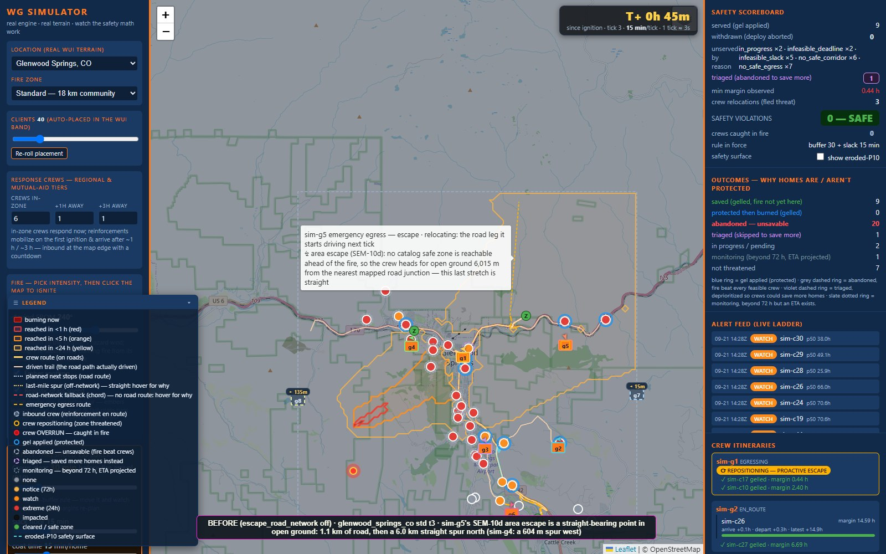
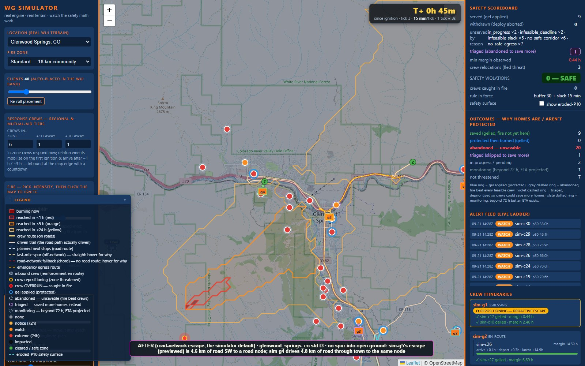
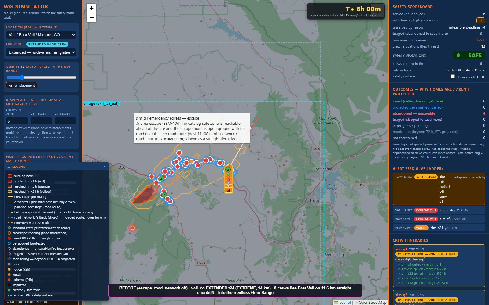
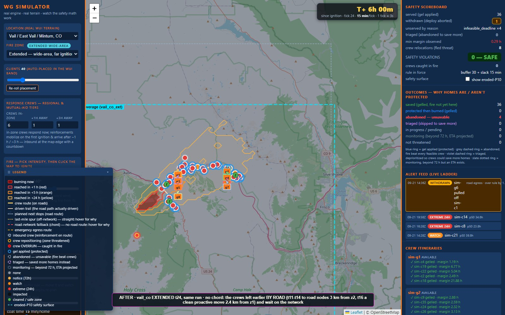
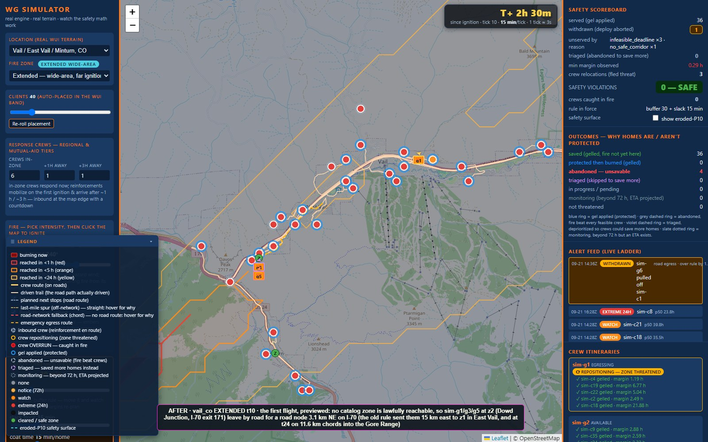

# Escape roads — fleeing crews drive the road network (2026-09-26)

Founder: *"rework the crews fleeing."* When no catalog safe zone can be reached
lawfully, the SEM-10d area escape sent a crew toward a point on one of 12
straight bearings: it drove to the nearest junction and then straight across
open ground (Glenwood 6 km, Beaver Creek 9 km, extended Vail 92 km of chords
into the roadless Gore Range — `roads_inspection_2026-09-25.md` E4). The
simple fix, `escape_road_snap_m`, was clean on an 8-session A/B but broke the
pinned Camp-Fire-scale extended run when armed. This record diagnoses why,
builds the replacement — a search of the road network — and measures it.
Nothing here is deployed.

**Short answer.**

* **Why the snap failed.** Both the ray escape and its snap ranked lawful
  destinations by *(transit exposure, drive time)* and never asked how long the
  destination stays safe. On the pinned run the rays were clean by luck: a
  **4-second** drive-time tie put the first crew at a ray end the fire never
  reaches instead of one it reaches in 26.6 h. The snap walked each ray back to
  a road node — closer to the fire — and parked crews at 10–27 h spots. The
  growing band overtook them; each re-flee started from a worse pocket
  (46 min of route exposure at t68, no lawful destination anywhere at t105) →
  two imminent-while-egressing rows.
* **The replacement** (`escape_road_network`, default OFF, armed by the
  simulator): a time-dependent Dijkstra over the road graph from the crew's
  position. Burned samples make an edge impassable; samples inside the
  eroded-P10 band cost exposure seconds. Destinations are road nodes ≥ 2 km
  out, ranked lawful-first, then by exposure (5-min steps), then the **safety
  horizon** (capped at `escape_road_horizon_cap_h` = 24 h), then zone-before-
  node, then drive time. The crew drives exactly the searched path. The SEM-10e
  proactive decamp gets the same search (lawful-only) when no zone rule yields
  a move. No passable road escape → the legacy logic, with a loud note.
* **Results.** The pinned run passes with the escape armed: **0 rows**,
  relocations 3 → 4. Straight escape driving −83 % / −96 % (probe standard /
  extended stress); the vail Gore Range chords (92.4 km) → **0**. Every
  departure-audit count stays **0**. 10c exposure rows fall everywhere the page's
  dispatch mode (plan-on-roads) runs: corridor 84 → 10 and 216 → 2, bench
  21 → 12; with legacy chord dispatch 146 → 130. Served is flat or up in the
  page's mode (corridor +1 / +6, bench −1 of 774); with chord dispatch it is
  −13 of 794 (§4.3). The search costs 2–8 ms median — an order of magnitude
  under the ray scoring it replaces.

## 1. Diagnosis — why the road-snapped flee broke the pinned run

The scenario is `test_sem10d_extended_campfire_scale_no_overrun_ever`: paradise_ca
EXTENDED, 20 homes, 2 crews, HIGH ignition 13.5 km up the hazard bearing,
30-min ticks, 120 ticks (60 h). `scratch_review/escape_roads_diag.py` re-runs
it and, at every `_best_escape` call, scores both proposal sets (raw ray ends
and snapped nodes) over the crew's actual route: exposure, drive time,
destination margin, and the destination's **safety horizon** (eroded-P10
arrival there minus now). JSON: `scratch_review/escape_roads/diag_{off,snap}.json`.

| tick | crew | rays (the old default) | snap 1500 m |
|---|---|---|---|
| t26 | sim-g1 | bearings 270 and 300 both 1,255.5 s exposure; **300 wins by 4.1 s of drive** (2,186.9 vs 2,191.0 s) — horizon ∞ vs 26.6 h | the same two, snapped: **270 wins by 0.8 s** (2,182.9 vs 2,183.7 s) — horizon **26.6 h** |
| t48 | sim-g2 | bearing 180: 921.5 s, horizon ∞ | bearing 60 snapped to a node 5.0 km out (walked back from the 11.55 km ray end): **743.2 s, horizon 10.6 h** — wins on exposure; the raw bearing-60 end had ∞ |
| t68 | sim-g2 | — (never needs to move again) | its node is overtaken: **every** proposal ≥ 2,771 s of exposure, the chosen one a 7,858 s drive → **imminent row at t69** (410 min inside the band) |
| t78, t105 | sim-g1 | — | re-flee 2.8 km (14.1 h), then at t105 no lawful destination among the snapped bearings (best −18.8 h) → **imminent row at t106** (1,158 min inside the band) |

Three root causes:

1. **The rule never looks at the destination's horizon.** Among lawful
   destinations it takes the least exposure, then the shortest drive. The raw
   rays' clean record on this run hung on a 4 s tie; the snap's 0.8 s tie went
   the other way.
2. **Snapping walks toward the fire.** `_snap_escape_target` scans from the
   ray end back toward the crew; the node it finds has less transit exposure
   (shorter route) and a much shorter horizon (t48: 10.6 h vs ∞) — and the
   road-bound proposals replace the raw set even when every one is worse.
3. **After an area escape nothing watches the refuge.** The crew idles at a
   non-zone point; SEM-10e (the proactive decamp) only knows catalog zones —
   all gone — so the crew waits for the imminent law and re-flees through the
   band.

The ray ends themselves are off the network (8.7 km from any road at t26,
beyond the 8 km spur cap → a whole-leg chord): a vehicle cannot drive there.

## 2. Design — `escape_road_network`

`ResponseConfig.escape_road_network: bool = False` (contracts; README row);
the simulator arms it in `SimSession._init_state`'s sim-defaults block
(explicit `cfg_overrides` win), like every other sim-only knob. Code:
`wgresponse/simui.py` (the `SEM-10d ROAD-NETWORK ESCAPE` block before
`_best_escape`), `wgresponse/roads.py` (`route_on_path`).

**The search** (`_road_escape_search`). The crew's origin spur to its nearest
node (exactly as `roads.route` snaps), then a label-setting Dijkstra over the
graph. Every edge is sampled with the `_route_points_with_times` law (each
polyline span in ≤ 275 m pieces; pass time = cumulative distance / the crew's
escape ground speed — the conservative speed `_route_metrics` uses, below the
road speeds the crew actually drives). A sample the nominal front crosses
inside its (per-fuel) cold-black window at pass time makes the edge
**impassable**; a sample whose eroded-P10 margin is below egress buffer +
lead costs its seconds as **exposure**. Labels are (exposure step, pass time,
exposure s). Edge samples are cached per session; fire rasters are read by
precomputed flat index (identical to `_crew_exposure`, whose instance-level
replacement in scripted tests is honored).

**The destination rule** (`_esc_net_key`, ascending):
1. lawful destination first (horizon ≥ egress buffer + lead at arrival);
2. transit exposure in **5-minute steps** (ceil; zero exposure is its own,
   first step) — 1-minute steps took a 15.5 h node over a 34.7 h zone for 74 s
   less estimated exposure (§4.6);
3. the **safety horizon** (eroded-P10 arrival at the destination minus the
   crew's arrival) in 30-min steps, **capped at 24 h** (§3);
4. **catalog zone before road node** — only among equally safe destinations:
   zones are where dispatch stages crews;
5. drive time, then id.

Unlawful destinations (none lawful) keep the legacy least-bad order (max
destination margin, then exposure, then drive). Candidates ≥ 2 km out (the ray
law's minimum). The zone-first rule (`_reachable_zone`) is unchanged and runs
first; the catalog zones then compete with the search's best node
(`_net_escape_choice`) under the same key.

**Driving what was judged.** The chosen node's searched path becomes a
`RoadRoute` (`roads.route_on_path`: origin spur + road, ending on the node — no
destination spur) and is pinned for its exact (origin, node) pair
(`_escape_pins`); `_leg_route` serves it, so the crew's leg, the map's
relocation preview and any `_route_metrics` of that pair all use the searched
path. While the crew drives it, the sweep's keep-fleeing check and the switch
hysteresis judge the **remaining leg** it is on (`_crew_target_metrics`), not a
fresh fastest route. Pins are pruned each sweep to targets some crew still
heads for.

**SEM-10e.** `_proactive_escape_zone` keeps its zone rules in their order —
fully lawful durable zone, then (standard sessions) the exposed-transit
fallback. Only when neither yields a move does it search the road network,
**lawful-only** (an exposed sample is impassable too) for a node whose own
eroded-P10 arrival clears the same durable bar. A road node never pre-empts a
zone move: whether a voluntary move may ride exposed transit to a zone is the
owner's open `escape_proactive_lawful_only` decision (roads inspection item
7). The other order was measured (§4.6): safer by 5 rows, 11 homes fewer.

**The fallback.** No passable road escape at all (the crew is beyond the spur
cap, the only way onto the network crosses the burn, or no node ≥ 2 km out is
reachable without crossing it) → steps 2–3 of the legacy `_best_escape` (rays;
`escape_road_snap_m` still applies there), with a one-per-episode note:
"CREW SAFETY (SEMANTICS 10d road-network escape): no passable road leads … out
… falling back to …". The page's existing map_view reasons explain any
straight stretch that follows.

**Budget.** Deterministic, never the wall clock: at most 25,000 settled nodes;
nodes beyond 3 h of escape drive are not expanded; the search stops at the
first settled node that is lawful with a full-cap horizon (pops come in
(exposure, time) order, so nothing later can beat it). Heap ties break on
(exposure, time, node id).

**Knob OFF = byte-identical.** Every new path is behind the knob; the
refactors (`_points_with_times`, `_metrics_of_points`,
`_proactive_exposed_zone`) are verbatim splits. Measured: the knob-off arm of
the offroad probe reproduces a HEAD checkout's engine output at every tick of
all 24 standard sessions (984 states) and all 6 extended-stress sessions (486
states) — hashes with `map_view` and `cmd_log` stripped (`cmd_log` echoes the
explicit `escape_road_network=False` override itself).

## 3. The horizon cap (pinned run)

`escape_roads_diag.py --arm network --cap-h H`, final rule:

| cap | 10c rows | relocations | escapes (straight km) | chosen-route exposure (sum) |
|---|---|---|---|---|
| rays (old default) | 0 | 3 | 2 (11.6, 11.6 — both chords off the network) | 2,177 s |
| snap 1500 m | **2** | 7 | 6 | 6,306 s |
| 6 h | **1** (t93) | 9 | 5 | 5,265 s |
| 12 h | 0 | 7 | 5 | 4,937 s |
| **24 h (default)** | **0** | **4** | 3 (7.0, 5.4, 2.7) | **1,892 s** |
| 48 h | 0 | 3 | 2 (9.2, 5.4) | 1,497 s |

Short caps park crews where the growing band overtakes them; every re-flee
starts from a worse pocket (6 h: a 16 km run with 49 min of exposure at t92).
The task suggested 6–12 h; the data put the default at 24 h. 48 h is one
relocation better here; re-measured with the final rule on the standard probe,
the extended stress set and the alerted corridor arm it matches 24 h on 10c
rows, served and relocations (the standard probe makes 7 more escape legs,
51 vs 44). 24 h keeps crews closer to the work (7.0 vs 9.2 km at t26).

## 4. Validation (before = knob OFF on this tree = HEAD's engine; after = the simulator default)

### 4.1 The pinned run

`tests/test_simui.py::test_sem10d_extended_campfire_scale_no_overrun_ever`
passes unchanged with the escape armed as the simulator default.
`scratch_review/snap_campfire_diag.py` (adapted to three arms):

| arm | 10c rows | served | relocations |
|---|---|---|---|
| rays (`escape_road_network=False`) | 0 | 16 | 3 |
| snap (`escape_road_network=False`, snap 1500) | 2 (t69, t106) | 16 | 7 |
| **network (simulator default)** | **0** | **16** | **4** |

### 4.2 Offroad probe — standard + extended stress

`scratch_review/roads_offroad_probe.py` now also records 10c rows summed over
every tick, the max departure-audit rows in any tick, and whether an escape
ends on a road node; `scratch_review/escape_roads_compare.py` tabulates.
JSON: `scratch_review/roads_offroad_probe_escroads_{off,on}{,_extstress}.json`.

**Standard + extended, 40 ticks, HIGH** (24 sessions; rows shown where anything
changed — the 13 others are identical in these columns):

| preset | zone | escape legs (on a road node) | straight escape km | whole-leg chords (km) | relocations | 10c rows | departure rows | served |
|---|---|---|---|---|---|---|---|---|
| aspen_co | std | 5 (0) → 3 (3) | 1.2 → 0.3 | 0 → 0 | 8 → 6 | 3 → 3 | 0 → 0 | 28 → 25 |
| basalt_carbondale_co | ext | 0 → 3 (3) | 0.0 → 1.1 | 0 → 0 | 0 → 3 | 0 → 0 | 0 → 0 | 34 → 34 |
| basalt_carbondale_co | std | 0 → 4 (4) | 0.0 → 0.3 | 0 → 0 | 0 → 4 | 0 → 0 | 0 → 0 | 23 → 23 |
| beaver_creek_co | std | 8 (0) → 8 (8) | 9.3 → 0.9 | 0 → 0 | 16 → 9 | 5 → **0** | 0 → 0 | 29 → 29 |
| glenwood_springs_co | ext | 3 (0) → 4 (4) | 0.4 → 0.3 | 0 → 0 | 7 → 11 | 0 → 0 | 0 → 0 | 34 → 34 |
| glenwood_springs_co | std | 4 (0) → 4 (4) | **12.4 → 1.0** | 0 → 0 | 6 → 5 | 3 → 3 | 0 → 0 | 12 → 12 |
| malibu_ca | std | 0 → 1 (1) | 0.0 → 0.0 | 0 → 0 | 2 → 3 | 1 → 1 | 0 → 0 | 12 → 12 |
| park_city_ut | ext | 0 → 8 (8) | 0.0 → 0.1 | 0 → 0 | 11 → 11 | 0 → 0 | 0 → 0 | 38 → 38 |
| park_city_ut | std | 1 (0) → 0 | 0.8 → 0.0 | 0 → 0 | 9 → 5 | 1 → **0** | 0 → 0 | 23 → 23 |
| santa_rosa_ca | std | 1 (0) → 1 (1) | 0.1 → 0.0 | 0 → 0 | 3 → 2 | 0 → 0 | 0 → 0 | 25 → 26 |
| vail_co | ext | 0 → 8 (8) | 0.0 → 0.2 | 0 → 0 | 6 → 14 | 0 → 0 | 0 → 0 | 40 → 40 |
| **all 24** | | **22 (0) → 44 (44)** | **24.2 → 4.2** | 0 → 0 | 92 → 97 | **14 → 8** | **0 → 0** | 652 → 650 |

**Extended stress, 80 ticks, EXTREME, 14 km** (6 sessions; malibu unchanged):

| preset | escape legs (on a road node) | straight escape km | whole-leg chords (km) | relocations | 10c rows | departure rows | served |
|---|---|---|---|---|---|---|---|
| basalt_carbondale_co | 0 → 3 (3) | 0.0 → 1.1 | 0 → 0 | 3 → 3 | 0 → 0 | 0 → 0 | 28 → 28 |
| boulder_co | 1 (0) → 1 (1) | 1.2 → 0.1 | 0 → 0 | 3 → 2 | 0 → 0 | 0 → 0 | 17 → 18 |
| paradise_ca | 5 (0) → 5 (5) | 2.0 → 1.9 | 0 → 0 | 7 → 7 | 0 → 0 | 0 → 0 | 25 → 25 |
| park_city_ut | 8 (0) → 8 (8) | 0.7 → 0.1 | 0 → 0 | 11 → 11 | 0 → 0 | 0 → 0 | 31 → 31 |
| vail_co | 8 (0) → 8 (8) | **92.4 → 0.3** | **8 (92.4) → 0** | 12 → 8 | 1 → 1 | 0 → 0 | 36 → 36 |
| **all 6** | **22 (0) → 25 (25)** | **96.3 → 3.5** | **8 (92.4) → 0** | 36 → 31 | 1 → 1 | **0 → 0** | 157 → 158 |

Every escape now ends on a road node. What stays straight is the **origin**
connector — from where the crew stands (e.g. a planning-grade zone anchor
off the road, roads inspection E6) to its nearest node — never a stretch
into open ground. More escape legs, and the relocations on vail/glenwood/
basalt extended, are mostly SEM-10e moves by road that the zone-only rule
could not make (vail_co ext t16: 4 crews leave z1 cleanly, 2.4 km, before it
is threatened). aspen_co std's −3 served is positional: at t3 the unified
rule sends sim-g3 to zone z2 instead of z1 (overrun by t7 in both arms) and
the later refuges differ; its 10c rows are unchanged.

### 4.3 The 60-scenario bench

`scratch_review/bench_dispatch.py` (5 maps × 3 wind offsets × 2 distances × 2
intensities, 40 homes, 4 crews, 60 ticks), now also recording departure-audit
rows and 10c rows. Its BASE config plans dispatch on straight **chords**
(`dispatch_plan_on_roads` off); the public page plans on roads — so both.

| dispatch mode | served | departure rows | 10c rows | overrun ticks | max-per-tick rows (sum) |
|---|---|---|---|---|---|
| chords (bench BASE), off → on | 794 → **781** | 0 → 0 | 146 → **130** | 137 → 122 | 50 → 50 |
| plan-on-roads (page default), off → on | 774 → **773** | 0 → 0 | 21 → **12** | 12 → 8 | 18 → 12 |

With the page's dispatch, 15 of 60 scenarios change; none gets worse on 10c;
served moves −2…+1 per scenario. Under chord dispatch 35 change: 10c falls in
16 scenarios and rises in 8. The worst, santa_rosa_ca|+40|8000|extreme
(overrun ticks 2 → 12), is dispatch's chord-vs-road mismatch
(`scratch_review/escape_roads_scenario.py`): from the refuge — now zone z2 —
dispatch keeps assigning home sim-c24 because its straight chord is clear,
while the road the crew drives to it spends 806–949 s in the band (worst
−148…−259 min); the sweep pulls the crew back every third tick until c24's
deadline passes. The old escape missed the loop by timing (the crew was on
its way to an open-ground ray point when c24 lapsed). The largest served loss
under chords, paradise_ca|+0|8000|high (17 → 12), is where a refuge sits:
sim-g3's early road refuge is up the ridge (39.848, −121.568), and from there
the corridor law refuses every home the old arm's crew went on to serve (c30,
c1, c16: latest safe departure 4.4 h in the past), while from where the old
arm's crew was they stay open 5.7–12.5 h
(`scratch_review/escape_roads_refuge_check.py`). Safer refuge, crew out of
play. Under
plan-on-roads (the page) no scenario loses more than 2 homes and none gets
worse on 10c.

### 4.4 Corridor subset

`scratch_review/escape_roads_ab.py` runs `corridor_grid.py` arms
`local2_road` + `alerted2_road` on vail_co, beaver_creek_co,
glenwood_springs_co (live watcher physics, plan-on-roads, 24 h hold) into
`scratch_review/escape_roads/corridor_{off,on}/` (the committed grid of record
is untouched) and classifies every audit row with `corridor_viol.py`.

| arm | scenarios | served | departure rows | 10c rows (reason/mode) | overrun ticks | worst min past eroded P10 |
|---|---|---|---|---|---|---|
| local2_road, off → on | 54 | 667 → **668** | 0 → 0 | 84 (82 imminent/egress, 2 burned) → **10** (imminent/egress) | 59 → 9 | 838 → 0 |
| alerted2_road, off → on | 9 | 253 → **259** | 0 → 0 | 216 (200 imminent/**idle** on beaver creek, 2 burned) → **2** | 109 → 2 | 2,293 → 0 |

The alerted beaver_creek rows are crews idling 100 ticks inside the band at a
refuge the old escape chose; by road they never enter it.

### 4.5 Tick time

`scratch_review/escape_roads_bench.py` (JSON `scratch_review/escape_roads/bench.json`),
on the offroad probe's sessions. Search cost from every safe zone, every crew
and 16 points on the fire's imminent ring, after 16 ticks of growth:

| graph | nodes | search cold median / max | warm median / max | settled nodes median / max | legacy ray scoring (`_best_escape`, knob off) median / max |
|---|---|---|---|---|---|
| eagle_vail_co | 6,836 | 1.8 / 8.4 ms | 0.9 / 2.9 ms | 276 / 564 | 21.8 / 174.1 ms |
| boulder_co extended | 42,881 | 7.7 / 104.9 ms | 3.7 / 10.5 ms | 1,055 / 2,839 | 39.6 / 448.4 ms |

Whole sessions, knob off → on (per-tick wall time; the max is the ignition
tick's forecast):

| session | ticks | median | p95 | session total | ticks with a flee (their cost) |
|---|---|---|---|---|---|
| eagle_vail_co std, HIGH 7 km | 40 | 15.5 → 16.3 ms | 87.6 → 63.2 ms | 4.9 → 5.0 s | t5: 87.6 → 96.3 ms |
| boulder_co ext, EXTREME 14 km | 80 | 8.1 → 8.3 ms | 209.8 → 233.9 ms | 15.9 → 15.9 s | off t4/t5/t8 824/641/152 ms; on t4/t5 644/528 ms |

The flee ticks are dominated by that tick's planning, not the escape: the
search replaces 12 routed ray scorings, so an escape is cheaper than before.

### 4.6 How the rule got here (measured, one change at a time)

The first build ranked exposure in 1-minute steps, had no zone-before-node
step, and put the lawful road node ahead of SEM-10e's exposed-transit zone.
On the pinned run it was already clean (0 rows); the broad sets showed:

* **1-minute exposure steps** chose by estimation noise: at santa_rosa t9 a
  node with a 15.5 h horizon beat zone z2 (34.7 h) for 74 s less estimated
  transit. Now 5-minute steps (a third of a standard tick); zero exposure
  keeps its own first step. **Zone before node** among equally safe
  destinations was added on principle (zones are where dispatch stages
  crews) — it decided no measured case.
* **The SEM-10e order**, ablated with everything else final (JSON:
  `scratch_review/escape_roads/ablation/`):

| SEM-10e order | bench plan-on-roads: served / 10c rows | corridor local2_road | corridor alerted2_road | bench chords | pinned run |
|---|---|---|---|---|---|
| knob off | 774 / 21 | 667 / 84 | 253 / 216 | 794 / 146 | 0 rows, 3 relocations |
| **B — zone moves first (shipped)** | 773 / 12 | **668** / 10 | 259 / 2 | 781 / 130 | 0 rows, 4 |
| A — lawful road node first | 772 / **7** | 658 / 10 | 259 / 2 | 783 / **121** | 0 rows, 4 |

On the page-config sets (plan-on-roads bench + corridor) B serves 1,700 homes
with 24 rows, A 1,689 with 19 (knob off 1,694 with 321). A would decide the
open owner question (lawful-only voluntary moves for standard sessions) by
the back door; B leaves it open and meets "served not worse". An earlier
draft of this record credited the paradise_ca|+0|8000|high served loss to
this order; the ablation disproved it (§4.3 has the verified cause).

### 4.7 Tests

`tests/test_sim_escape_roads.py` (new, 13 tests): knob default off and armed by
the simulator; knob off never searches and matches verbatim copies of the
legacy `_best_escape` / `_route_metrics`; destinations are road nodes and the
drive is spur + road with no destination spur, the search's numbers equal
`_route_metrics` of the pinned path; burned edges are never used (and the
unconstrained fastest route would have crossed the burn); the exposure-minimal
choice; horizon preference and the cap; the cornered fallback (legacy result,
loud note); determinism; the sweep pins the path and the crew drives it (and
the remaining leg is what is re-judged); the lawful-only SEM-10e decamp; the
real glenwood_springs_co session (probe parameters). Also
`tests/test_config_validation.py` (the cap must be > 0).
`tests/test_escape_proactive.py`: two zone-only picker tests
(`test_picker_none_when_no_durable_zone`, `test_sweep_holds_when_no_durable_exit`)
script a world where only the zone cells are threatened; with the knob armed a
fully lawful, durable road node exists there and the crew now decamps by road.
They are pinned with `escape_road_network=False` (assertions unchanged — the
zone rules are unchanged) and their armed counterparts are in the new file.

**Suite:** `py -3 -m pytest -q -p no:cacheprovider` — **1,665 passed, 0
failed, 7 skipped** (the pre-existing Rancho Santa Fe extended-tile and
Boulder-pinned drive skips). No pinned safety test changed; the pinned
Camp-Fire-scale run passes with the escape armed.

## 5. Frames

`scratch_review/escape_roads_shots.py` drives `roads_inspection_shots.py`
against a private server port (another worktree was serving on 8893 — a frame
taken through it was discarded). Specs:
`scratch_review/escape_roads_shots_{before,after}.json`.

| frame | what it shows |
|---|---|
|  | **BEFORE, glenwood_springs_co t3.** sim-g5's area escape: 1.1 km of road, then a 6.0 km straight spur north into open ground (tooltip); sim-g4 a 604 m spur west. |
|  | **AFTER, same moment.** sim-g5's escape (previewed, orange) is 4.6 km of road — I-70, then SH-82 south — to a road node; sim-g4 drives 4.8 km of road through town to the same node. No spur into open ground. |
|  | **AFTER, t4 mid-tick**, inspection overlay: magenta = the path the page slides sim-g5 along — the road it drives to its node. |
|  | **BEFORE, vail_co EXTENDED t24 (EXTREME, 14 km).** Eight crews flee East Vail on 11.6 km chords NE into the roadless Gore Range ("no road route … dest 11108 m off-network"). |
|  | **AFTER, t24.** No chord: the crews left earlier by road and wait on the network along I-70. |
|  | **AFTER, t10.** The first flight, previewed: no zone lawfully reachable, so the crews at z2 (Dowd Junction) leave by road for a node 3.1 km NE on I-70 (the old rule sent them 15 km to z1, then into the Gore Range). |

## 6. Open items

1. **Chord-dispatch loops.** With `dispatch_plan_on_roads` off, dispatch can
   keep re-sending a crew from its refuge along a road that crosses the band
   (the sweep pulls it back each time). Any refuge can trigger it; the page
   plans on roads and does not. The bench's BASE config is chord-planned — the
   owner may want its baseline moved to plan-on-roads.
2. **Horizon cap 24 vs 48 h** — 48 h saved one relocation on the pinned run and
   matched 24 h on 10c rows, served and relocations elsewhere; 24 h is the
   default (`escape_road_horizon_cap_h`).
3. **`escape_proactive_lawful_only` for standard sessions** (roads inspection
   open item 7) is unchanged; the road-network decamp never pre-empts the
   exposed-transit zone move it governs. If the owner flips it, that move
   disappears and the lawful road node becomes the next option — the closest
   measured ordering is variant A in §4.6 (10c rows 24 → 19, served
   1,700 → 1,689 on the page-config sets).
4. The legacy `escape_road_snap_m` remains (default off); in the simulator it
   now only shapes the no-passable-road fallback.
