# Roads inspection — why crews looked like they left the roads (2026-09-25)

Founder: *"have Opus visually inspect the model — there are times that the
response team does not use roads."* He watches crews cut straight across terrain
in the public simulator. This record finds every mechanism that draws a straight
line, shows it, counts it before and after, fixes the defects and labels the
rest on the map. Nothing here is deployed; the operator deploys.

**Short answer.** The engine was already driving the roads: across 1,088 movement
legs in 24 sessions there was not one whole-leg straight chord on a standard
tile. What the founder saw was mostly **the page**. It slid each crew marker in
a straight line between 15-minute tick positions, joined the breadcrumb with one
point per tick, drew a deploying crew's queued stops as one straight red chord,
drew a straight chord on the tick a crew was sent to a new zone, and slid
mutual-aid crews up to 34 km across the map from the tile edge. That accounts for
**2,457 straight renderings → 0**. The engine does have real straight stretches,
and they fall into four groups:
- **Homes seeded on roadless ski-mountain cells** (Vail: spurs up to 6.4 km).
  Fixed with road-proximity placement for the six corridor presets.
- **Extended sessions routing on the 18 km core graph** (215 km of chords when
  crews flee outward). Fixed with the new `<key>_ext.wgr` graphs.
- **SEM-10d area-escape points in open ground.** Now labelled on the map, plus a
  default-OFF road-bound knob measured in an A/B test.
- **Last-mile spurs to junction-snapped homes and planning-grade zone anchors.**
  These stay straight by design and are now labelled on the map.

## 1. Method

* **Visual inspection** — the simulator served locally (`py -3 -m wgresponse.cli
  simui --host 127.0.0.1 --port 8877`), driven in the browser pane
  (`park_city_windstorm`, `boulder_chinook`, `vail_co`), and — for saved frames —
  by `scratch_review/roads_inspection_shots.py`: headless Chrome over the
  DevTools protocol (stdlib websocket), same page, same `/api/sim` path, ticks
  stepped one at a time so the page's own tween runs. An **inspection overlay**
  is drawn on some frames: **magenta dots = the path the page slides the marker
  along** (its own `anim[cid].pts`), **green = the road the crew actually drove
  that tick** (probe record). A still cannot show an animation; the overlay can.
* **Headless probe** — `scratch_review/roads_offroad_probe.py`: all 13 presets
  (standard) + the 11 with an `_ext` tile (extended; the task said 12 —
  `rancho_santa_fe_ca` has no extended tile and `eagle_vail_co` has none by
  design), the page's session defaults (spotting, grass floor, plan-on-roads,
  24 h coating hold, 15 min deploy), HIGH, 40 clients, 6 in-zone crews + one 1 h
  and one 3 h reinforcement, 40 ticks, seed `roads-probe`, ignition 7 km (standard)
  / 18 km (extended) upwind. A second set stresses the extended zone: EXTREME,
  14 km, 80 ticks, six presets. Read-only wrappers record every leg the crews
  begin (`_SimCrew._begin_leg`), its `RoadRoute` segments, every drive, jumps,
  and the page's tween and trail logic ported verbatim. JSON:
  `scratch_review/roads_offroad_probe_{before,after,before_extstress,after_extstress,after_snap,after_extstress_snap}.json`;
  tables: `scratch_review/roads_offroad_compare.py` → `roads_offroad_compare.md`.
  The *before* runs used the unmodified engine (`simui.py` stashed).

## 2. What I saw (before)

| frame | what it shows |
|---|---|
| 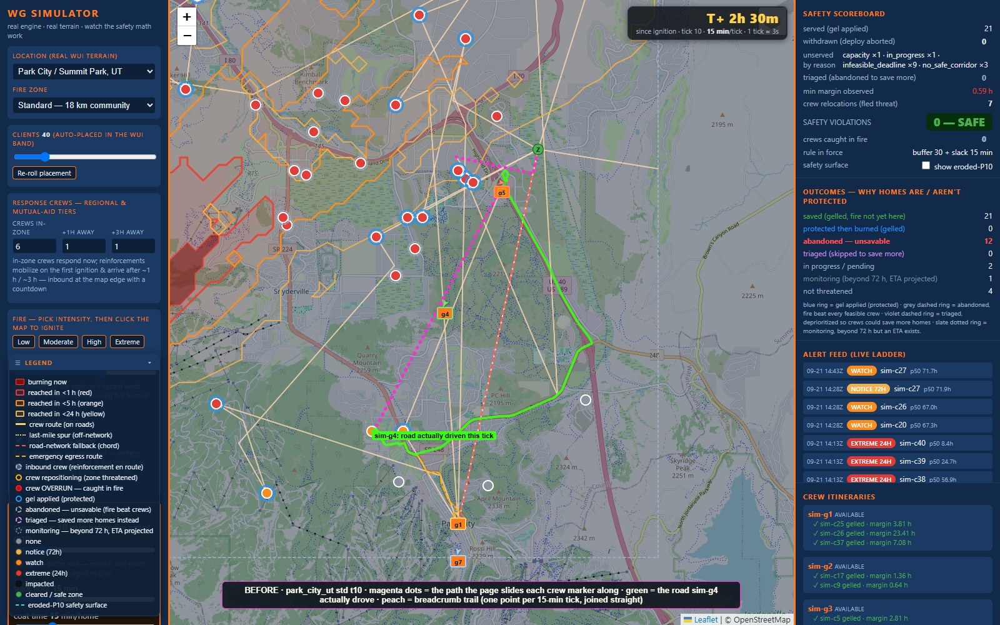 | **park_city_ut t10.** sim-g4 drove Park City → US-40 → SR-248 (green) but the page slides its marker straight across the basin (magenta); every peach breadcrumb segment is a straight chord between tick positions. |
| 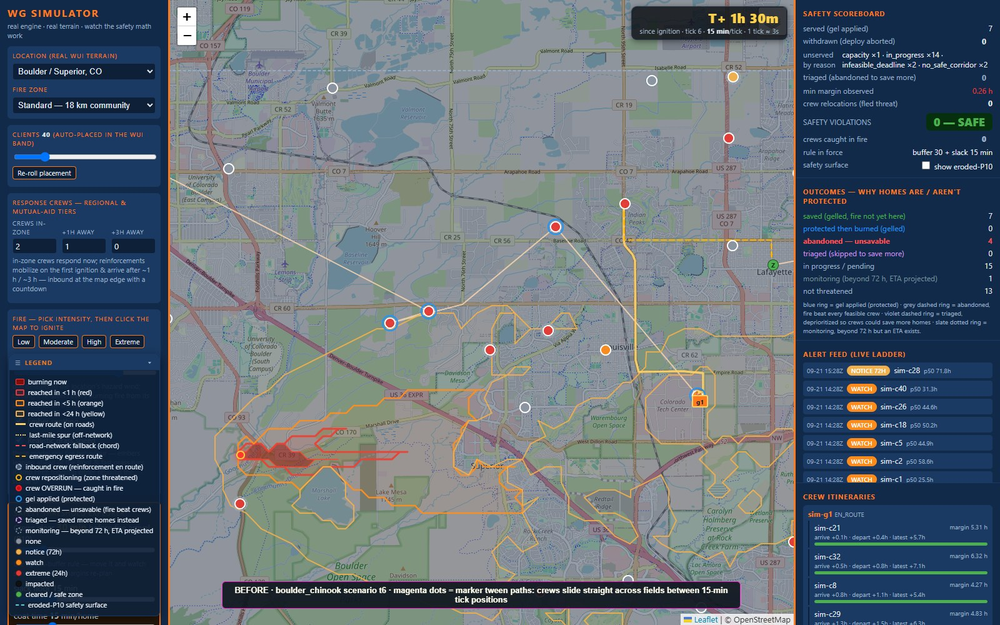 | **boulder_chinook t6** (the founder's one-click scenario): the marker tweens cut diagonally across fields between US-36 / US-287 positions. |
| 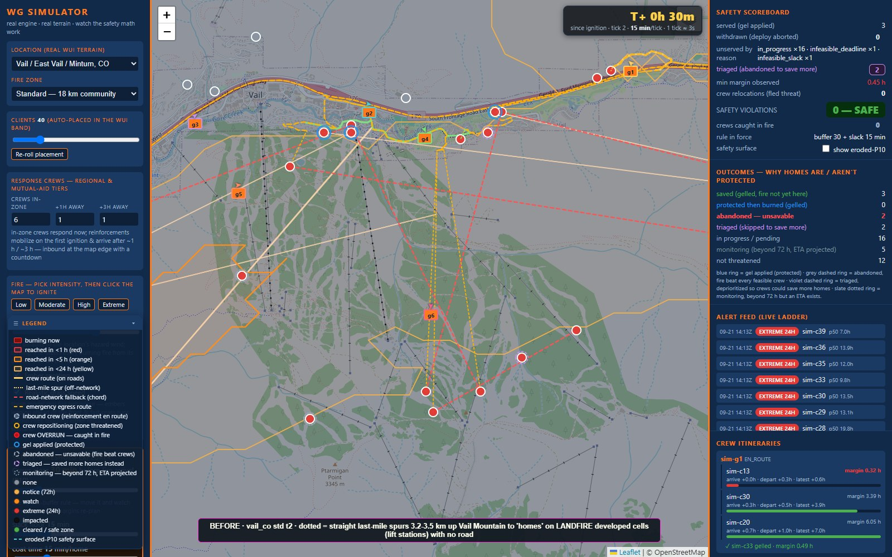 | **vail_co t2.** Dotted straight spurs 3.2–3.5 km up Vail Mountain to "homes" seeded on LANDFIRE *developed* cells (lift stations); red dashed = deploying crews' queued stops drawn as straight chords. |
| 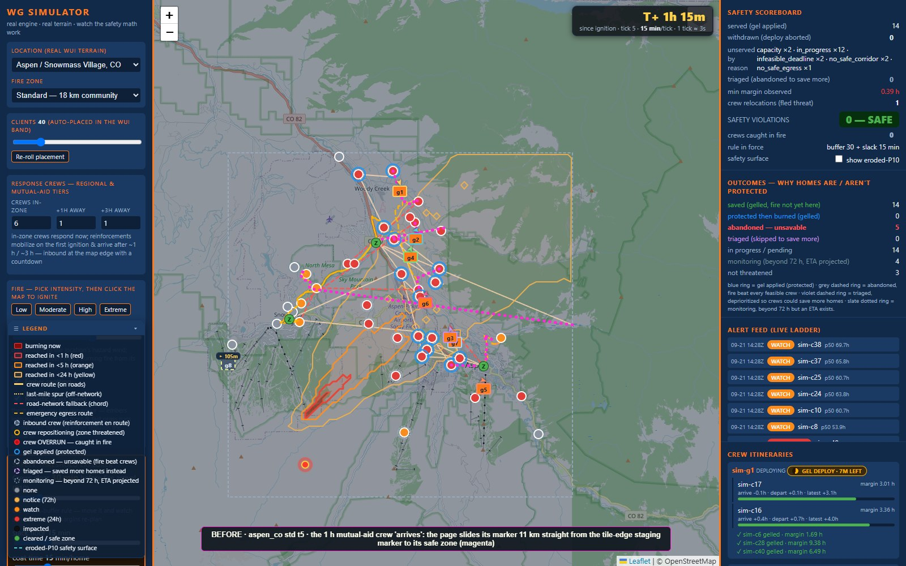 | **aspen_co t5.** The 1 h mutual-aid crew "arrives": the engine moves it from the east-edge staging marker to its zone without a drive, and the page slides the marker 11 km straight across the map. |
| 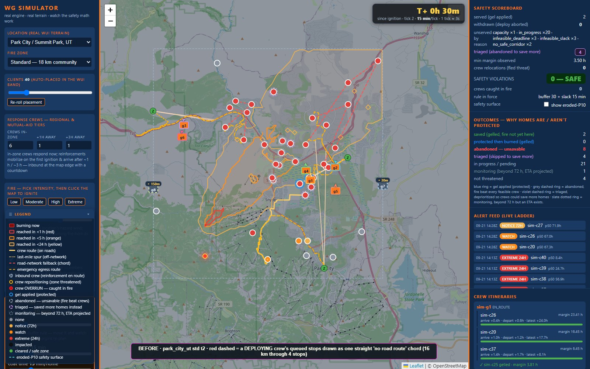 | **park_city_ut t2.** Deploying crews' queued stops as single straight red "no road route" chords (up to 16 km). |
| 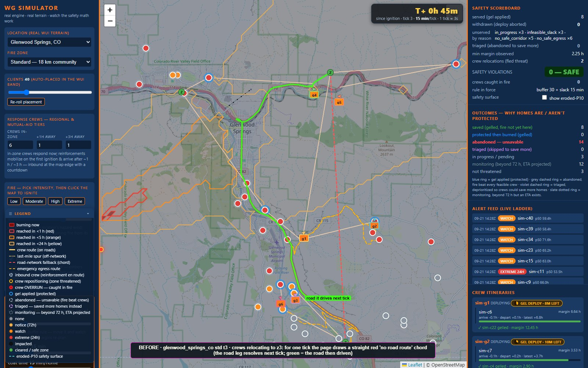 | **glenwood_springs_co t3.** Crews the safety sweep just sent to z3 have no leg yet, so the page synthesizes a straight red chord; green = the road they actually drive next tick. |
| 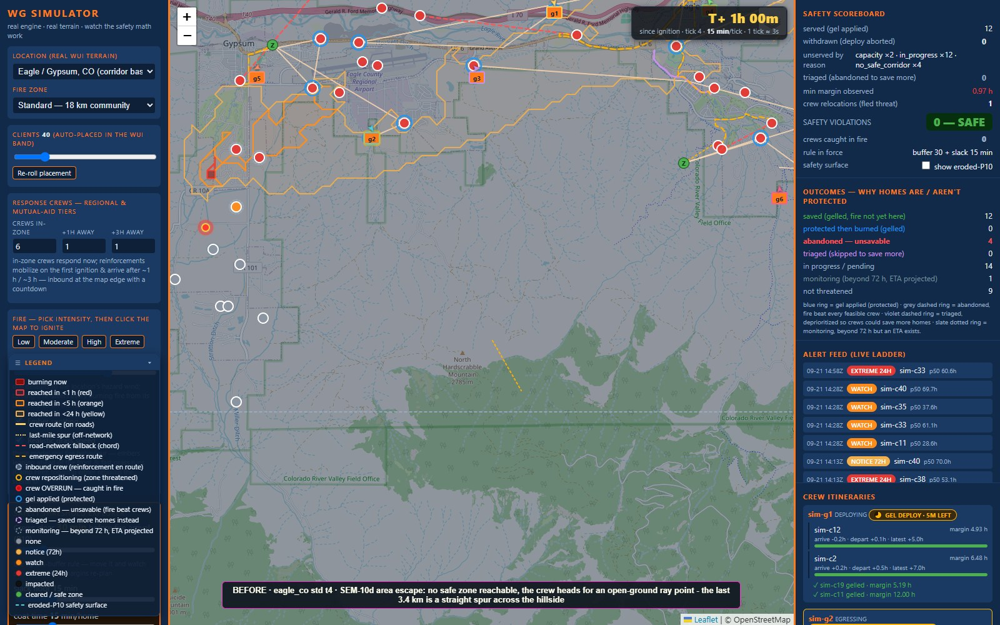 | **eagle_co t4.** SEM-10d area escape: no catalog zone reachable, so the crew heads for a ray point in open ground and the last 3.4 km is a straight spur. |
| 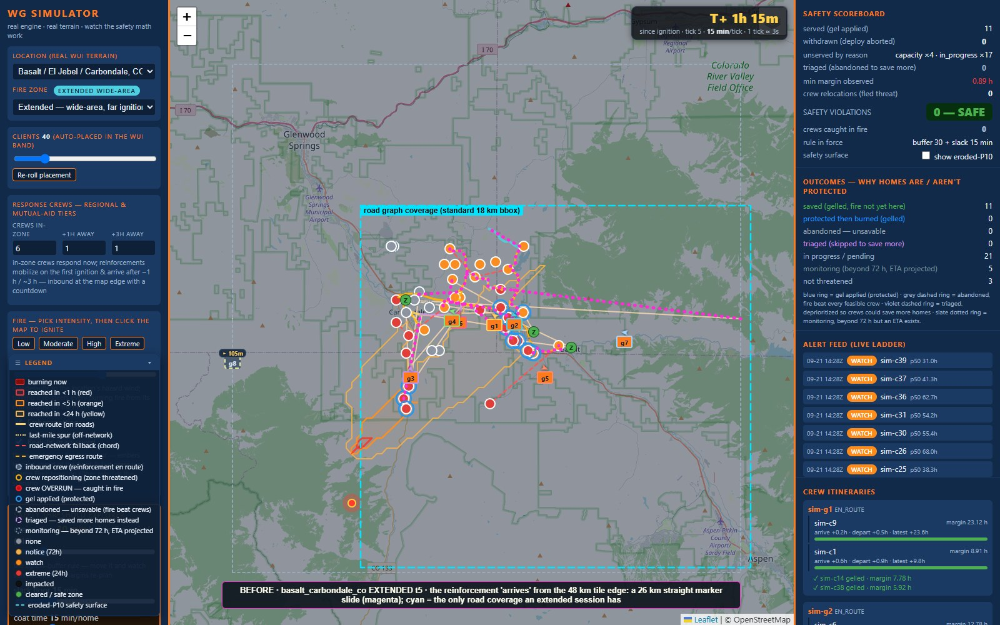 | **basalt_carbondale_co EXTENDED t5.** The reinforcement slides 26 km from the 48 km tile edge; cyan = the only road coverage an extended session had (the 18 km standard bbox). |
| 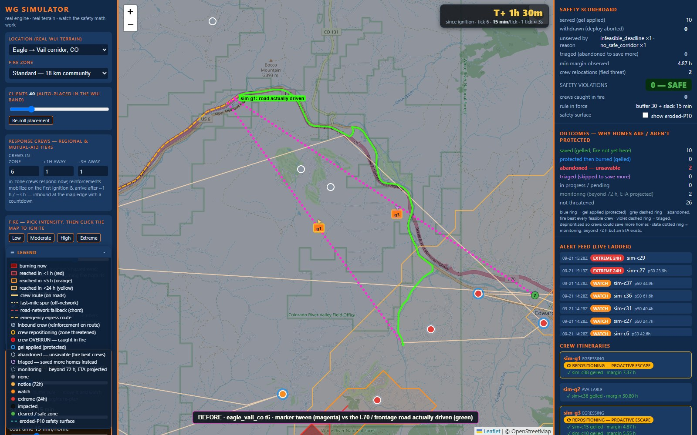 | **eagle_vail_co t6.** The marker tween (magenta) leaves I-70 (green) by up to 2.7 km. |
| 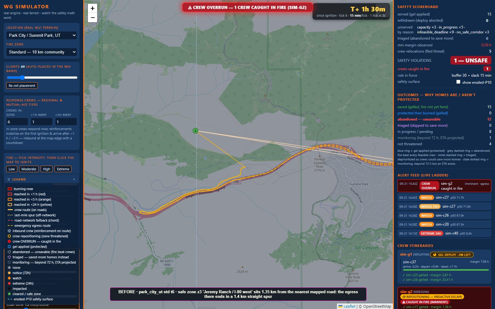 | **park_city_ut t6.** Safe zone z3 "Jeremy Ranch / I-80 west" is anchored 1.35 km from any mapped road; every egress there ends in a 1.4 km straight spur. |
| 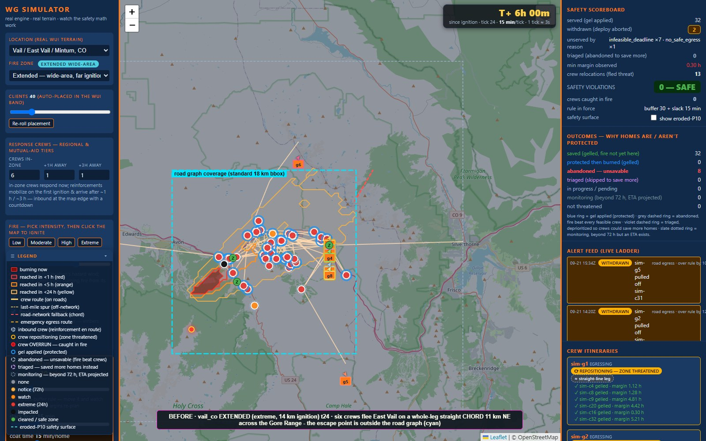 | **vail_co EXTENDED (extreme, 14 km) t24.** Crews flee East Vail on whole-leg chords 11 km NE: the escape point is off the road graph. |
| 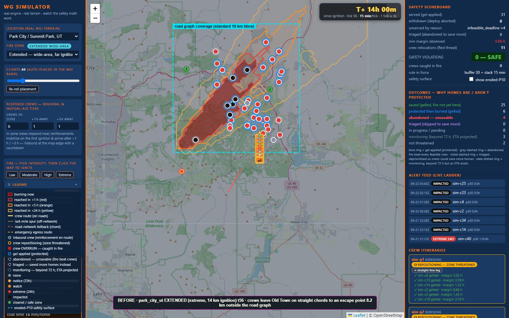 | **park_city_ut EXTENDED t56.** Crews leave Old Town on straight chords to an escape point beyond the standard graph. |

## 3. Mechanisms, attributed and counted (24 probe sessions unless noted)

**Rendering — the page (`console/simulator.html`).** Totals, before → after:

| # | mechanism | before | after |
|---|---|---|---|
| R1 | **marker tween** — `startCrewTween` projected the previous position onto the NEW tick's remaining route, so the marker slid straight between tick positions (moving crew-ticks cutting > 250 m off the road driven; max) | 805 of 1,615 (max 30.6 km) | **0** of 1,582 (max 10 m) |
| R2 | **breadcrumb trail** — `crews[i].track`, one point per 15-min tick, joined straight (crew-ticks > 250 m off the road; max) | 1,087 (max 3.3 km) | **0** (max 20 m) |
| R3 | **queued-stop chord** — a DEPLOYING crew with ≥ 2 stops has no route polyline; the page drew `[crew, stops…]` as the red dashed "straight-line (no road route)" chord (crew-ticks; max) | 438 (max 38 km) | **0** (drawn on the road route) |
| R4 | **relocation first tick** — `relocate_to` clears the leg until the next drive; the page synthesized a straight red chord to the new zone | 80 | **0** (road preview) |
| R5 | **reinforcement arrival** — tick() step 0 teleports the INBOUND crew from the tile-edge marker to its zone; the page slid the marker across the map | 47 slides (max 34.5 km) | **0** (placed, flagged `jumped`) |

**Engine — what crews drive (`wgresponse/roads.py`, `wgresponse/simui.py`).**

| # | mechanism | before | after |
|---|---|---|---|
| E1 (a) | **roadless 'developed' homes** → multi-km last-mile spurs. The WUI band includes ski-mountain lift stations; the simulator's spur cap is `SIM_ROAD_SPUR_MAX_M = 8 km` (`simui.py:335`, the engine default is 2 km, `contracts.py:1251`) | corridor presets: 114 homes > 300 m from a road (21 > 2 km, max 6.4 km); spur km 347; 36 spurs > 2 km | **0 homes** > 300 m; spur km 177; 3 spurs > 2 km (all area escapes) |
| E2 (b) | **extended sessions on the 18 km core graph** → any leg ending outside it is a whole-leg chord (extended stress set) | 21 chord legs = **215 km** straight; 27 legs leave the graph bbox | 8 chord legs (92 km, all the Gore Range escape, see E4); **0** leave the graph |
| E3 (c) | **chord on disconnected components** — graphs keep the largest component only, so snapped nodes always connect | 0 | 0 (new test pins one component per extended graph) |
| E4 (d) | **SEM-10d area escape** (`_escape_ray_targets`, `simui.py:2978`) — targets are points on 12 straight bearings, often open ground; the crew drives to the nearest junction then straight | 15 escape legs, straight km: glenwood 5.6, beaver 11.4, eagle 3.5; extended stress 253 km (215 km of it whole-leg chords) | unchanged by default (labelled on hover); with `escape_road_snap_m=1500`: −75…−99 % straight km, 0 chords (§5) |
| E4 (d) | **SEM-10 relocation / proactive escape / preposition moves** — target a catalog zone, drive on roads | road legs + the zone's anchor spur | unchanged (drawn on roads; R4 fixed the first tick) |
| E5 (f) | **snap to the nearest graph NODE, not the nearest road** — degree-2 chain collapse leaves long edges with no node, so a home 50 m from a road can get a 300 m diagonal spur to the next junction (`roads.py:317`, `:757`) | all 534 spur km; an edge snap would cut 30–60 % (e.g. park_city 25.2 → 11.7 km, eagle 19.1 → 9.2 km) but not the > 2 km cases | unchanged (engine contract; open item) |
| E6 (f) | **planning-grade zone anchors off the road** — park_city z3 1,440 m from the nearest junction (1,346 m from any road), eagle_co z3 889 m, glenwood z2 734 m, malibu z2 429 m, paradise z1 375 m, rancho z1 361 m, park_city z1 356 m, basalt z3 356 m | every egress to them ends in that spur | unchanged, labelled on hover (data fix changes those presets; open item) |
| E7 (f) | **OSM `track` not fetched** (`HIGHWAY_REGEX`, `tools/fetch_sim_roads.py`) + largest-component pruning: forest/ranch access roads count as roadless | context for E1/E4 | unchanged (open item) |
| E8 (e) | **UI interpolation between sparse vertices** — R1/R2 are this mechanism; road segments themselves carry every OSM vertex | — | map_view paths are Douglas-Peucker ≤ 8 m (marker), ≤ 20 m (recent trail) |
| E9 (f) | **SEM-10e proactive escape rides audit-counted exposure** — `_proactive_escape_zone` falls back to a route that is "not burned, never crosses a nominal-passed cell, lawful destination" but may cross *pessimistic* (eroded-P10) exposure. Its docstring says a proactive move "must not buy audit overrun ticks", yet since the 2026-09-03 audit change (A8) that exposure IS counted. The extended road graph surfaced it: on the pinned Camp-Fire-scale extended run (`test_sem10d_extended_campfire_scale_no_overrun_ever`) the new 36.9 km z1 → z3 road route south of Paradise, unburned but with 35 min of pessimistic exposure, replaced the standard graph's burned 46.7 km one, and the crew picked up one imminent row at tick 23 | 0 on the standard graph | 1 row with the legacy rule → **0** with `escape_proactive_lawful_only` (armed for extended sessions; same 16 homes served, escape law still exercised) |

Safety audit: **0 violations in every run, before and after** (24 + 6 + 30 A/B
sessions).

## 4. What I changed

**Map legibility — `crews[i].map_view`** (display-only; additive; the engine
never reads it; recorded in the contracts ROADS LEGIBILITY note,
`contracts.py:292`):

* `_SimCrew` records the exact positions it drives in each `advance()`
  (`simui.py:1363`, `:1416`/`:1420`, `:1600`). Legs keep their origin and the
  roads-seam note for explanations (`_begin_leg`, `simui.py:1367`).
* `tick()` flags non-driven position changes as jumps — a reinforcement's
  arrival (`simui.py:3660`, `:3869`) — and stores each crew's simplified drive
  and trail (`_map_jumps` / `_record_map_paths` / `_build_trail`,
  `simui.py:4315`–`:4350`). The trail keeps the last hour at 20 m and older ticks
  at ≤ 80 m. Past 400 vertices it drops the oldest ticks; it never straightens.
* `state()` emits `map_view` (`simui.py:4826`, built by `_map_view`, `:4581`):
  * `moved_path`, `jumped` and `trail`;
  * `queue`: a deploying crew's queued legs on the road route (`_queue_view`,
    `:4540`), with its own route cache;
  * `egress_preview`: the exact `_leg_route` the relocated crew drives next tick
    (`_egress_preview`, `:4556`);
  * `route_why` / `egress_why`: one reason per spur or chord (`_explain_segments`
    / `_why_spur`, `:4438`–`:4474`), e.g. "last-mile spur: home sim-c20 sits
    74 m from the nearest mapped road junction…", "safe zone park_city_ut-z3 …
    anchored 1,440 m from the nearest mapped road junction (planning-grade
    coordinate)", "area escape (SEM-10d): … open ground 6,015 m …", "no road
    route (…) — an end of this leg lies outside the loaded road graph's
    coverage".
* Page (`console/simulator.html`):
  * `startCrewTweenMV` (`:1687`) tweens the marker along `moved_path` and places
    it (never slides it) on a jump, a reset or a tick without a drive. The
    legacy `startCrewTween` (`:1584`) stays only for backends without `map_view`.
  * `syncTrail` (`:1668`) draws the driven runs.
  * The queue is drawn on roads, pale dotted (`queueSegStyle`, `:1657`;
    `:2170`), and the relocation preview replaces the synthesized chord
    (`:2201`).
  * `segTip` (`:1641`) puts the reason in every spur/chord tooltip and the jump
    reason in the marker tooltip. Tooltips wrap at 380 px (`:314`).
  * New legend rows (`:574`): "driven trail", "planned next stops (road route)",
    "hover for why".

**Placement (E1).** `CORRIDOR_PLACE_NEAR_ROAD_M = 300` (`simui.py:670`) is armed
on the six Vail → Aspen presets. The five originals and Rancho Santa Fe stay on
the whole band.
* A harness seam `SimSession(place_near_road_m=…)` keeps the corridor grid's
  whole-band arms reproducible (`scratch_review/corridor_grid.py`,
  `corridor_viol.py` pass `0.0`).
* One sentence was added to `docs/vail_aspen_response_program.md` §3.
* Tests pinning the three Eagle Valley presets at 0.0 were updated
  (`tests/test_corridor_vail_aspen.py`, `tests/test_simui.py`
  registry shape).

**Extended road graphs (E2).**
* `tools/fetch_sim_roads.py --extended` (`EXT_TWO_TIER` `:120`, `ext_bbox_for`
  `:164`, `overpass_query_two_tier` `:200`, `fetch_one(extended=)` `:408`)
  wrote `data/roads/<key>_ext.wgr` for all 11 extended keys, with provenance in
  `data/roads/provenance_ext.json`. The standard `provenance.json` and every
  `<key>.wgr` are untouched.
* Overpass sizing (`out count`, 48 km box): a full fetch was 3.2k–22.3k ways
  for the eight mountain/rural keys. It was too big for the urban three:
  * Boulder timed out three times;
  * Malibu was 70,063 ways;
  * Santa Rosa was 49,164 ways.

  Those three are **two-tier**: every class inside the standard bbox, plus
  motorway..tertiary + unclassified over the extended box.

| graph | tiers | ways | nodes | LCC % | KB | load s |
|---|---|---|---|---|---|---|
| aspen_co_ext | full | 3,824 | 5,337 | 99.0 | 1,021 | < 0.1 |
| basalt_carbondale_co_ext | full | 6,730 | 9,425 | 97.0 | 1,519 | < 0.1 |
| beaver_creek_co_ext | full | 4,095 | 5,528 | 98.5 | 1,409 | < 0.1 |
| boulder_co_ext | two-tier | 49,632 | 42,881 | 99.1 | 6,160 | 0.43 |
| eagle_co_ext | full | 3,164 | 4,283 | 94.1 | 1,234 | < 0.1 |
| glenwood_springs_co_ext | full | 5,556 | 7,676 | 95.1 | 1,203 | < 0.1 |
| malibu_ca_ext | two-tier | 21,479 | 16,361 | 98.7 | 3,042 | 0.15 |
| paradise_ca_ext | full | 13,205 | 19,404 | 99.3 | 2,745 | 0.18 |
| park_city_ut_ext | full | 22,292 | 31,458 | 98.1 | 4,770 | 0.29 |
| santa_rosa_ca_ext | two-tier | 19,439 | 25,173 | 98.9 | 3,282 | 0.25 |
| vail_co_ext | full | 4,345 | 4,566 | 78.0 | 908 | < 0.1 |

  (`vail_co_ext`'s 22 % dropped nodes are subdivisions the tile box clips —
  Silverthorne/Dillon at the east edge. Frisco and Copper are in the main
  component, within 21 m and 34 m.)
* The simulator loads `<key>_ext` only for extended sessions (`simui.py:1975`,
  `EXT_ROAD_SUFFIX` `:397`). When it is missing, a loud note falls back to the
  standard graph. Tests pin all eleven: `tests/test_roads.py`
  `TestExtendedRoadGraphs` checks the load budget, a single component, reach
  well beyond the core, core detail kept, and core → outer-ring road routes.

**Lawful-only proactive escape (E9) — default OFF, armed for extended
sessions.** `ResponseConfig.escape_proactive_lawful_only` (`contracts.py:1010`; README row).
`_proactive_escape_zone` (`simui.py:3093`, the check at `:3130`) returns no move
when no fully lawful route exists instead of riding exposed transit. The
simulator arms it for EXTENDED sessions only (`simui.py:1878`, next to the
extended horizon floor; explicit override wins). Those sessions change anyway
with the extended road graph, and standard sessions keep the legacy rule,
byte-identical. Tests: `test_extended_sessions_arm_lawful_only_proactive_escape`
+ the pinned `test_sem10d_extended_campfire_scale_no_overrun_ever` (120 ticks,
0 rows).

**Escape road snap (E4) — default OFF.** `ResponseConfig.escape_road_snap_m`
(`contracts.py:998`, validated ≥ 0). When > 0, each area-escape proposal snaps to
the road node nearest a safe ray sample. The flee becomes road-bound: a bearing
with no road in reach is proposed only when no bearing reaches a road
(`_escape_ray_targets` `simui.py:2978`, `if on_road` `:3025`,
`_snap_escape_target` `:3030`). It is not armed in the simulator, so existing
sessions are unchanged.

**Tests added** — `tests/test_simui.py`:
* map_view is additive; polling `state()` never changes the engine;
* `moved_path` lies on the leg and turns corners; the trail is on the driven
  road while the old track cuts corners;
* the reinforcement arrival is a jump; the queue follows the road; the relocation
  preview equals next tick's drive; the why texts name each mechanism;
* corridor placement, the placement seam, extended-graph loading and its
  fallback, the escape snap default-off / road-bound behaviour.

Also `tests/test_simulator_ui.py` (8 structural tests), `tests/test_server.py`
(map_view over HTTP and in the LAW 1 snapshot), `tests/test_roads.py` (11 × 4
extended pins + provenance) and `tests/test_config_validation.py`. The README
config table documents both new knobs (`tests/test_docs.py`). Updated pins:
the extended real-tile integration test (a far ignition is now inside road
coverage), the corridor placement pins and the egress-decode fragment.

**Suite:** `py -3 -m pytest -q -p no:cacheprovider` gives 1,648 passed and 7
skipped, 0 failed. The skips are pre-existing: Rancho Santa Fe has no extended
tile, and the Boulder-pinned drive test skips because `aspen_co` sorts first.

## 4a. After

| frame | what it shows |
|---|---|
| 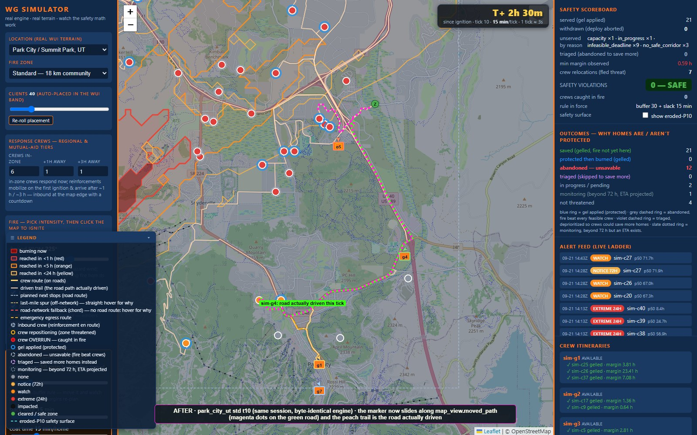 | **park_city_ut t10** — same session, byte-identical engine. The marker path (magenta) lies on the road driven (green); the trail follows US-40/SR-248. |
| 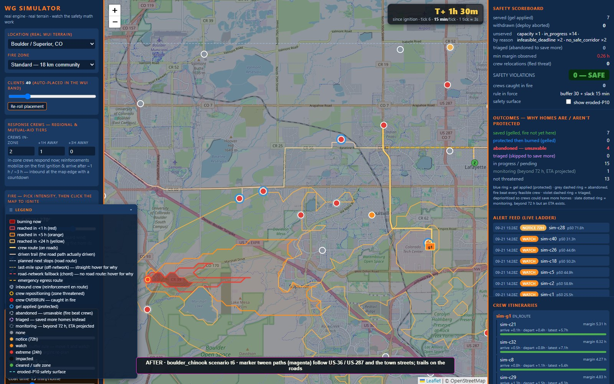 | **boulder_chinook t6** — tweens follow US-36/US-287 and the streets. |
| 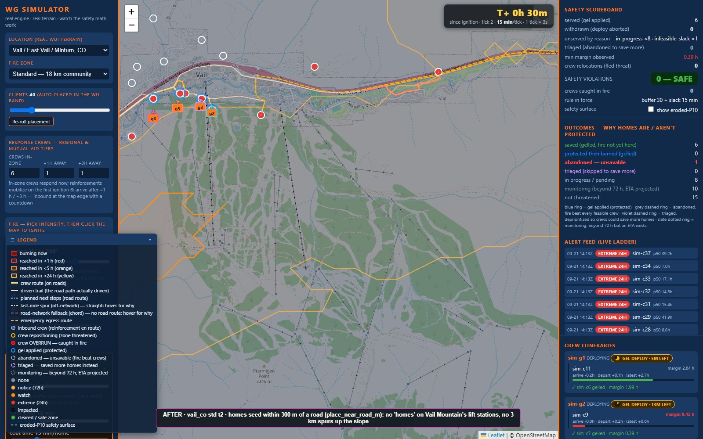 | **vail_co t2** — homes within 300 m of a road; no spurs up the mountain. |
| 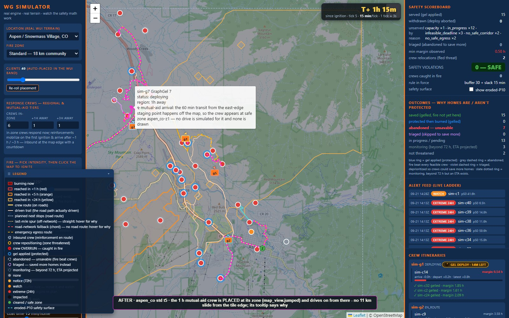 | **aspen_co t5** — the reinforcement is placed at its zone and drives on; the tooltip gives the jump's reason. |
| 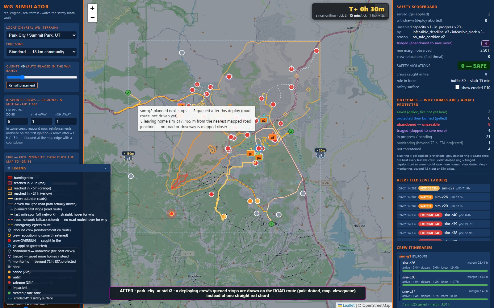 | **park_city_ut t2** — queued stops drawn on the road route (pale dotted). |
| 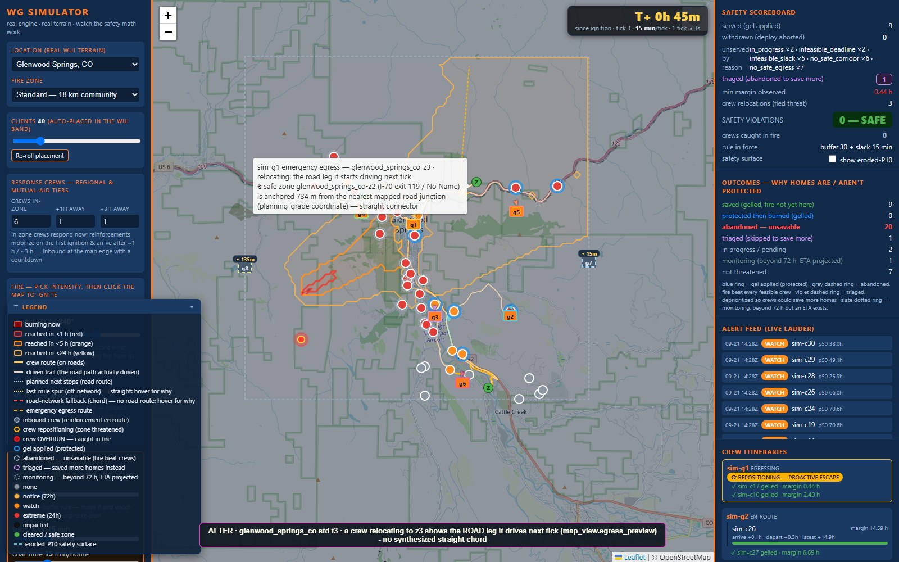 | **glenwood_springs_co t3** — the relocating crew shows the road leg it drives next. |
| 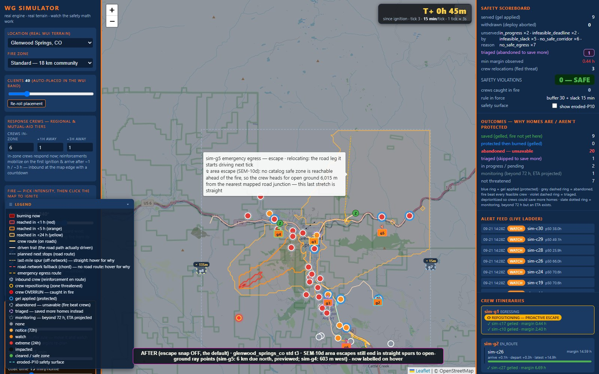 | **glenwood_springs_co t3**, snap off. The 6 km area-escape spur remains and is labelled. |
| 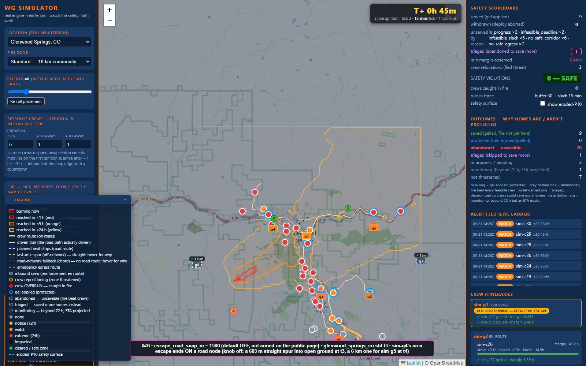 | **A/B, `escape_road_snap_m = 1500`.** The escape ends on a road node. |
| 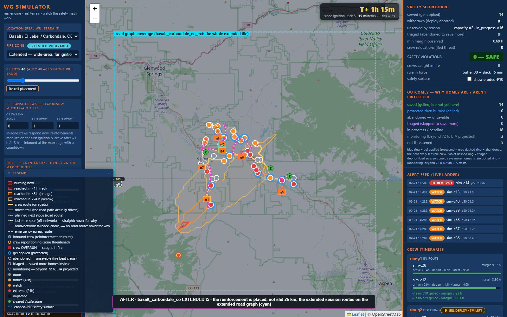 | **basalt_carbondale_co EXTENDED t5** — no slide; cyan = the extended graph covering the tile. |
| 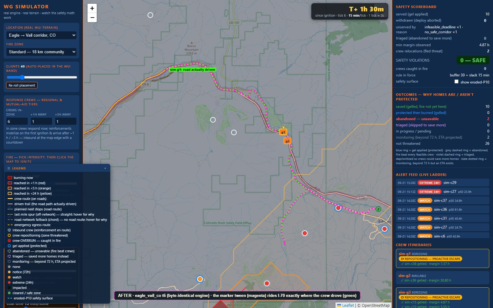 | **eagle_vail_co t6** — the tween rides I-70 where the crew drove. |
| 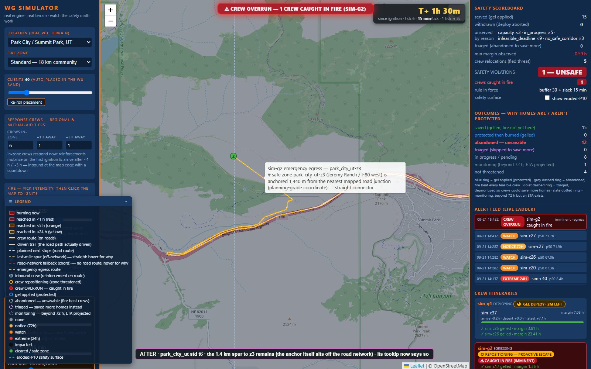 | **park_city_ut t6** — the z3 anchor spur remains, with its reason in the tooltip. |
| 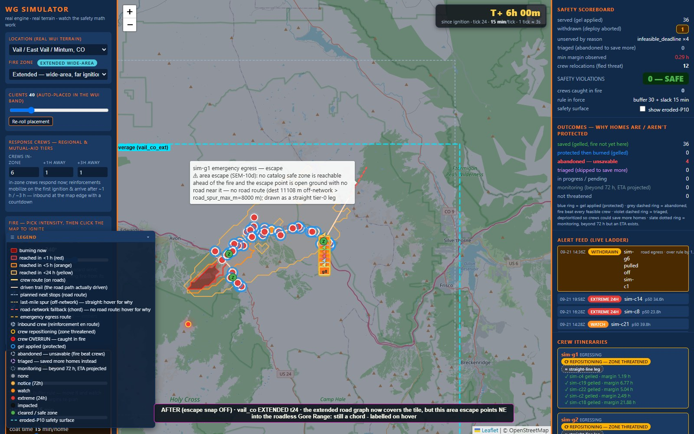 | **vail_co EXTENDED t24**, snap off. The escape bearing points into the roadless Gore Range, so it is still a chord. The tooltip reads "area escape (SEM-10d): … open ground with no road near it — no road route (dest 11108 m off-network > road_spur_max_m=8000 m)". |
| 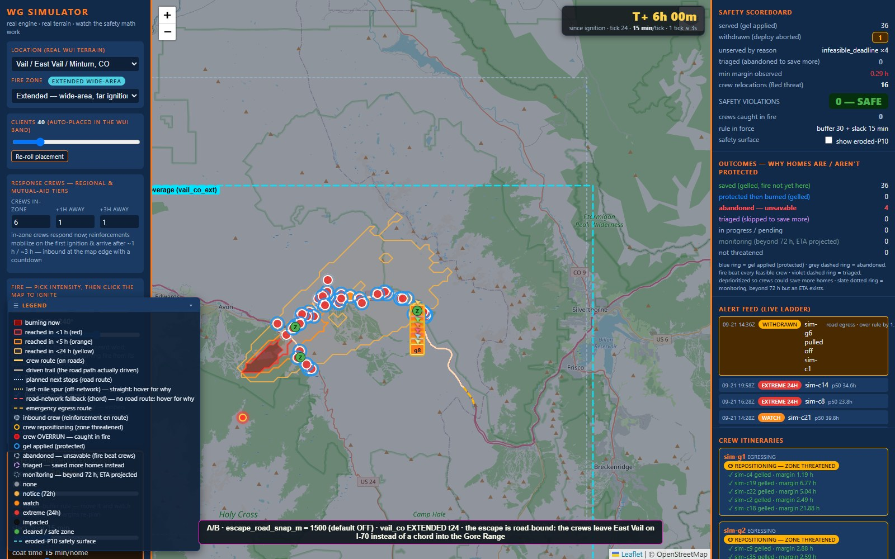 | **Same moment, snap armed.** The crews leave East Vail down I-70 toward Vail Pass. |
| 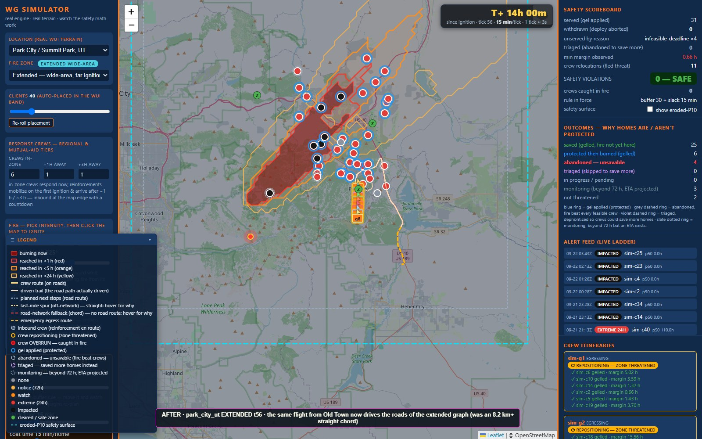 | **park_city_ut EXTENDED t56** — the same flight now drives the extended graph's roads. |

## 5. Before / after per preset (probe tables)

Rendering (`tween` / `trail` = crew-ticks drawn > 250 m off the road driven):

| preset | zone | tween >250 m | trail >250 m | jump slides (max km) | queued chords (max km) | relocation chords |
|---|---|---|---|---|---|---|
| aspen_co | std / ext | 24 → 0 / 25 → 0 | 37 → 0 / 36 → 0 | 2 (13.5) → 0 / 2 (28.4) → 0 | 20 (16.0) → 0 / 28 (12.2) → 0 | 4 → 0 / 0 → 0 |
| basalt_carbondale_co | std / ext | 20 → 0 / 50 → 0 | 32 → 0 / 68 → 0 | 2 (17.2) → 0 / 2 (32.1) → 0 | 12 (12.8) → 0 / 22 (30.0) → 0 | 3 → 0 / 2 → 0 |
| beaver_creek_co | std / ext | 42 → 0 / 42 → 0 | 68 → 0 / 63 → 0 | 2 (6.3) → 0 / 2 (20.9) → 0 | 19 (16.5) → 0 / 29 (21.7) → 0 | 14 → 0 / 3 → 0 |
| boulder_co | std / ext | 21 → 0 / 26 → 0 | 28 → 0 / 31 → 0 | 2 (18.8) → 0 / 2 (33.2) → 0 | 8 (10.0) → 0 / 12 (12.9) → 0 | 0 / 0 |
| eagle_co | std / ext | 25 → 0 / 30 → 0 | 36 → 0 / 41 → 0 | 2 (4.5) → 0 / 2 (19.5) → 0 | 18 (16.0) → 0 / 27 (26.3) → 0 | 5 → 0 / 0 |
| eagle_vail_co | std | 21 → 0 | 27 → 0 | 1 (2.7) → 0 | 5 (11.9) → 0 | 2 → 0 |
| glenwood_springs_co | std / ext | 27 → 0 / 35 → 0 | 37 → 0 / 47 → 0 | 2 (12.4) → 0 / 2 (27.2) → 0 | 6 (6.3) → 0 / 19 (19.1) → 0 | 4 → 0 / 6 → 0 |
| malibu_ca | std / ext | 20 → 0 / 39 → 0 | 26 → 0 / 48 → 0 | 2 (19.6) → 0 / 2 (34.5) → 0 | 4 (4.7) → 0 / 24 (18.9) → 0 | 2 → 0 / 0 |
| paradise_ca | std / ext | 30 → 0 / 72 → 0 | 40 → 0 / 98 → 0 | 2 (19.4) → 0 / 2 (33.8) → 0 | 8 (16.0) → 0 / 26 (21.5) → 0 | 1 → 0 / 4 → 0 |
| park_city_ut | std / ext | 35 → 0 / 47 → 0 | 41 → 0 / 65 → 0 | 2 (15.7) → 0 / 2 (29.5) → 0 | 17 (16.4) → 0 / 27 (38.2) → 0 | 9 → 0 / 9 → 0 |
| rancho_santa_fe_ca | std | 38 → 0 | 44 → 0 | 2 (14.0) → 0 | 27 (13.7) → 0 | 0 |
| santa_rosa_ca | std / ext | 34 → 0 / 45 → 0 | 40 → 0 / 61 → 0 | 2 (16.1) → 0 / 2 (30.4) → 0 | 20 (25.7) → 0 / 17 (25.6) → 0 | 3 → 0 / 0 |
| vail_co | std / ext | 23 → 0 / 34 → 0 | 27 → 0 / 46 → 0 | 2 (3.3) → 0 / 2 (17.8) → 0 | 13 (9.8) → 0 / 30 (29.6) → 0 | 4 → 0 / 5 → 0 |

Engine (legs = movement legs begun; spur p90 / max in metres):

| preset | zone | legs | chord legs | spur km | spur p90 | spur max | spurs > 2 km | escape legs (straight km) | homes > 300 m / > 2 km | engine bytes |
|---|---|---|---|---|---|---|---|---|---|---|
| aspen_co | std | 46 → 48 | 0 → 0 | 11.4 → 8.4 | 188 → 166 | 1,012 → 268 | 0 → 0 | 2 (0.5) → 5 (1.2) | 3/0 → 0/0 | changed (placement) |
| basalt_carbondale_co | std | 32 → 41 | 0 → 0 | 13.6 → 9.6 | 463 → 269 | 1,041 → 490 | 0 → 0 | 0 → 0 | 10/0 → 0/0 | changed (placement) |
| beaver_creek_co | std | 67 → 58 | 0 → 0 | 30.0 → 20.8 | 396 → 270 | 3,257 → 889 | 1 → 0 | 8 (11.4) → 8 (9.3) | 8/0 → 0/0 | changed (placement) |
| boulder_co | std | 26 → 26 | 0 → 0 | 3.0 → 3.0 | 155 → 155 | 284 → 284 | 0 → 0 | 0 → 0 | 1/0 → 1/0 | **identical (41 ticks)** |
| eagle_co | std | 42 → 42 | 0 → 0 | 19.1 → 11.0 | 627 → 256 | 3,370 → 889 | 1 → 0 | 1 (3.5) → 0 | 7/0 → 0/0 | changed (placement) |
| eagle_vail_co | std | 22 → 22 | 0 → 0 | 4.6 → 4.6 | 259 → 259 | 270 → 270 | 0 → 0 | 0 → 0 | 0/0 → 0/0 | **identical** |
| glenwood_springs_co | std | 35 → 26 | 0 → 0 | 16.8 → 25.7 | 734 → 734 | 4,173 → 6,015 | 1 → 3 | 2 (5.6) → 4 (12.4) | 3/0 → 0/0 | changed (placement) |
| malibu_ca | std | 29 → 29 | 0 → 0 | 7.5 → 7.5 | 269 → 269 | 429 → 429 | 0 → 0 | 0 → 0 | 2/0 → 2/0 | **identical** |
| paradise_ca | std | 39 → 39 | 0 → 0 | 14.2 → 14.2 | 287 → 287 | 1,198 → 1,198 | 0 → 0 | 0 → 0 | 6/1 → 6/1 | **identical** |
| park_city_ut | std | 46 → 46 | 0 → 0 | 25.2 → 25.2 | 716 → 716 | 1,756 → 1,756 | 0 → 0 | 1 (0.8) → 1 (0.8) | 4/1 → 4/1 | **identical** |
| rancho_santa_fe_ca | std | 52 → 52 | 0 → 0 | 8.5 → 8.5 | 206 → 206 | 361 → 361 | 0 → 0 | 0 → 0 | 0/0 → 0/0 | **identical** |
| santa_rosa_ca | std | 41 → 41 | 0 → 0 | 8.8 → 8.8 | 233 → 233 | 783 → 783 | 0 → 0 | 1 (0.1) → 1 (0.1) | 3/0 → 3/0 | **identical** |
| vail_co | std | 30 → 30 | 0 → 0 | 29.9 → 5.4 | 2,721 → 207 | 3,450 → 291 | 8 → 0 | 0 → 0 | 11/9 → 0/0 | changed (placement) |
| extended (11 keys) | ext | 581 → 617 | 0 → 0 | 341.5 → 196.8 | — | 6,439 → 2,448 | 30 → 2 | 0 → 0 | 103/15 → 29/1 | changed (extended graph) |

"Engine bytes" compares the probe's per-tick sha256 of the full `state()` with
`map_view` stripped. The standard sessions of the five originals, Rancho Santa Fe
and `eagle_vail_co` are **byte-identical at all 41 ticks**. The six corridor
presets change from tick 0 because the homes are different; their served counts
move with the homes (e.g. glenwood 18 → 12, basalt 19 → 23, vail 19 → 16 of 40).
Extended sessions change because they route on the extended graph.

Extended stress (EXTREME, 14 km, 80 ticks, six presets):

| preset | chord legs (km) | escape legs (straight km) | legs leaving the graph | violations | served |
|---|---|---|---|---|---|
| basalt_carbondale_co | 0 → 0 | 0 → 0 | 0 → 0 | 0 → 0 | 32 → 28 |
| boulder_co | 0 → 0 | 0 → 1 (1.2) | 0 → 0 | 0 → 0 | 17 → 17 |
| malibu_ca | 0 → 0 | 0 → 0 | 0 → 0 | 0 → 0 | 19 → 20 |
| paradise_ca | 6 (41.8) → 0 | 12 (73.6) → 0 | 11 → 0 | 0 → 0 | 23 → 25 |
| park_city_ut | 8 (92.4) → 0 | 8 (92.4) → 8 (0.7) | 8 → 0 | 0 → 0 | 31 → 31 |
| vail_co | 7 (80.8) → 8 (92.4) | 8 (87.4) → 8 (92.4) | 8 → 0 | 0 → 0 | 32 → 36 |

`escape_road_snap_m = 1500` A/B, after code, knob off → on:

| run | preset | escape legs (straight km) | chord legs (km) | spurs > 2 km | violations | served | relocations |
|---|---|---|---|---|---|---|---|
| 40 t high | aspen_co std | 5 (1.2) → 5 (0.5) | 0 → 0 | 0 → 0 | 0 → 0 | 28 → 28 | 8 → 8 |
| 40 t high | beaver_creek_co std | 8 (9.3) → 10 (2.2) | 0 → 0 | 0 → 0 | 0 → 0 | 29 → 29 | 16 → 18 |
| 40 t high | glenwood_springs_co std | 4 (12.4) → 3 (0.9) | 0 → 0 | 3 → 0 | 0 → 0 | 12 → 12 | 6 → 7 |
| 40 t high | park_city_ut std | 1 (0.8) → 1 (0.1) | 0 → 0 | 0 → 0 | 0 → 0 | 23 → 23 | 9 → 9 |
| 40 t high | santa_rosa_ca std | 1 (0.1) → 1 (0.0) | 0 → 0 | 0 → 0 | 0 → 0 | 25 → 25 | 3 → 3 |
| ext 80 t extreme | boulder_co ext | 1 (1.2) → 1 (0.1) | 0 → 0 | 0 → 0 | 0 → 0 | 17 → 18 | 3 → 2 |
| ext 80 t extreme | park_city_ut ext | 8 (0.7) → 8 (0.1) | 0 → 0 | 0 → 0 | 0 → 0 | 31 → 31 | 11 → 11 |
| ext 80 t extreme | vail_co ext | 8 (92.4) → 10 (0.4) | 8 (92.4) → 0 | 0 → 0 | 0 → 0 | 36 → 36 | 12 → 14 |

## 6. Decisions and what remains by design

* **Spur cap: kept at 8 km** (`SIM_ROAD_SPUR_MAX_M`, `simui.py:332`). A leg
  whose endpoint is beyond the cap becomes a whole-leg chord. With road-placed
  homes, only 5 of 1,117 after-legs have an end spur over 2 km:
  * three glenwood area escapes;
  * two legs to paradise's roadless home.

  At 2 km those 5 legs would each become a whole-leg straight line; at 3–4 km,
  3; at 6 km, 2; at 8 km, 0. The cap does not cause the long spurs. The
  endpoints do, and they are now either removed (placement), labelled, or
  addressed by the escape knob.
* **Last-mile spurs stay straight.**
  * The model has no driveways, and OSM `track`s are not fetched. Median 41–170 m
    by preset.
  * They are drawn dotted and each explains itself on hover.
  * Paradise and Park City keep a few whole-band homes 2–6 km from a road (non-
    corridor presets stay byte-identical by law).
* **Zone-anchor spurs** (park_city z3 1.4 km and the other anchors in E6) stay
  and are labelled.
* **Reinforcement transit is off-map by design** (SEMANTICS 9): the delay is the
  drive. The crew is now placed at its zone and says so, rather than being slid.
* **SEM-10d area escape into open ground** stays in the public simulator until
  the owner arms `escape_road_snap_m`. Arming it changes every existing
  preset's session where an escape occurs. The A/B above is the evidence.
* **Payload.**
  * `state()` JSON median 84 → 106 KB per session (+26 %; max +62 KB). The
    600-tick history ring grows in proportion.
  * Tick cost, HEAD vs this tree (30 ticks after a HIGH ignition, page
    defaults): median +0.4…+13 ms per tick (park_city 25.8 → 39.1 ms, boulder
    13.7 → 14.1, malibu 17.3 → 20.7, eagle_vail 12.3 → 15.9). A `state()`
    poll costs +0.3…+2.5 ms. Session totals are within run-to-run noise
    (−12…+17 %); a tick is 3 s of wall clock at the page's 300×.
  * The largest extended graph is Boulder at 6.2 MB (~80 MB RAM per extended
    Boulder session; graphs load per session).

## 7. Open items (owner decisions)

1. **Arm `escape_road_snap_m`** (e.g. 1500 m) as a simulator default. On the
   A/B above:
   * straight escape driving −75…−99 %;
   * vail extended's 92 km of Gore Range chords → 0;
   * 0 violations; served unchanged or +1; relocations +0…+2.

   It changes existing sessions wherever an area escape happens.
2. **Edge snapping in `roads.route`** — join a leg at the nearest point on the
   nearest road, not the nearest junction. Spur km −30…−60 %. It is an engine
   contract change: a default-OFF knob plus a rebaseline.
3. **Planning-grade anchors off the road**: park_city z3 (1.35 km from any road),
   eagle z3, glenwood z2, malibu z2. This is a data fix that changes those
   presets. Park City's z3 coordinate sits on a hillside; the nearest I-80
   ramps in the graph are 2.4 km SW and 2.9 km E of it.
4. **Fetch OSM `track`** (forest/ranch access) so mountain homes and escapes join
   real roads.
5. **Share road graphs across sessions** in the server process. Extended
   Boulder is ~80 MB per session and the App Runner service allows 16 sessions.
6. The corridor grid's **alerted arms** now route on the extended graphs. A
   re-run can differ from the 2026-09-23 record, which used the standard graph
   (noted in `scratch_review/corridor_grid.py`). The reactive arms reproduce
   exactly.
7. **Lawful-only proactive escape for standard sessions too.** The same
   exposed-transit branch still runs in every standard session (legacy,
   byte-identical by law). Flipping `escape_proactive_lawful_only` on for all
   simulator sessions is the consistent fix. It changes existing sessions
   wherever that branch fires.
8. Pre-existing cross-reference in `docs/vail_aspen_response_program.md` §3:
   "sensitivity (§3.6)" should read §3.7 — left untouched.
